# herdr-mods

Keep your projects, agents, files, Git changes and pull requests in one [Herdr](https://herdr.dev) window. Install the whole workbench or pick the mods you need.

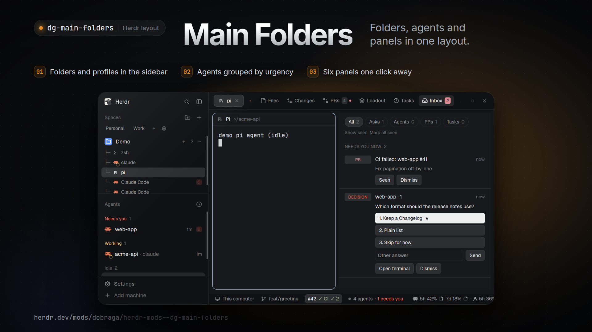

**What you get.** A sidebar of spaces grouped in folders, every running agent ranked by urgency, a tab bar with Files, Changes, PRs, Loadout, Tasks and Inbox panels, a file viewer and editor, and a status bar with branch, PR and CI state.

[Install](#install) · [The layout](#the-layout) · [Mods](#whats-here) · [Tour](#the-tour) · [Development](#development)

## What's here

Each mod is a top-level folder with a `README.md` (everything it does), a `RECIPE.md` (a brief an agent can rebuild it from) and a `preview.png`.

| Mod | In short |
|---|---|
| [`dg-spaces`](dg-spaces/README.md) | The sidebar's spaces, rebuilt around folders and profiles |
| [`dg-agents`](dg-agents/README.md) | Every running agent, grouped by space or sorted by urgency |
| [`dg-inbox`](dg-inbox/README.md) | One ranked list of what needs you: blocked agents, PR alerts, task runs, ask cards |
| [`dg-files`](dg-files/README.md) | The working folder as a lazy file tree |
| [`dg-file-view`](dg-file-view/README.md) | One tab per file: code editor, Markdown, image, audio, video, PDF, git diff |
| [`dg-file-picker`](dg-file-picker/README.md) | Ctrl+P popup to find a file in the active space |
| [`dg-changes`](dg-changes/README.md) | Git changes of the active space, staged apart from unstaged |
| [`dg-prs`](dg-prs/README.md) | Your open GitHub and Bitbucket Cloud pull requests across profiles |
| [`dg-loadout`](dg-loadout/README.md) | Skills, MCP servers and plugins configured for the folder (Claude, Antigravity, Codex, Gemini) |
| [`dg-tasks`](dg-tasks/README.md) | Scripts and scheduled tasks for the folder (needs the scheduler) |
| [`dg-tabs`](dg-tabs/README.md) | The top tab bar |
| [`dg-new-tab`](dg-new-tab/README.md) · [`dg-new-menu`](dg-new-menu/README.md) | The new-tab dialog and the "+" menu |
| [`dg-status-bar`](dg-status-bar/README.md) | Bottom bar: branch, PR and CI, agents, usage, load |
| [`dg-workspace-chrome`](dg-workspace-chrome/README.md) | The strip at the top of the sidebar and its Settings footer |
| [`dg-settings`](dg-settings/README.md) | A modal Settings with a left nav, replacing the native one |
| [`dg-desktop-toast`](dg-desktop-toast/README.md) | A replacement for Herdr's notification toast |
| [`dg-workbench-layout`](dg-workbench-layout/README.md) | The layout that puts them all together |

Eight are modified forks of Herdr's own mods (Apache-2.0, see [NOTICE](NOTICE)). Mods work together through shared state; each recipe lists what it assumes.

## The tour

### Spaces and agents

**Projects in folders.** `dg-spaces` groups spaces in colored folders and profiles; `dg-agents` lists every running agent under it, by urgency (Needs you, Done, Working, Idle).

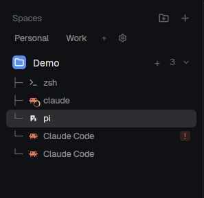
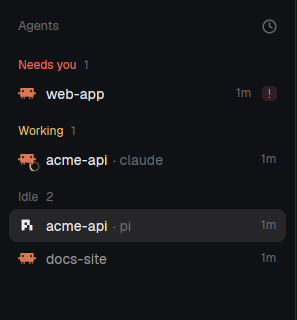

### Inbox

**One list of what needs you.** Blocked or finished agents, PR alerts and task runs, with ask cards to answer a waiting agent from the list. [More](dg-inbox/README.md)

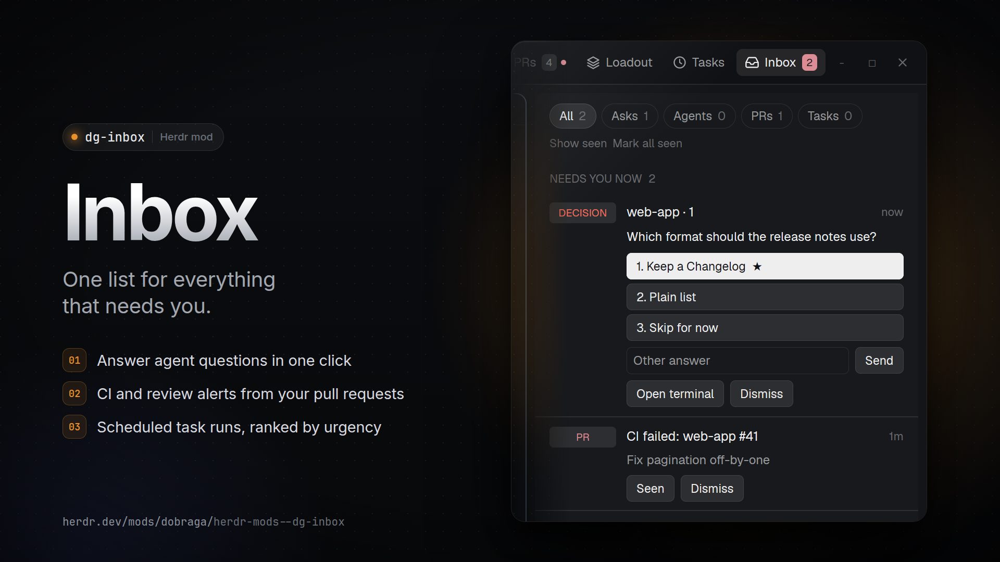

### Files and the file viewer

**Browse, find, open.** `dg-files` is the lazy tree, `dg-file-picker` finds a file with Ctrl+P, and `dg-file-view` opens it the right way: editor, Markdown, image, audio, video, PDF or git diff.

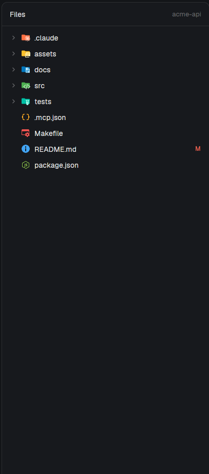
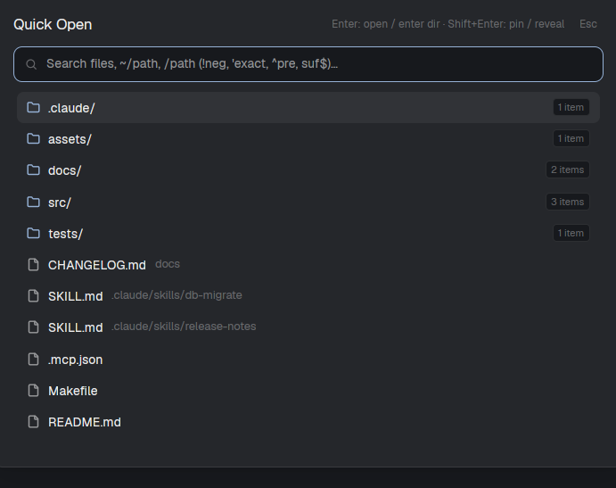
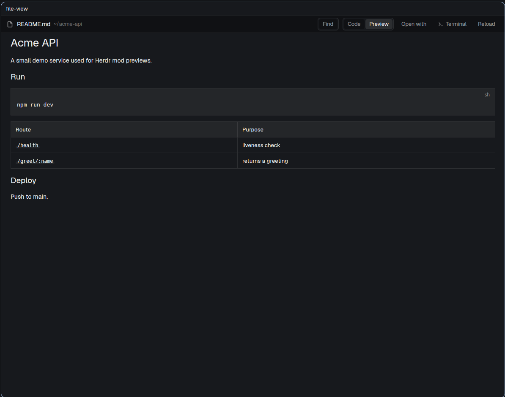

### Git and pull requests

**Changes and PRs of the folder.** `dg-changes` separates staged from unstaged, and `dg-prs` lists GitHub and Bitbucket Cloud pull requests across profiles.

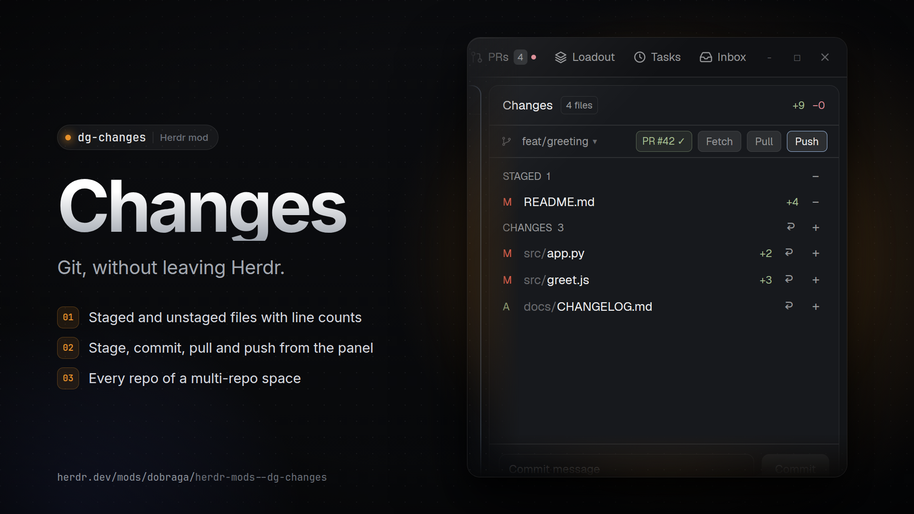
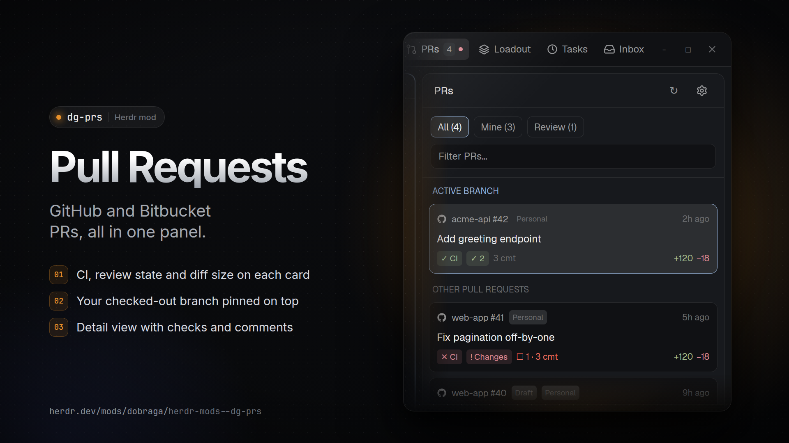

### Loadout and tasks

**What your AI setup has, and what runs on a schedule.** `dg-loadout` inventories skills, MCP servers and plugins; `dg-tasks` runs scripts and scheduled tasks.

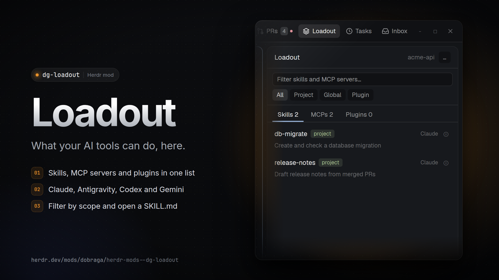
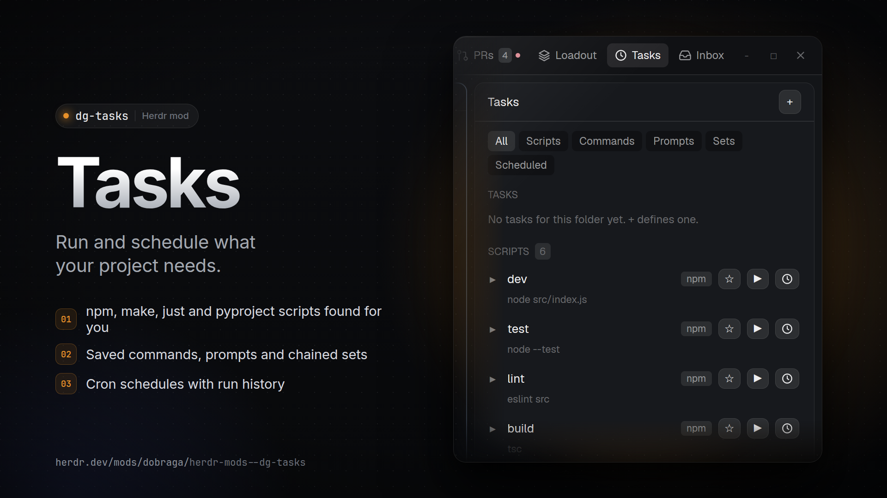

### Window chrome

**Tabs, status bar, menus and toasts.**

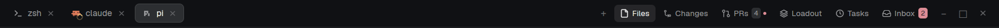
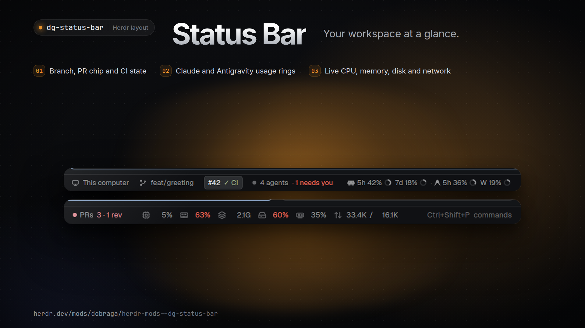
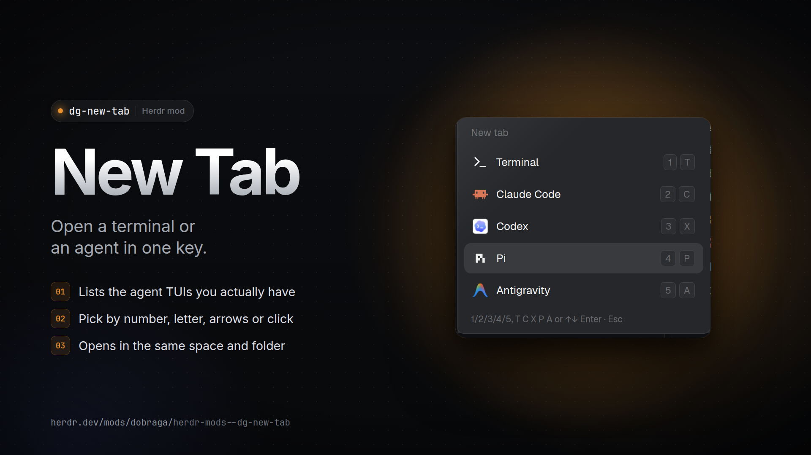
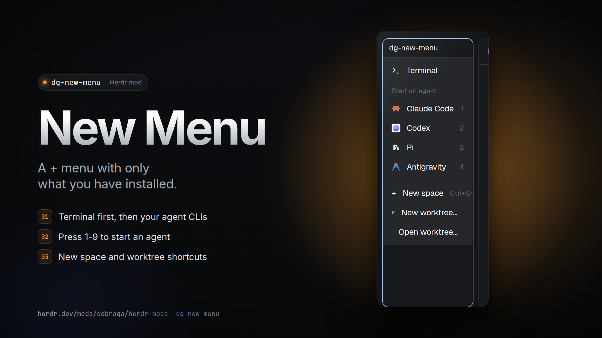
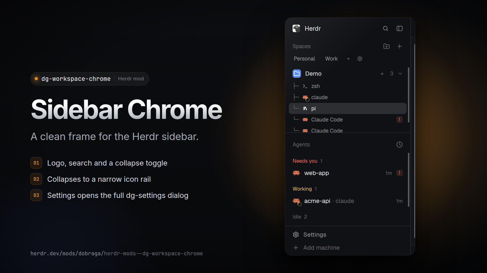
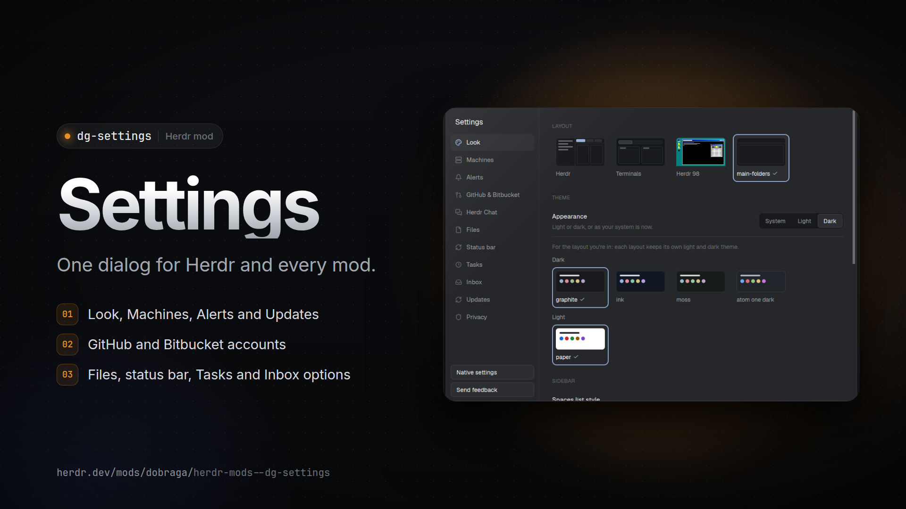
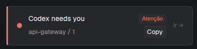

*Every picture comes from the demo workspace (see [Previews without real data](#previews-without-real-data)): fictional projects, agents and PRs.*

## Install

Ask your Herdr agent to add `herdr.dev/mods/dobraga/herdr-mods--<name>`. It reads the recipe and every file first, and tells you if a mod reaches the network or runs programs.

Or clone the repo and link the mods:

```sh
git clone https://github.com/dobraga/herdr-mods.git ~/src/herdr-mods
cd ~/src/herdr-mods
./install.sh                 # every mod, plus the Tasks scheduler (needs bun)
./install.sh dg-inbox dg-prs # only some mods
./install.sh --no-tasks      # every mod, without the scheduler
./install.sh --setup         # also the layout and, if you have none, its keys.json
./install.sh --uninstall     # remove the links and the scheduler service
```

Mods (`<name>/mods/<name>/`) are symlinked into `~/.config/herdr-app/mods/`, so `git pull` updates them. A real folder with the same name is moved to `~/.config/herdr-app/.backups/mods/`.

### The layout

The mods are built for [dg-workbench-layout](dg-workbench-layout/README.md). After `./install.sh --setup`, pick `dg-workbench-layout` in Settings > Look. If you already have a `keys.json`, merge `dg-workbench-layout/keys.json` into it by hand. `setup/` and `tools/sync-layout.sh` keep that folder in step with the dotfiles repo, which owns the layout.

### The Tasks scheduler

`dg-tasks` is only the panel. Scheduled tasks run in `herdr-tasks`, a small [bun](https://bun.sh) program in `tools/tasks`. `./install.sh` links it to `~/.local/bin/herdr-tasks` and installs it as a login service (systemd user unit on Linux, launchd agent on macOS). Without it the panel still lists and runs scripts, but shows "Scheduler stopped" and scheduled tasks never run.

```sh
herdr-tasks service status   # is the scheduler running?
herdr-tasks daemon           # run it by hand if the service could not be installed
```

## Repository layout

```
dg-inbox/
  mods/dg-inbox/   main.js, mod.json, ...
  tests/           the mod's tests
  README.md        what it does
  RECIPE.md        brief an agent can rebuild it from
  preview.png
tools/             Tasks scheduler, fork checks, preview tooling (not mods)
install.sh
```

## Keeping forks in sync

`forks.json` lists the mods forked from Herdr's own. After a Herdr update:

```sh
tools/check-forks.sh                 # forks whose upstream mod changed
# diff ~/.config/herdr-app/mods/<upstream>/main.js against <fork>/mods/<fork>/main.js, merge, then:
tools/check-forks.sh --sync <fork>   # or: --sync all
```

## Development

```sh
bun test */tests/                      # JS tests, of every mod (or one: bun test dg-inbox/tests)
cd tools/tasks && bun test             # scheduler tests
herdr-app check <name>/mods/<name>     # load a mod once
uv run tools/crop.py <mod> shot.png    # crop a full-window shot into <name>/preview.png
```

### Previews without real data

`tools/demo/` runs Herdr in a throwaway fake home (`/dev/shm/fh`) and its own herdr-core session (`HC_SESSION=demo`), with mock projects, agents, PRs, skills and usage, so previews never show real data:

```sh
tools/demo/setup.sh      # build the fake home
tools/demo/run.sh &      # open the demo window
tools/demo/populate.sh   # mock spaces, tabs and agents
tools/demo/shoot.sh      # shoot and crop every preview (or: shoot.sh <mod>...)
```

## License

Apache-2.0. See [LICENSE](LICENSE) and [NOTICE](NOTICE).
