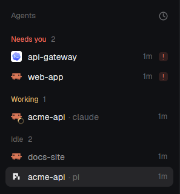

# Agents (custom)

A sidebar list of every running agent, grouped by space or sorted by urgency (Needs you, Done, Working, Idle). It is Herdr's own agents list with one change: each row's agent icon carries its status as a small badge (a spinner while working, a green dot when done) instead of a separate status glyph on the right. Sub-agents hang under their parent in a tree, and the sidebar can shrink to a narrow numbered rail.

## What you see

A full-height column (`size_full`) with background `t.chrome`, a 1px top border `t.border`, base text 13px. It has no mod `place` of its own (`"place": "none"`), so a layout block places it.

- **Header (41px, wide mode only):** "Agents" at 11.5px, medium, `t.dim`, 16px side padding. On the right a 14px sort icon (clock for Priority, layers for Grouped by space) in `t.dim`, tooltip "Sort agents: <label>".
- **List:** scrolling area with 8px side padding, always-visible scrollbar.
  - **Group headers (30px):** label at 11px medium plus a count. In Priority the label is colored by status (blocked, done, working); otherwise `t.dim`. A "Pinned" group comes first if anything is pinned. Folded, the header adds a right chevron, and in Grouped mode the most urgent status mark.
  - **Agent row (30px, rounded 8):** 16px agent icon, then a name (max 200px, truncated; 120px when a detail follows), then optional dim `· detail`, then a machine name (10px, dim) for agents on other machines (address like `vps/t7`), a fold chevron with child count if it has sub-agents, and at right either the time since its last state change (11px, dim; `<1m`, `5m`, `2h`, `3d`) or, on hover, a pin button. The focused row is filled `t.selected`; an idle unfocused row's name is `t.muted`.
  - **Row name:** in Priority or for pinned rows, the space name plus `· <tab title or agent title>`. In Grouped mode, the tab/agent title alone (the space is the header above).
  - **Sub-agent row (26px):** indented 39px, 14px icon, name at 12.5px, tree lines (`├`, `└`, `│`) drawn with 1.5px `t.input` borders, status at right. The sub-agent whose terminal is focused is filled `t.raised`.
- **Empty state:** "No agent status yet. Agents show up here when they report their status. Older versions and agents inside tmux may not."
- **Sort popup:** 200x140 popover, title "Sort agents", two 31px rows (icon, label, check on the active one).
- **Rail (sidebar narrower than 160px):** no header; each agent is a 26px row with its 1-based index right-aligned and a 14px status mark; a "»" button (28px high) at the bottom.

## How it behaves

Status looks (per agent, from `agents()`):
- **working:** a 10px spinner (900ms spin, `t.working`) pinned at the bottom-right corner of the agent icon (offset -4px). If the program has no icon, a 12px spinner in the status slot at right.
- **blocked:** a "Needs you" pill (`t.blocked` at 15% fill, 10.5px semibold) at right. Under a "Needs you" header (Priority mode, not pinned) it shortens to a 14px square with `!`.
- **done:** a 7px dot in `t.done` at the icon's bottom-right (offset -2px) with a 1px ring matching the row background. With no icon it shows as a dot at right.
- **idle:** a 7px ring (`t.idle`, else `t.dim`) at right, shown only when the program has no icon (an icon row shows nothing at right for idle).
- Sub-agents without a pane use the raw status (`error` becomes blocked, `done` becomes idle); kept sub-agents (with a pane) keep their own status.

Ordering and grouping:
- Priority sorts by urgency rank (blocked 4, done 3, working 2, idle 1), then most recent state change, then `seq` descending. A parent's rank is the highest of itself and its live sub-agents (a sub-agent's done counts as idle). Pinned agents always come first.
- Grouped puts agents under their space name; adjacent agents of one space share a header.
- Done and idle count as the same state for the "since" timer, so looking at a finished agent does not reset it. Timer text refreshes every 30s.
- The order shown is published with `setAgentOrder` so Herdr's agent-jump keys follow it.

Clicks:
- Row click: `pane.focus` on the agent's pane. Sub-agent with a pane: `pane.focus`; without: `terminal.peek`.
- Click the agent icon of a row with sub-agents: fold or unfold its tree. The chevron does the same. Group header click: fold or unfold the group. Folds are in memory only.
- Hover a row: pin button appears (`terminal.pin`, toggles). Pinned state is kept by Herdr as the terminal label `herdr.pinned`.
- Sort icon opens a popup; choosing an option writes `agents.sort` and closes it.
- Rail: row click focuses; "»" widens the sidebar back to its previous width (default 268px).

## Built from

Files: `main.js` (one `View` class, default export), `mod.json` = `{ "place": "none", "title": "Agents" }`. Also ships `jsconfig.json` and `gpui-kit.d.ts` for editor typing only (not needed at run time). No `props` roles: the same class renders the list normally and the sort popup when `props().sortMenu` is set.

Imports: `gpui-kit` (`View, div, image, svg`), `gpui-base` (`v_flex, h_flex`), `herdr` (`agents, terminals, panes, focused, spaces, run, theme, shared, setShared, setAgentOrder, openOverlay, closeOverlay, props, window, layout`).

Herdr commands via `run`: `pane.focus`, `terminal.peek`, `terminal.pin`, `layout.resize`. Overlay: `openOverlay({ mod: "agents", kind: "popup", width: 200, height: 140, props: { sortMenu: true } })`.

`shared()` keys: reads and writes `agents.sort` (`priority` or `grouped`, default priority), `sidebar.width`, `sidebar.collapsed` (written for older mods; the rail is detected from the sidebar's width). Local storage: `changed` (each agent's last state and timestamp, pruned after 30 days) and `pins` (legacy pending pins, migrated to `terminal.pin`).

Shipped assets used: `mods/workspace-chrome/{clock,layers,check,spinner,chevron-down,chevron-right,pin,pin-off}.svg` (sizes 10 to 14px). Agent icons come from `program.icon` of each agent (an SVG tinted to the text color if `program.tint`, otherwise an image). No art of its own.

Programs run: none. Network: none. Files read outside its folder: none directly (assets above are loaded by path from the Herdr home).

Layout assumption: a layout node with `id: "sidebar"` and a pixel `size` (read through `layout()`; resized with `layout.resize`). The shipped layout places this mod as `{ "mod": "agents-custom" }` in a block under that sidebar.

Differences from upstream agents (the shipped mod, same file layout):
- The agent icon is wrapped in a relatively positioned box that carries a working spinner (10px) or a done dot (7px) in its bottom-right corner.
- The right-hand status is rendered only for `blocked`, or when the program has no icon (upstream always renders it).
- Nothing else differs (`mod.json`, helpers, sorting, tree, rail and sort popup are identical).

Derived from Herdr's agents mod (Apache-2.0), see ../NOTICE.

## Watch out

- The sort popup opens the mod named `agents` (the upstream one), not `agents-custom`. Herdr's shipped `agents` mod must stay installed and must still support `props.sortMenu`, or the sort icon opens nothing useful.
- Needs the shipped `workspace-chrome` mod's SVGs (`mods/workspace-chrome/*.svg`); a missing file leaves blank icons.
- `sidebar.width` and `sidebar.collapsed` are shared with `workspace-chrome-custom`, which also toggles the rail with the same keys. The two stay consistent only because both use the same logic (rail means sidebar under 160px; 76px on macOS for the traffic lights, 44px elsewhere).
- Idle agents with an icon show no status mark at all; only the icon and the dimmed name tell them apart. This is intentional.
- Done agents lose the "done" look once looked at (done and idle are treated as one for timing, and Herdr reports idle after focus).
- Stale `changed` entries are only pruned when some state changes and the agent has been gone for 30+ days.
- Visual changes were validated only by static check, not live; open the sidebar to verify.

## Done when

- `herdr-app check mods/agents-custom` passes.
- The sidebar shows an "Agents" header and agent rows; with no agents it shows the empty-state text.
- A working agent shows a spinning badge on its icon; a done agent a green dot; a blocked agent a "Needs you" pill; an idle agent only a dimmed name.
- The sort icon opens a popup with "Priority" and "Grouped by space"; choosing one regroups the list and persists in `agents.sort`.
- Clicking a row focuses that agent's pane; hovering shows a pin button that moves the row into "Pinned".
- An agent with live sub-agents shows a tree with `├` and `└` lines, and clicking its icon or chevron folds it.
- Dragging the sidebar under 160px switches to the numbered rail; "»" restores the previous width.
- The mod makes no network requests and runs no programs.
