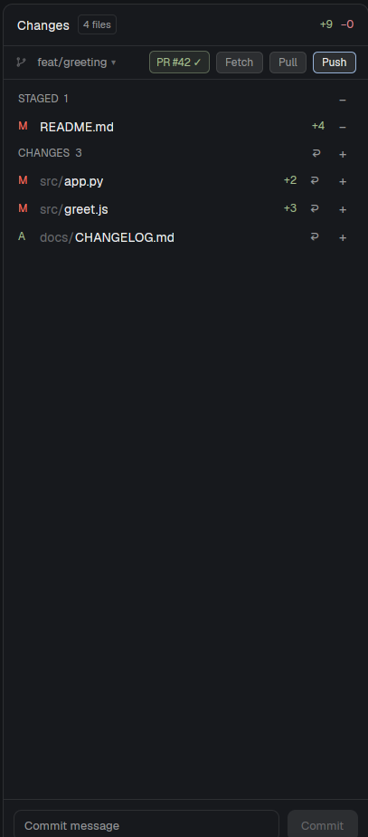

# Changes Tabs



A Git changes sidebar for the active Herdr space. It lists every changed file of the repo (or of every repo, when the space folder holds several), split into Staged and Changes, with `+N`/`-N` line counts. You can stage, unstage, discard, commit, fetch, pull, push and switch branch without leaving Herdr. Clicking a file opens its diff as a tab in the main area, VS Code style: one click is a reusable preview tab, a double click pins it.

Derived from Herdr's changes mod (Apache-2.0), see [NOTICE](../NOTICE).

## Quick start

1. Install the mod (see below), together with `file-view`, which renders the diffs.
2. Mount `changes-tabs` in a layout block (this mod has no slot of its own).
3. Open a space inside a git repo with edits: the files appear under Staged / Changes. Click one to see its diff.

## Install

> Read ~/.config/herdr-app/AGENTS.md, then add this mod: https://github.com/dobraga/herdr-mods/tree/main/changes-tabs

<details>
<summary>Install by hand</summary>

```sh
git clone https://github.com/dobraga/herdr-mods
cd herdr-mods
./install.sh changes-tabs
./install.sh file-view
```

This links the mod into `~/.config/herdr-app/mods`; `git pull` updates it.

The mod's `place` is `none`, so the layout has to mount it. Add a block to your layout (the author's layout puts it in a stack):

```json
{ "id": "changes", "type": "block", "content": { "mod": "changes-tabs" } }
```

</details>

## Usage

- **Header:** file count, and the total `+N` / `-N` of all changes. With several repos there is an "Expand all" / "Collapse all" button.
- **Repos:** follows the focused pane's folder. If the space folder holds several repos (`<folder>/*/.git`), each gets its own collapsible block; repos without changes start collapsed.
- **Files:** click opens a diff preview tab, double click pins it, right click gives "Copy relative path", "Copy full path" and (local only) "Open with...".
- **Stage / unstage:** the `+` / `-` buttons on a row or on the section header (all files).
- **Discard:** the `↩` button is two-step. The first click turns it into a check mark, the second one discards (untracked files are deleted).
- **Commit:** type a message and press Enter or click Commit. It needs a message and at least one staged file.
- **Fetch, Pull, Push:** buttons in the branch bar, with ahead/behind counts. Push on a branch without upstream runs `git push -u origin <branch>`. Repos with an upstream are also fetched silently every 5 minutes.
- **Branches:** click the branch name to filter and switch (local, or remote-only branches).
- **PR chip:** if a companion mod publishes the branch's open PR, a `PR #N` chip shows its CI/review state; clicking it opens the PRs panel.

## Requirements

- `git` on the PATH of the machine the space runs on (also `find`, to discover repos). Works on remote machines too.
- [`file-view`](../file-view) in this repo, to render the diffs. Without it a click opens a tab that never renders.
- Optional: `workspace-status-usage` (publishes the PR state) and `prs-panel` (target of the PR chip click, needs a layout with a `prs` child in a `panel-body` stack).
- It runs `git` in your repos and talks to their remotes with your own git credentials (fetch, pull, push). Discard is destructive and only guarded by the two-click confirm.
- The mod name is hard-coded for its popups: keep the folder named `changes-tabs`.

See [RECIPE.md](RECIPE.md) for how it is built.
