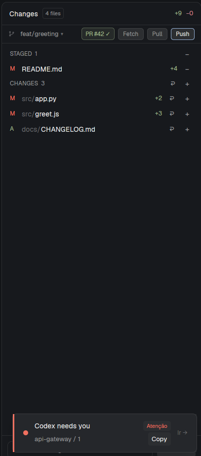

# Changes Tabs

A Git changes sidebar for the active space. It lists every changed file of the repo (or of every repo, when the space folder holds several), split into Staged and Changes. You stage, unstage, discard, commit, fetch, pull, push and switch branch from it. Clicking a file opens its diff as a tab in the main area, VS Code style: one click is a reusable preview tab, a double click pins it.

## What you see

A rounded (10px) panel with a 1px `border` outline, `background` fill, 13px text, filling its slot, top to bottom:

- **Header, 42px:** "Changes" (semibold), a small bordered count chip (`N files`, or `N files · M repos` for several repos), in multi-repo mode an "Expand all"/"Collapse all" text button, then a spacer and the totals `+N` (`ansi2`, green) and `−N` (`ansi1`, red).
- **Branch bar, 34px** (single repo only; each repo block has its own in multi-repo): `branch.svg` icon (12px, `dim`), the branch name with a `▾` (11.5px, `muted`), an optional PR chip, then three 22px buttons Fetch, Pull, Push. Pull reads `↓N Pull` and Push reads `↑N Push` when behind/ahead, and those get the `accent` border and `selected` fill. Push is highlighted too when the branch has no upstream.
- **List** (scrolls, 6px padding, custom vertical scrollbar): two sections, `STAGED  n` and `CHANGES  n` (11px semibold `muted`; a section is hidden when empty). The Changes header has a discard-all `↩` and stage-all `+`; the Staged header has unstage-all `−`. Each file row is 28px: a status letter (`A` green, `D` red, `U` red for conflicts, `M` in the `blocked` color), the directory part (`dim`, truncated) then the file name, `+N`/`−N` line counts (11px), a discard `↩` (Changes only, not for conflicts) and a stage `+` or unstage `−` 20px button. The row whose diff is open in the active tab has the `selected` fill.
- **Multi-repo list:** one bordered, rounded (8px) block per repo with a 30px `chrome` header: `▸`/`▾`, repo name (semibold 12px), branch (`dim`), `↓N` (`ansi3`), `↑N` (`ansi2`), `+N`/`−N`, a count chip. Below the header: branch bar, the two sections, commit box. A repo with no changes starts collapsed.
- **Commit box:** a 32px bordered text input ("Commit message", border turns `accent` while typing) and a 32px "Commit" button (`solid` fill, `solid_foreground` text when enabled, `raised`/`dim` when disabled). One per repo; in single-repo mode it is pinned at the bottom.
- **Footer notes:** "Showing the first 1,000 changed files per repo" when truncated; a red (`ansi1`) error line with a `✕` dismiss when a git command failed.
- **Empty states:** "Loading changes…", "Not a git repository", "No folder", "No uncommitted changes".
- **Popups:** a branch picker (280px wide, filter input "Filter branches…", rows 28px, current branch has `✓`, remote-only branches tagged `origin`) and a file context menu (190px wide).

## How it behaves

- **Context:** follows the focused pane's cwd (falling back to the focused terminal, any pane of the space, then the space folder) and the space's machine. When it changes, the list reloads. Works on remote machines (`on`), except the folder watch.
- **Repo discovery:** the focused repo first, then the space folder if it is a repo, then every `<folder>/*/.git` one level down (directory or worktree file), alphabetical, no duplicates. More than one repo switches to multi-repo layout. A repo whose folder was deleted is dropped.
- **Refresh:** a folder watch on each repo marks it dirty, and a 500ms timer refreshes when dirty, when 10s have passed since the last scan, or when the window regains focus. Nothing runs while the window is inactive. Slow `git status` calls back off (up to 60s). Scans are shared between copies of the mod. Reads use `--no-optional-locks`, so the refresh never writes under `.git`.
- **Auto-fetch:** every 30s, repos with an upstream that have not been fetched for 5 minutes get a silent `git fetch --prune` (no toast, errors ignored).
- **File click:** opens (or reuses) a `file-view` tab with `kind: "diff"`. Single click makes/replaces the one preview tab of the space; double click pins. A diff already open for the same file is just selected. Right click opens the context menu: "Open with…" (local machines only), "Copy relative path", "Copy full path" (to the clipboard).
- **Stage / unstage:** `git add -- <path>` or `git add -A`; `git restore --staged -- <path>` (or `git rm --cached -r -q --` before the first commit).
- **Discard** is two-step: the first click turns `↩` into `✓` with the tooltip "Click again to discard"; the second click on the same target runs `git restore -- <path>` (untracked files: `git clean -fdq -- <path>`; discard-all: `git restore -- .` then `git clean -fdq`). The armed state is per repo and is cleared by any other action or context change.
- **Commit:** Enter in the input or the Commit button runs `git commit -m <message>`; needs a non-empty message and at least one staged file. The input is cleared on success. Per-repo messages survive context changes.
- **Fetch / Pull / Push:** buttons show "Fetching…", "Pulling…", "Pushing…" and disable everything else while running (120s timeout). Pull and Push show a success toast ("Git pull complete"/"Git push complete", 3s). Push on a branch with no upstream runs `git push -u origin <branch>`. A collapsed repo header shows one hover button, Pull if behind, Push if ahead or no upstream, otherwise Fetch.
- **Branch picker:** local branches then remote-only ones, newest commit first; type to filter. Picking runs `git switch <name>` (remote: `git switch --track origin/<name>`) and shows a success or an error toast. Clicking the current branch just closes it.
- **PR chip:** when the branch has an open PR in `shared("forge.state")`, a chip `PR #N` (plus `✕` for failing CI, `✓` for passing) is shown, colored `ansi1` (CI failure, conflicts, changes requested), `ansi2` (CI success and approved), `working` (CI pending), else `muted`. Clicking it selects the `prs` child of the `panel-body` stack, shows the `panel` layout block, and asks the PRs panel to focus that PR.
- **Status:** a git error in one repo is shown inside that repo's block and does not hide the others. Conflicts show as `U` in Changes. At most 1,000 status entries per repo are read.
- Escape while typing in the commit input leaves the input.

## Built from

Files (flat folder `mods/changes-tabs/`):
- `mod.json`: `{ "place": "none", "cloned_from": { "name": "changes", "version": "0.1.16" } }`. No slot of its own; the layout places it.
- `main.js`: default export `class ChangesTabs extends View`. It renders one of three UIs by `props()`: `props.contextMenu` (file menu popup), `props.branchMenu` (branch picker popup), otherwise the panel. Popups are opened with `openOverlay({ mod: "changes-tabs", kind: "popup", width, height, props })` and receive `props.overlay` to close themselves.
- `repos.js`: `normalizeRemoteSlug(url)` (github/bitbucket remote to `provider:owner/repo`, lowercase), `repoName`, `mergeRepoRoots`, `discoverRepoRoots`. Kept identical to `prs-panel/repos.js`.
- `changes.svg`: 24px stroke icon (two nodes joined by a bent arrow). The mod itself does not reference it.

Modules and herdr API: `gpui-kit` (`View`, `div`, `svg`), `gpui-base` (`v_flex`, `h_flex`, `InputState`, `Input`, `Scrollbar`), `herdr` (`spaces`, `panes`, `focused`, `exec`, `watchFolder`, `theme`, `run`, `shared`, `setShared`, `props`, `openOverlay`, `closeOverlay`, `notify`, `window`). Theme tokens: `background`, `border`, `foreground`, `muted`, `dim`, `accent`, `selected`, `hover`, `raised`, `chrome`, `popover`, `solid`, `solid_foreground`, `blocked`, `working`, `ansi1`/`ansi2`/`ansi3`.

Commands via `run`: `tab.new` (`{ name, space, mod: "file-view", props }`), `tab.rename`, `tab.select`, `layout.select` (`{ stack: "panel-body", child: "prs" }`), `layout.show` (`{ id: "panel" }`).

Programs run through `exec` (all with `cwd` = repo root, `on` = machine): `git` (`status --porcelain=v1 -z --untracked-files=all`, `rev-parse`, `config --get remote.origin.url`, `rev-list --left-right --count @{u}...HEAD`, `diff --numstat [--cached]`, `for-each-ref`, `add`, `restore`, `rm --cached`, `clean`, `commit`, `fetch --prune`, `pull`, `push`, `switch`) and `find <folder> -mindepth 2 -maxdepth 2 -name .git`. No `hc`.

Shipped/sibling mods used:
- `file-view` (sibling in this repo) renders the diffs. Needs its `kind` values `diff` and `open-with`.
- `workspace-chrome` icon `mods/workspace-chrome/branch.svg` (Herdr's shipped mod).
- `prs-panel` (optional): target of the PR chip.

`shared()` keys:
- Read and written: `file-view.slots`, a map `slotId -> { spaceId, tabId, kind, path, root, on, name, preview, updatedAt }`. This mod creates entries (id `fv-<time>-<rand>`), re-uses or re-pins them, and prunes dead ones (tab gone, or no `tabId` after 5s). `file-view` fills in `tabId` and keeps them up to date.
- Read: `forge.state` (`byBranch["<provider:owner/repo>::<branch>"]` with `key`, `number`, `title`, `ciState`, `reviewState`, `conflicts`). Written by `workspace-status-usage`, read by `prs-panel`.
- Written: `forge.focusPrKey` `{ key, seq }`, consumed by `prs-panel`.

Network and files: no direct network from JS, but `git fetch`, `pull` and `push` (buttons, plus the 5-minute auto-fetch) talk to the repo's remotes with the person's own git credentials. It reads no files itself (no `readTextFile`) and writes none; git works inside the repos it lists, which can be outside the mod folder.

### Differences from upstream `changes`

Derived from Herdr's changes mod (Apache-2.0), see ../NOTICE.

- Upstream renders the diff itself inside the panel (virtual list, syntax and font settings, `readTextFile`, `settings()`); this fork has no inline diff and opens diffs as `file-view` tabs (`file-view.slots`, preview/pinned, `tab.new`/`tab.select`/`tab.rename`).
- Upstream is a single-repo panel; this fork adds multi-repo discovery (`repos.js`, `find`) and collapsible per-repo blocks with an Expand/Collapse all toggle.
- Added git actions: stage, unstage, discard (two-step), commit with per-repo input, fetch, pull, push, branch switcher popup, background auto-fetch with ahead/behind counts.
- Added the file context menu (copy paths, Open with…) and the PR chip linked to the PRs panel.
- `mod.json` gets `cloned_from`. Upstream keeps `{ "place": "none" }`.
- Kept from upstream: the shared `repoStatus` scan cache (`Symbol.for("herdr.repoStatus.v2")`), the watch/poll/back-off refresh logic and the `git status` flags.

## Watch out

- **Runs programs and talks to remotes:** it runs `git` and `find` through `exec`, and fetch/pull/push/switch/commit/discard change the repo. Discard is destructive (`git clean -fdq` deletes untracked files); it is guarded only by the two-click arm. Say this before installing.
- **Reads outside its folder:** it scans the focused pane's repos and the space folder's children (repos anywhere on disk or on a remote machine). It also reads `shared("file-view.slots")` and `shared("forge.state")` written by other mods.
- **Depends on siblings:** without `file-view` a click creates a slot and a tab that never renders; without `workspace-status-usage` publishing `forge.state` the PR chip never appears; without `prs-panel` and a layout with the `panel` block and `panel-body` stack containing a `prs` child, the chip click does nothing. The icon path `mods/workspace-chrome/branch.svg` must exist (Herdr ships it).
- **Placement:** `place` is `none`; the layout has to mount `changes-tabs` in a panel itself. The mod name is hard-coded in `openOverlay` (`mod: "changes-tabs"`), so renaming the folder breaks the popups.
- Popup heights are fixed in code: branch picker `min(branches, 9) * 28 + 58`, context menu 108 (local) or 76 (remote, no "Open with…").
- Folder watch is skipped on remote machines, so they refresh by the 10s poll only. Only `github` and `bitbucket` remotes produce a slug for the PR chip.
- Render must not create `InputState`; the inputs are created in `refresh()` (`inputFor`). A fresh build that creates them in `render` fails.
- Keep `repos.js` identical to `prs-panel/repos.js` (mods cannot import each other).
- Needs `git` on the PATH of the machine in `on`; no other non-Herdr program is required (no `gh`, `hc`, `bb.py`).

## Done when

- `herdr-app check mods/changes-tabs` passes.
- In a space inside a repo with edits, the panel lists them under Staged/Changes with correct letters and `+/−` counts, and the header totals match.
- Clicking a file opens a diff preview tab; clicking another replaces it; double click pins a new one; clicking the same file again just selects its tab.
- `+` stages and `−` unstages a file; `↩` needs two clicks, the first only turns it into `✓`.
- Commit is disabled without a message or staged files, and after success the input is empty and the file is gone from Staged.
- Fetch, Pull and Push show their running label, and Pull/Push show a success toast; the branch picker lists local then remote branches, filters on typing and switches the branch.
- In a folder holding two or more repos, each appears as a collapsible block, empty ones start collapsed, and "Collapse all"/"Expand all" works.
- A branch with an open PR in `forge.state` shows the PR chip, and clicking it opens the PRs panel.
- Right click on a row shows "Copy relative path" and "Copy full path" (plus "Open with…" locally).
