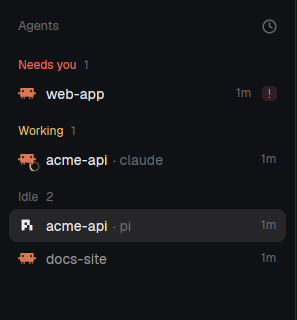

# Agents (custom)



A sidebar list of every running agent, grouped by space or sorted by urgency (Needs you, Done, Working, Idle). It is Herdr's own agents list with one change: each row's agent icon carries its status as a small badge (a spinner while working, a green dot when done) instead of a separate status glyph on the right. Sub-agents hang under their parent in a tree, and the sidebar can shrink to a narrow numbered rail.

Derived from Herdr's agents mod (Apache-2.0), see [NOTICE](../NOTICE).

## Quick start

1. Install the mod (see below).
2. Put `{ "mod": "dg-agents" }` in a layout block under your sidebar.
3. Start an agent in any pane: it shows up in the list with its status.

## Install

> Read ~/.config/herdr-app/AGENTS.md, then add this mod: https://github.com/dobraga/herdr-mods/tree/main/dg-agents

<details>
<summary>Install by hand</summary>

```sh
git clone https://github.com/dobraga/herdr-mods
cd herdr-mods
./install.sh dg-agents
```

This links the mod into `~/.config/herdr-app/mods`; `git pull` updates it.

The mod has `"place": "none"`, so a layout block must place it. Add a block like this inside a node with `"id": "sidebar"` and a pixel `size`:

```json
{
  "id": "agents",
  "type": "block",
  "size": { "weight": 1 },
  "min": 90,
  "content": { "mod": "dg-agents" }
}
```

</details>

## Usage

- Each row shows the agent icon, its space and tab (or title), and the time since its last state change.
- Status: a spinner badge on the icon while working, a green dot when done, a "Needs you" pill when blocked. Idle agents show only a dimmed name.
- Click a row to focus that agent's pane. Hover a row to pin it; pinned agents move to a "Pinned" group.
- Agents with sub-agents show a tree. Click the icon or chevron to fold it; click a group header to fold the group (folds are not saved).
- The sort icon in the header opens a popup: Priority or Grouped by space. The choice is stored in Herdr's shared state as `agents.sort`.
- Drag the sidebar under 160px to get a numbered rail; the "»" button restores the previous width.
- The order shown also drives Herdr's agent-jump keys.

## Requirements

- Herdr's shipped `agents` mod must stay installed: the sort popup opens it, not this mod.
- Herdr's shipped `workspace-chrome` mod, whose SVG icons it loads (missing files leave blank icons).
- A layout node with `"id": "sidebar"` and a pixel size, so the rail and "»" can resize it.
- It runs no programs and makes no network requests.

See [RECIPE.md](RECIPE.md) for how it is built.
