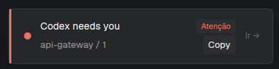

# Desktop Toast



A replacement for Herdr's notification toast. Every notification still shows as a slim in-app toast (a colored bar on the left edge, a title, an optional body with a Copy button). When the Herdr window is not focused, the same notification is also sent to the Linux desktop with `notify-send`, so a blocked or finished agent reaches you while you are in another app.

## Quick start

1. Install the mod (see below).
2. Add `"toast": "dg-desktop-toast"` to the root of your layout.
3. Trigger a notification (for example, let an agent finish or get blocked) and switch to another window to see the desktop notification too.

## Install

Ask your agent:

> Read ~/.config/herdr-app/AGENTS.md, then add this mod: https://github.com/dobraga/herdr-mods/tree/main/dg-desktop-toast

<details>
<summary>Install by hand</summary>

```sh
git clone https://github.com/dobraga/herdr-mods
cd herdr-mods
./install.sh dg-desktop-toast
```

This links the mod into `~/.config/herdr-app/mods`. Run `git pull` to update it.

The mod has no layout slot (`"place": "none"`). Select it as the toast mod in the root of your active layout:

```json
{
  "id": "root",
  "toast": "dg-desktop-toast"
}
```

</details>

## Usage

It opens by itself: Herdr shows it whenever a notification is raised.

- The bar color and badge follow the level: error (`Atenção`), warning (`Aviso`), success (`Pronto`); info has no badge.
- Click the toast to run its action, if it has one (shown as `Ir →`), and close it.
- Click **Copy** to copy the title and body to the clipboard. The button then reads "Copied" and the toast stays open.
- If the body is `<machine> needs login; run hc machine login <machine>`, the toast shows the command with its own Copy button. The command is only displayed and copied, never run.
- Desktop notifications are sent only when the Herdr window is not active and the title or body is not empty:
  - error: critical, stays until dismissed
  - warning: normal, 8 s
  - success: normal, 5 s
  - info: low, 4 s
- There are no settings to configure and nothing is stored.

## Requirements

- Linux with a notification daemon and `notify-send` (libnotify-bin) on your PATH. Without it the desktop notification fails silently and only the in-app toast appears.
- It reads no files itself. It passes `~/.local/share/herdr-app/herdr-app.svg` to `notify-send` as the icon; if that file is missing the notification has no icon.
- No network access.
- The badge labels and `Ir →` are in Portuguese.

See [RECIPE.md](RECIPE.md) for how it is built.
