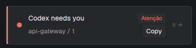

# Desktop Toast

A replacement for Herdr's notification toast. Every notification still appears
as a slim in-app toast (dark popover, a colored bar on the left edge, a title, an
optional body with a Copy button). When the Herdr window is NOT the active
(focused) window, it also posts the same notification to the Linux desktop
through `notify-send`, so a blocked or finished agent reaches you while you are
in another app.

## What you see

A single full-size row (the size Herdr gives the toast overlay), left to right:

- A 3px left border in the level color, on a `popover` background, 16px
  horizontal padding, 12px gap, items vertically centered.
- A leading mark: `props().icon` as an 18x18 image when given, otherwise a 9px
  round dot in the level color.
- A text column (fills the width, clips overflow, 2px gap):
  - Title line: semibold 13px `foreground`, truncated with an ellipsis. To its
    right a small badge (10px semibold, `raised` background, 4px radius,
    6px x 1px padding) in the level color: Portuguese labels,
    exactly `Atenção` (error), `Aviso` (warning), `Pronto` (success). Info has
    no badge.
  - Body line: 12px `muted`, truncated, full body in a tooltip, followed by a
    12px `raised` "Copy" button (4px radius, 6px x 3px padding).
- At the far right, when the notification has an action, a dim 11px label
  `Ir →` ("Go").

Level colors (theme names): error `blocked`, warning `working`,
success `done`, info/unknown `accent`.

## How it behaves

- Hover: row background becomes `hover`; the whole row is a pointer.
- Click on the row: if `props().action.name` is set, runs that command with
  `action.args` (default `{}`), then closes the overlay with
  `closeOverlay(props().overlay)`. With no action it just closes.
- Click on "Copy": stops propagation (does not close or run the action), copies
  `"<title>\n<body>"` (trimmed) to the clipboard, and the button text becomes
  "Copied".
- Login special case: if the body matches exactly
  `<machine> needs login; run hc machine login <machine>` (machine is
  `[a-z0-9][a-z0-9_.-]{0,31}`), the title shows `<machine> needs a login: run`,
  the badge and the action label are hidden, and the second line shows the
  command `hc machine login <machine>` with its own Copy button that copies just
  that command.
- Desktop notification (only in `init`, once per toast): skipped when
  `window().active` is true, or when title and body are both empty. Otherwise
  runs `notify-send --app-name=Herdr --urgency=<u> --icon=<icon>
  [--expire-time=<ms>] <title or "Herdr"> [body]`. Errors are swallowed.
  Mapping by `props().level`:
  - error: urgency `critical`, never expires (no `--expire-time`)
  - warning: `normal`, 8000 ms
  - success: `normal`, 5000 ms
  - info / unknown: `low` (unknown levels get `normal`, 5000 ms), 4000 ms for info
- Icon for the desktop notification: `~/.local/share/herdr-app/herdr-app.svg`
  (built from `home()`).
- The mod never calls `closeOverlay` after posting to the desktop; it still
  draws its in-app toast and closes only on click (or whatever Herdr's own
  overlay timeout does with `props().timeout`).

## Built from

- `mod.json`: `{ "place": "none" }` (no layout slot; used only as the toast mod).
- `main.js`: one `View` subclass, `DesktopToast`, with `init(p, cx)` and
  `render(cx)`. No other files (no icons, no `icon-map.js`).
- Imports: `View, div, image` from `gpui-kit`; `v_flex, h_flex` from
  `gpui-base`; `props, closeOverlay, run, theme, exec, home, window` (as
  `appWindow`) from `herdr`.
- Props read: `title`, `body`, `level` (`error|warning|success|info`), `icon`,
  `action` (`{name, args}`), `overlay`. `timeout` is ignored. `init` also
  accepts the props as its first argument `p`, falling back to `props()`.
- Herdr functions: `props()`, `theme()` (keys `popover`, `hover`, `raised`,
  `foreground`, `muted`, `dim`, `blocked`, `working`, `done`, `accent`),
  `window().active`, `home()`, `exec`, `run(name, args)`, `closeOverlay(id)`,
  `cx.spawn`, `cx.write_to_clipboard`, `cx.stop_propagation`, `cx.notify`.
- Programs run: `notify-send` (libnotify-bin), via `exec`. No `hc`, `gh`,
  `herdr-tasks` or other programs are run; `hc machine login` text is only
  displayed and copied, never executed.
- Shipped mods used: none. `shared()` keys: none read or written.
- Sibling mods: none of the other mods in this repo reference or provide
  `dg-desktop-toast`; it is selected by the layout root, not by another mod.
- Layout hook: the active layout's root must contain `"toast": "dg-desktop-toast"`
  (documented root-only key for choosing the toast mod). This file does not set
  it.
- Art: none shipped; uses the user's `herdr-app.svg` for the system icon.

## Watch out

- Runs a program: `notify-send` on the host. Linux with a notification daemon
  only; on a machine without `notify-send` the call fails silently (caught) and
  only the in-app toast shows.
- Reads outside its folder: only the path `~/.local/share/herdr-app/herdr-app.svg`,
  passed to `notify-send` as an icon (not opened by the mod). If that file is
  missing the desktop notification just has no icon.
- No network access.
- Badge labels and the "Ir →" / login wording are Portuguese; change them if you
  want English. The login pattern is tied to the exact wording of the message
  `<machine> needs login; run hc machine login <machine>`, which comes from a
  `hc` machine setup, not from this repo; without it that branch never triggers.
- `render` does not early-return when the window is active; `init` does. Do not
  "fix" this by closing the overlay in `init`, the in-app toast must still draw.
- Title and body are passed as plain arguments to `notify-send` via `exec` (no
  shell), so quoting is not needed; some daemons render Pango-like markup in the
  body.
- The `Copy` state is per toast instance (`this.copied`); it is not reset.
- `timeout` from props is not honored by this mod; desktop expiry is the fixed
  table above.

## Done when

- `herdr-app check mods/dg-desktop-toast` passes.
- With `"toast": "dg-desktop-toast"` in the layout root, `notify({title, body,
  level})` shows the in-app toast with the correct level color, badge and body.
- With the Herdr window unfocused, the same call also raises a desktop
  notification (critical and persistent for `error`, 8 s for `warning`, 5 s for
  `success`, 4 s low urgency for `info`); with it focused, no desktop
  notification appears.
- A notification with empty title and body posts no desktop notification.
- Clicking the toast runs `action.name` with `action.args` and closes it;
  clicking Copy copies `title\nbody`, shows "Copied" and does not close it.
- A body of `foo needs login; run hc machine login foo` shows
  `foo needs a login: run`, the command `hc machine login foo`, and Copy puts only
  that command on the clipboard.
