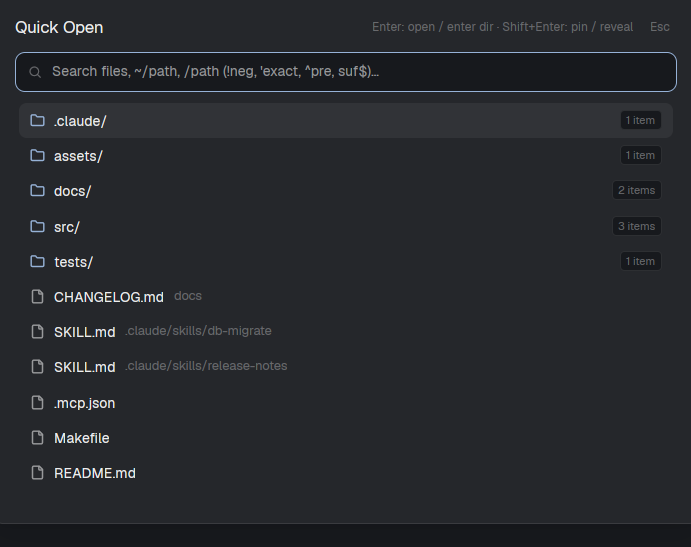

# Quick Open



A popup that drops from the top of the Herdr window with a search box and a list of the files in the active space's folder. Type a few letters, arrow to a file, press Enter, and it opens in a file tab. Typing a path that starts with `~` or `/` browses any folder on the machine instead.

## Quick start

1. Add the mod (see [Install](#install)) and make sure `dg-file-view` is also installed.
2. Bind a key in `keys.json`: `"global": {"ctrl-p": "mod.open:dg-file-picker"}`.
3. Press Ctrl+P, type part of a file name, and press Enter.

## Install

Ask your agent:

> Read ~/.config/herdr-app/AGENTS.md, then add this mod: https://github.com/dobraga/herdr-mods/tree/main/dg-file-picker

<details>
<summary>Install by hand</summary>

```sh
git clone https://github.com/dobraga/herdr-mods
cd herdr-mods
./install.sh dg-file-picker
```

This links the mod into `~/.config/herdr-app/mods`; `git pull` updates it.

The mod takes no layout slot (`"place": "none"`). It is opened on demand, so bind a key in your `keys.json`:

```json
{
  "global": {
    "ctrl-p": "mod.open:dg-file-picker"
  }
}
```

</details>

## Usage

- Open it with the key you bound (`mod.open:dg-file-picker`). The search box is focused at once.
- The folder searched is the focused pane's working directory (falling back to the space's folder). In a git repo it lists tracked and untracked files, minus ignored ones.
- Search tokens are separated by spaces and all must match: `!x` excludes, `'x` exact substring, `^x` starts with, `x$` ends with, anything else is a fuzzy match.
- Start the query with `~` or `/` to browse the disk; `dir/partial` filters that folder.
- Keys: Down / Ctrl+N and Up / Ctrl+P move; Enter opens; Shift+Enter pins a file; Tab or Enter on a folder enters it; Backspace on an empty box goes up; Esc closes.
- Mouse: click opens, double click or Shift+click pins.
- Shift+Enter on a folder closes the popup and reveals it in the Files tab (needs `dg-files`).
- Settings: the ignore list is read from `files-tabs.settings` (`quickOpenIgnore`, an array of names or `*.ext` globs), usually set by the `dg-settings` mod. The default hides `*.pyc`, `__pycache__`, `.venv`, `venv`, `node_modules`, `.git`, `.DS_Store` and the mypy, pytest and ruff caches.
- Up to 10000 files are indexed.

## Requirements

- Sibling mods: `dg-file-view` (shows the opened file), `dg-files` (folder reveal), `dg-settings` (optional, for the ignore setting). The `files` and `workspace-chrome` mods supply its icons.
- `git` on the machine; `rg` and POSIX `sh`, `find` and `ls` are used as fallbacks (`powershell` on Windows, untested).
- It runs those programs and can list folders outside the space when you type `~` or `/` paths. It makes no network requests and writes nothing to disk.

See [RECIPE.md](RECIPE.md) for how it is built.
