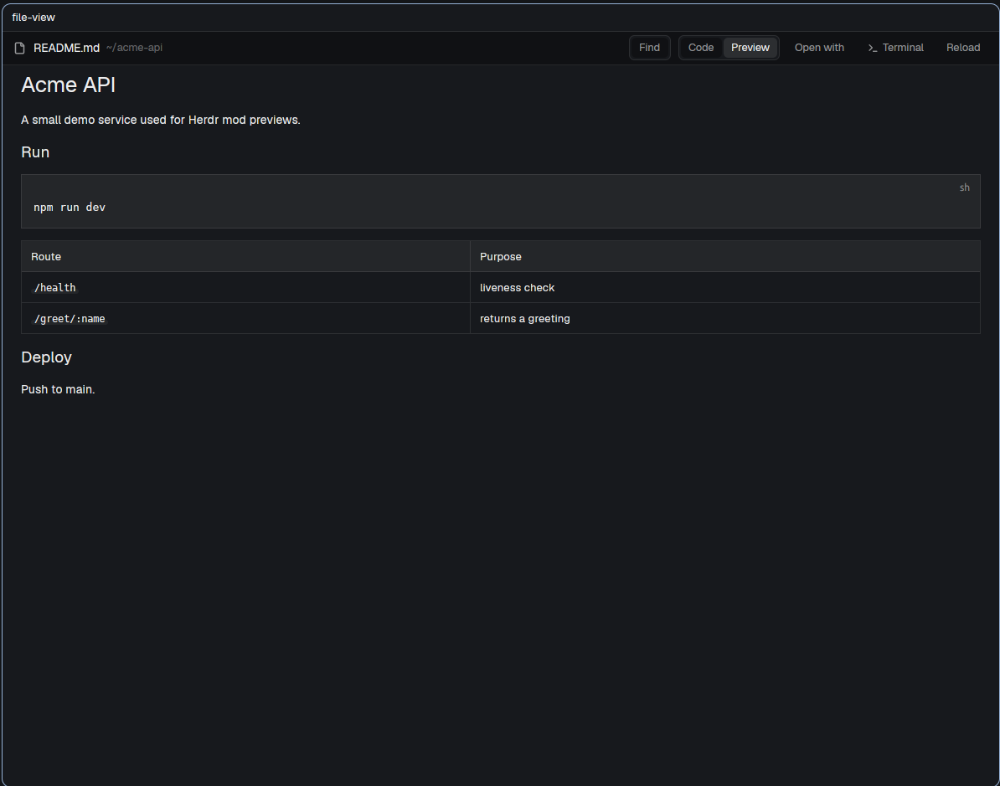

# File View



A Herdr tab that opens one file and shows it the right way: editable code with find, a rendered Markdown preview, an image/SVG viewer, an audio player, a video poster with storyboard, a PDF page viewer, a git diff, or an "Open with" screen for files it cannot show.

It has no panel of its own. Other mods (file picker, changes list, and so on) open it, so a click on a file lands in one consistent viewer instead of an external app.

## Quick start

1. Install the mod (see below) and reload Herdr.
2. Install a mod that opens files, for example `./install.sh dg-file-picker` or `./install.sh dg-changes`.
3. Open a file from it. A `.md` file opens as a rendered preview, a `.js` file as editable code.

## Install

> Read ~/.config/herdr-app/AGENTS.md, then add this mod: https://github.com/dobraga/herdr-mods/tree/main/dg-file-view

<details>
<summary>Install by hand</summary>

```sh
git clone https://github.com/dobraga/herdr-mods
cd herdr-mods
./install.sh dg-file-view
```

This links the mod into `~/.config/herdr-app/mods`; `git pull` updates it. The folder must stay named `dg-file-view`, because its helper scripts are called by that path. It needs no layout slot and no key (`"place": "none"`): other mods open it with `tab.new`.

</details>

## Usage

- **Code files**: edit in place. `Ctrl/Cmd+S` saves; a dot in the header marks unsaved edits. If the file changed on disk you get "File changed on disk" with Overwrite and Reload.
- **Find**: `Ctrl/Cmd+F` in code, Markdown and PDF; `F3` / `Shift+F3` step through matches, `Esc` closes.
- **Markdown and SVG**: open as Preview; the Code chip shows the source.
- **Diff**: shows `git diff HEAD` for one file, with Diff / File chips to switch. Tint strength comes from the `diffTint` setting written by `dg-settings`.
- **Images**: Fit, 100%, zoom, Reveal in Files, Copy path.
- **Audio**: waveform, seek, speed, volume. `Space` plays/pauses, Left/Right seek 5 s.
- **Video**: poster frame and 8-thumbnail storyboard (no playback, no sound).
- **PDF**: one page at a time, Prev/Next, zoom, text search, Copy text, Text mode. Arrow keys, PageUp/PageDown or `j`/`k` turn pages.
- **Open with**: for binary, non-UTF-8 or too-large files. Type to filter apps, `Enter` launches, "Set default" changes the default app.
- **Header buttons**: Open with, Pin (preview tabs), Terminal (opens a terminal in the file's folder), Reload.

## Requirements

- `git` for diffs.
- `python3` with Pillow (optional but wanted) and PyGObject `gi` (Gio/GLib for Open with, GStreamer for audio).
- `ffmpeg` / `ffprobe` for audio info, video frames, and HEIC/AVIF images.
- Poppler (`pdfinfo`, `pdftoppm`, `pdftotext`) for PDFs; without it they fall back to Open with.
- `gio` / `xdg-open` / `gtk-launch` (Linux desktop) to launch and reveal files.
- Icons come from the shipped `changes`, `files` and `workspace-chrome` mods; they are blank if missing.
- Reads any file a caller points it to, and writes only the file you edit. Preview images are cached under the app's `data/file-view-cache/` (pruned to 90 files / 80 MB).
- No network access beyond a token-guarded audio helper on `127.0.0.1`, which quits when the view closes or after 10 idle minutes.

See [RECIPE.md](RECIPE.md) for how it is built.

## Mermaid diagrams

The Markdown preview draws ```` ```mermaid ```` blocks with [`mmdr`](https://github.com/1jehuang/mermaid-rs-renderer), a Rust program with no browser: `cargo install mermaid-rs-renderer`. Without it, diagrams stay as code.

## Test file

`samples/markdown-test.md` exercises the Markdown preview: text styles, nested lists, task lists, tables, code blocks, Mermaid diagrams, images, HTML and footnotes. Open it in a file view and use Ctrl+F.
