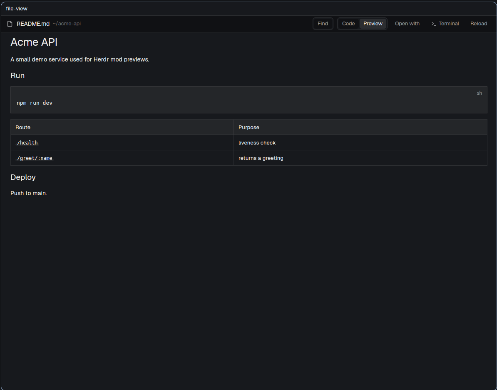

# File View

A tab that opens one file and shows it the right way: an editable code view with find, a rendered Markdown preview, an SVG/image viewer, an audio player with waveform, a video poster with a storyboard, a PDF page viewer with text search, a git diff view, or an "Open with" screen that lists desktop apps for files it cannot show. Other mods open it with `tab.new` and a `slotId`; it has no panel of its own (`"place": "none"`).



## What you see

Top to bottom, filling the tab (background = theme `background`, text 13px):

- Header bar, 36px, `chrome` background, 1px bottom border. Left to right: a 14px icon (changes icon in diff mode, file icon otherwise), the relative file path (12.5px medium, truncated), a 7px `accent` dot when the buffer has unsaved edits, the folder in dim 11.5px with the home folder shown as `~`, and a small bordered "preview" tag when the tab is a preview. On the right, small 24px buttons: Save (only while dirty/saving), a "Find" chip, mode chips (Diff / File; Unified / Split / Auto in diff mode; Code / Preview for Markdown and SVG; Page / Text for PDF), "Open with", "Pin" (preview tabs only), "Terminal", "Reload".
- Save-error strip, 32px, red tint, under the header when a save fails. "File changed on disk" adds an Overwrite button; Reload is always there.
- Find bar, 38px, `chrome` background: search icon, 320px max input, "n / total" or "No matches", Prev, Next, x.
- Body, one of:
  - Code: a code editor (13px, the app font, syntax colors from theme ansi colors). While searching, a hand-drawn line list (20px rows, 40px line-number gutter, matches `#fde047`, current match `#fb923c`, text `#1c1917`).
  - Markdown preview: lazily rendered blocks (20px side padding). Fenced code blocks are drawn by hand in a card (`raised`, 1px `border`, language tag) with `syntax.js` colors (`languageByTag`; `diff` colors +/-/@@ lines; unknown languages are plain; over 400 lines falls back to the plain view). Before splitting, `mdPrep` rewrites what the view cannot draw: `<details>` becomes its bold `▾ summary` and the body, `[^n]` a superscript number with the notes listed under a rule at the end, and `Term` + `: text` a bold term and a `↳` line. A ```` ```mermaid ```` block is drawn as a PNG made by `mmdr` (cached by hash, in the theme's colors, shown in a box of at most 900x480; click opens a zoom view with Prev/Next across the page's diagrams). Until it is ready, or if it fails, the block stays as code with `mermaid: <error>` under it. With a search active, blocks that contain hits are redrawn by hand (headings, lists, quotes, tables, bold, inline code) with the same highlight colors.
  - Diff: 20px lines (a row is `lines * 20 + 2`), hunk header rows on `raised` (the whole header is the Stage/Unstage button where allowed), 36px line-number gutter, `+` rows tinted ansi2 and `-` rows tinted ansi1 (`diffTint`, default 10% alpha), changed words on a stronger tint (`min(60, 3 × diffTint)` %), light per-line syntax coloring. Gap rows ("Show N of M unchanged lines" / "Hide") sit before each hunk and after the last one. Unified draws one column; Split draws old left and new right, each with its own number gutter, the shorter side padded and an empty side as a `raised` filler.
  - Image / SVG: image in a bordered 8px-radius stage, bottom 38px toolbar: Fit, 100%, -, +, zoom %, "w x h", format, size, Reveal in Files, Copy path.
  - Audio: 640px max card with 72px cover (or file icon), title, artist/album, codec/sample rate/channels/bitrate/size, a 72-bar waveform, seek slider, -10s / Play / +10s, speed, Vol/Muted, volume slider, hint "Space: Play/Pause".
  - Video: poster frame, seek slider, a storyboard of 8 thumbnails, details, Reveal, Copy path, "Open with..." (no sound, no playback).
  - PDF: one rendered page, bottom bar with Prev/Next, page slider, Search, Fit W, Fit P, -, +, zoom %, Copy text, Reveal, Copy path. Text mode shows extracted text in a read-only editor with `--- Page N ---` separators.
  - Open with: centered card (680px max) with a type badge, file name, MIME and size, buttons "Open with <default app>", "Reveal in Files", "Copy path", "Back (Esc)", a filter input, then "Recommended" and "All installed applications" rows (28px colored letter tile, name, Default / Flatpak / Snap tags, "Set default" button).
- Empty or closed slot: centered dim "File no longer open".

## How it behaves

- Input props: `slotId`, `path`, `root`, `kind` ("file" default, "diff", "open-with"), `on` (remote machine name or null), `name`, `preview` (default true), `spaceId`, `updatedAt`, `beforeTabs` (array of tab ids that must not be claimed). The live slot is read from `shared("file-view.slots")[slotId]`, so another mod can retarget the tab by rewriting its slot; a changed `kind:root:path:on` key resets and reloads the view.
- Claiming its tab: the view finds the `dg-file-view` pane that is not claimed by another slot (preferring the active tab of the slot's space), stores `tabId` in the slot and renames the tab to `slot.name`. It retries after 80 ms.
- Files: text up to 1 MiB is read (edit buffer capped at 400,000 chars, shown truncated and read-only above that). Extension picks the kind: png jpg jpeg webp gif bmp ico tiff tif avif heic heif (image); mp3 wav flac ogg oga opus m4a aac wma aiff aif (audio); mp4 mkv webm mov avi m4v wmv flv mpeg mpg ogv (video); pdf. Remote files (`on` set) never use media preview or Open with. A non-UTF-8, binary or too-large file falls back to the Open with screen with the reason as a badge. A broken symlink, a directory or a vanished file shows a plain message.
- Editing: Ctrl/Cmd+S saves. The write passes the text last read from disk, so an outside change gives "File changed on disk" with Overwrite (re-reads, then writes) and Reload. First edit of a preview tab pins it (clears `preview` in the slot). The open folder is watched; a clean, non-media view reloads on change.
- Find: Ctrl/Cmd+F opens the bar in code and Markdown files, F3 / Shift+F3 steps, Esc closes, Enter / Shift+Enter in the input steps. Case-insensitive. In PDFs Ctrl/Cmd+F searches extracted text by page and jumps to the first matching page.
- Markdown opens in Preview, SVG opens in Preview; the Code chip switches back.
- Diff: runs `git --literal-pathspecs diff --full-index --src-prefix=a/ --dst-prefix=b/ --no-renames [--cached | HEAD] --no-ext-diff --no-textconv --no-color -- <file>` for the one file (`--cached` in the Staged tab, `HEAD` in the combined view, nothing extra in Changes; untracked/new-without-HEAD files show as all-added). The prefixes and `--no-renames` stop user diff settings (noprefix, mnemonicPrefix, renames) from breaking the parse, and `--full-index` gives the blob ids that expand needs. `w` reruns it with `-U100000` (whole file, no gaps, no staging). Max 3000 rows, lines cut at 1200 chars. Unchanged lines between hunks are read from the old blob with `git cat-file blob <old> | awk` (80 lines per click, 640 at most per gap). A reload whose raw text is unchanged keeps the expansion and scroll. Stage/Unstage: `guard` (git-guard), then the raw diff is re-read and must match what is shown, then `sh -c` pipes the one hunk patch to `git apply --cached [--reverse]`. A module-level `staging` set allows one apply per checkout at a time, then the view reloads. Messages: "Not a git repository", "No uncommitted changes for this file", "Binary file changed or no text diff available". Diff / File chips switch mode in place. Tint strength comes from `shared("files-tabs.settings").diffTint` (0 to 30, default 10).
- Audio: playback is a background helper process; Space toggles, Left/Right seek 5 s, speeds cycle 1, 1.25, 1.5, 2, 0.75. Opening Open with pauses playback. Changing file stops it.
- PDF keys (page mode, search closed): Left/PageUp/k/p previous, Right/PageDown/j/n/Space next, Home/End first/last, +/= and - zoom (0.5 to 2.5). DPI is 150, 220 when manually zoomed past 1.3. Neighbor pages are prefetched; the page cache keeps 24 pages. Encrypted PDFs go to Open with as "Password-protected PDF".
- Open with: typing filters (every word must match name, description, executable or id); Up/Down or Ctrl+N/Ctrl+P move, Enter launches, Esc clears the filter then goes back. After launching from an unsupported/"open-with" tab with other tabs in the space, the tab closes itself (`tab.close`, `confirmed: true`) and its slot is deleted. "Set default" changes the MIME default app and raises a success toast.
- Buttons: Terminal runs `terminal.open {place: "right", folder: slot.root}`; Pin clears `preview`; Reload forces a reload.

## Built from

Files in `mods/dg-file-view/` (no art of its own):

- `mod.json`: `{"place": "none", "title": "File View"}`.
- `main.js`: the `FileView` class (default export), mode switching, editor, search, diff loading, fold/expand, hunk staging, keys, all layout.
- `diff-model.js` (adapted from herdr-powertools `diff.js`): `parse(text, {capture})` returns `{header, hunks, binary, cut, conflict, oldBlob, newFile, deletedFile}`; `added`, `hunkPatch(parsed, i)` (null when unsafe: cut, binary, conflict, any mode change or a mode other than 100644/100755, multi-hunk new or deleted files, NUL or over 20000 chars), `gaps`, `unified(d, expanded)`, `split(d, expanded)`, `widest`. Hunk header rows keep `kind: "@"`, so `colorRows()` still resets on them.
- `diff-words.js` (adapted from upstream `words`): `words(text, other, budget)`, an LCS over word tokens that returns null when under 30 % is in common, over 300 tokens, or when the per-file budget (`BUDGET`, 6e6 cells) is spent; `markTokens(tokens, marks)` cuts syntax tokens at mark boundaries and sets `marked`.
- `diff-layout.js` (ours): `wrapDiffRow`, `layoutUnified`, `layoutSplit` (both return `{wrapped, sizes}`), `colsFor`, `pickLayout(mode, paneCols, doc)` for Auto, `DIFF_LINE_H = 20`.
- `git-guard.js` (adapted from upstream): `probe`, `guard(run, git, expect)` (refuses during a rebase, merge, cherry-pick, revert or bisect, or when the checkout, branch or a ref moved), `APPLY` and `applyArgs(patch, reverse)`. `run` and `git` are injected, so it is testable with node.
- `syntax.js`: dependency-free line tokenizer shared by diff rows, the code search list and the Markdown code cards (`languageOf(path)`, `languageByTag(fence tag)`, `tokenize`, `colorRows`). Families: js/ts, C-like (C, C++, Java, Kotlin, Swift, PHP, C#, Zig...), Go, Rust, CSS, JSON, Python, shell, Ruby, Lua, YAML/TOML/INI/HCL, SQL, HTML/XML, Markdown, plus generic `#` and `--` comment families (R, Julia, Elixir, Perl, Haskell...). A file or fence of any other language is drawn plain, like the Editor does. No coloring above 5000 diff rows, 20000 search lines or 400-char lines.
- Code files are generic: the same Ctrl/Cmd+F bar, hit coloring, gutter, scroll-keeping Esc and syntax colors apply to every text file the Editor opens; only Markdown has its own rendered preview.
- `open-with-ui.js`: `runPythonHelper`, Open with screen, app filtering.
- `media-ui.js`: image, audio, video and PDF views plus the bridge calls and the audio HTTP client.
- `open-with.py`: `inspect`, `launch`, `set-default`, `reveal` commands (JSON on stdout).
- `media-helper.py`: `image-info`, `audio-info`, `video-info`, `video-frame`, `audio-start`, `pdf-info`, `pdf-page`, `pdf-text`.
- `audio-daemon.py`: GStreamer `playbin` server on 127.0.0.1 with a random port and `X-Token` header; endpoints `/status`, `/play`, `/pause`, `/seek`, `/volume`, `/rate`, `/quit`; exits after 600 s idle or when its parent process dies.

herdr functions used: `props`, `shared`, `setShared`, `spaces`, `panes`, `focused`, `run`, `exec` (with `cwd` and `on`), `readTextFile`, `writeTextFile` (with the expected old text), `watchFolder`, `theme`, `settings` (`font_family`, `zoom`), `home`, `checking`, `notify`, `appHome`. Commands: `tab.rename`, `tab.close`, `terminal.open`. UI kit: `gpui-kit` and `gpui-base` (View, Editor, EditorState, TextView.markdown, Input, Slider, virtual lists, Scrollbar, `image`, `svg`).

Shipped mods used (icons only): `mods/changes/changes.svg`, `mods/files/file.svg`, `mods/workspace-chrome/pin.svg`, `mods/workspace-chrome/terminal.svg`, `mods/workspace-chrome/search.svg`.

Programs run (via `exec` or spawned by the helpers): `git` (`rev-parse`, `status`, `diff`, `cat-file`, and `apply --cached` for Stage/Unstage hunk through `sh -c`; reads use `--no-optional-locks`), `/usr/bin/python3` (falls back to `python3`), `ffmpeg` / `ffprobe` (images that Pillow cannot open, audio info and waveform, video poster and frames), `pdfinfo` / `pdftoppm` / `pdftotext` (Poppler), `gio` / `xdg-open` / `gtk-launch` / `open` (launch, reveal, set default), a D-Bus `org.freedesktop.FileManager1.ShowItems` call, and `audio-daemon.py`. Python modules: Pillow (optional but wanted), PyGObject `gi` with Gio/GLib (Open with, and Gst for the audio daemon).

`shared()` keys: reads and writes `file-view.slots` (`{slotId: {spaceId, tabId, kind, path, root, on, name, preview, updatedAt}}`); reads `files-tabs.settings.diffTint`.

Network: none off the machine. The audio client uses `fetch` to `http://127.0.0.1:<port>` of its own token-guarded daemon.

Files outside its folder: reads any file the slot points to; writes only the edited file and, on Stage/Unstage hunk, the git index of that checkout; writes previews to `<appHome>/data/file-view-cache/` (pruned to 90 files / 80 MB); a temp file `herdr-audio-*.json` while starting audio.

Sibling mods: `dg-file-view` provides the tab; `dg-changes`, `dg-file-picker`, `dg-tasks`, `dg-loadout` create slots and call `tab.new {mod: "dg-file-view", props: {slotId, ...entry, beforeTabs}}` after writing `file-view.slots`; `dg-tabs` and `dg-spaces` read `file-view.slots` for tab names/icons and close preview tabs; `dg-settings` writes `files-tabs.settings` (diffTint).

## Watch out

- It runs programs and reads outside its folder: anything the slot path names, plus the programs above. It does not touch the network beyond the local loopback audio daemon. Say so before installing.
- Linux desktop assumptions: Gio/D-Bus/`gio` for Open with, GStreamer for audio. Without `gi` it falls back to `gtk-launch` / `gio mime`; without GStreamer audio will not play; without ffmpeg video, audio info and HEIC/AVIF fail; without Poppler PDFs fall back to Open with.
- Media helpers are called as `<appHome>/mods/dg-file-view/<script>.py`, so the folder name must stay `dg-file-view`. Previews are cached under `data/file-view-cache/` and referenced by a `data/...` relative path.
- The slot must exist in `file-view.slots` before `tab.new`; a bare `tab.new` without `slotId`/`path`/`root` props shows "File no longer open".
- Icons come from shipped mods `changes`, `files`, `workspace-chrome`; if one is missing the icon is blank.
- Markdown/code search redraws the view by hand because the editor cannot highlight or scroll to matches; the markdown match renderer handles only headings, lists, quotes, tables, bold and inline code.
- Hunk staging writes the git index, not the working tree. It refuses during a rebase, merge, cherry-pick, revert or bisect, and when the checkout, branch or HEAD changed since the diff was loaded (`guard`). If the raw diff changed since it was shown it refuses with "File changed, try again". Unstage (`--reverse`) is offered only in the Staged tab.
- Remote checkouts (`on` set) have no folder watch, so after a stage the other stage tab stays stale until it is reloaded. This is accepted.
- Auto decides only once the width is known (it is 0 on the first frame) and falls back to Unified, so it does not flip while the view settles.
- Markdown search: up to 600 blocks the preview is one plain scroll area (`ScrollHandle`, every block laid out as it really is), and a search only repaints the blocks with hits in place, so nothing shifts and closing the search keeps the scroll position; Prev/Next `scroll_to_item` the hit's block. Past 600 blocks it falls back to a lazy `list`, and a search switches to a separate fixed-height list that restarts at the top.
- The Markdown view draws no color, collapsing details, real footnotes or definition lists itself; code cards and `mdPrep` stand in for them. Inline text stays uncolored.
- Mermaid needs `mmdr` (a Rust program, no browser): `cargo install mermaid-rs-renderer`, or `brew tap 1jehuang/mmdr && brew install mmdr`. It is looked up on `PATH`, then `~/.cargo/bin`, `/opt/homebrew/bin`, `/usr/local/bin`, `~/.local/bin`. Without it diagrams stay as code. There is no other renderer.
- Video preview is frames only: no playback, no sound.
- Closing the view quits the audio daemon; it also quits on its own after 10 idle minutes.
- `checking()` is true during `herdr-app check`; the mod must skip loading then.
- Sliders emit events when set from code; a guard flag (`updatingSliders`) is needed to avoid feedback loops.

## Done when

- `herdr-app check mods/dg-file-view` passes.
- Opening a slot for a `.js` file shows editable code; typing shows the dot and Save; Ctrl+S writes and clears it.
- Editing the file elsewhere then saving shows "File changed on disk" with Overwrite and Reload.
- A `.md` file opens as Preview and the Code chip shows the source; Ctrl+F highlights hits in both.
- A `kind: "diff"` slot for a modified tracked file shows green/red rows with Diff and File chips; an unchanged file says "No uncommitted changes for this file".
- A PNG, an MP3, an MP4 and a PDF each open their own view; Space plays/pauses audio, arrow keys page the PDF.
- A binary non-media file opens the Open with screen with a reason badge, a filter box and app rows; Enter launches the highlighted app.
- With `on` set, no media preview or app launching is attempted.
- Reload re-reads the file, Terminal opens a terminal to the right in the file's folder, Pin clears the "preview" tag.
- A diff of a changed tracked file shows changed words on a stronger tint; `s` and the Unified / Split / Auto chips switch layout, and the choice survives a reopen.
- "Show N of M unchanged lines" adds 80 lines per click up to 640 per gap, "Hide" folds it back, and `w` shows the whole file with no gaps.
- In the Changes tab, a click on a hunk header stages that hunk (`git diff --cached` then shows it); in the Staged tab it unstages it. No button in the combined view or in whole-file mode. During a rebase or merge, or after the file changed, it refuses with a notice.
