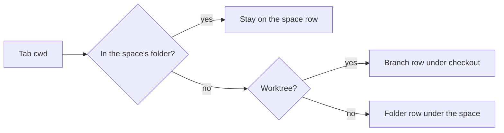
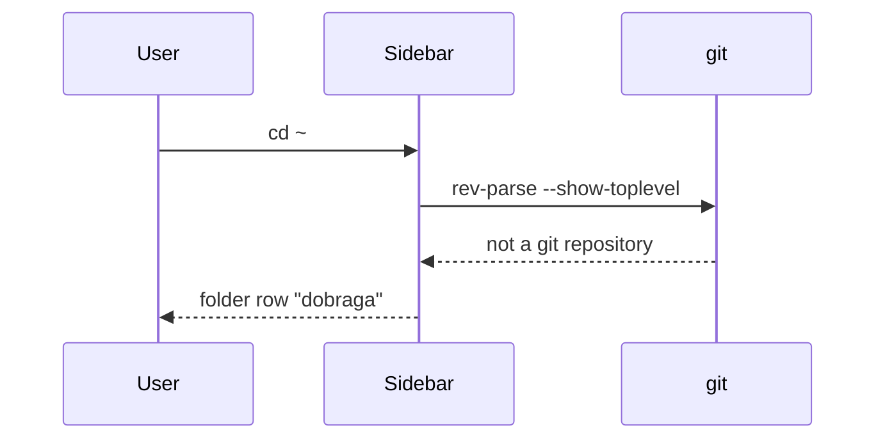
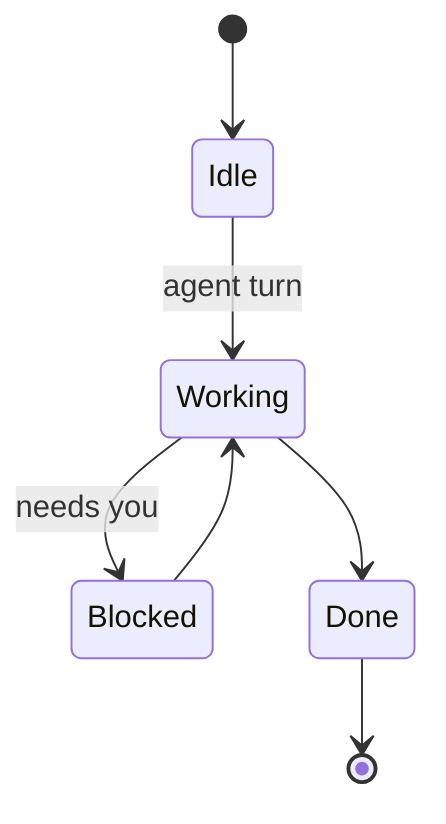
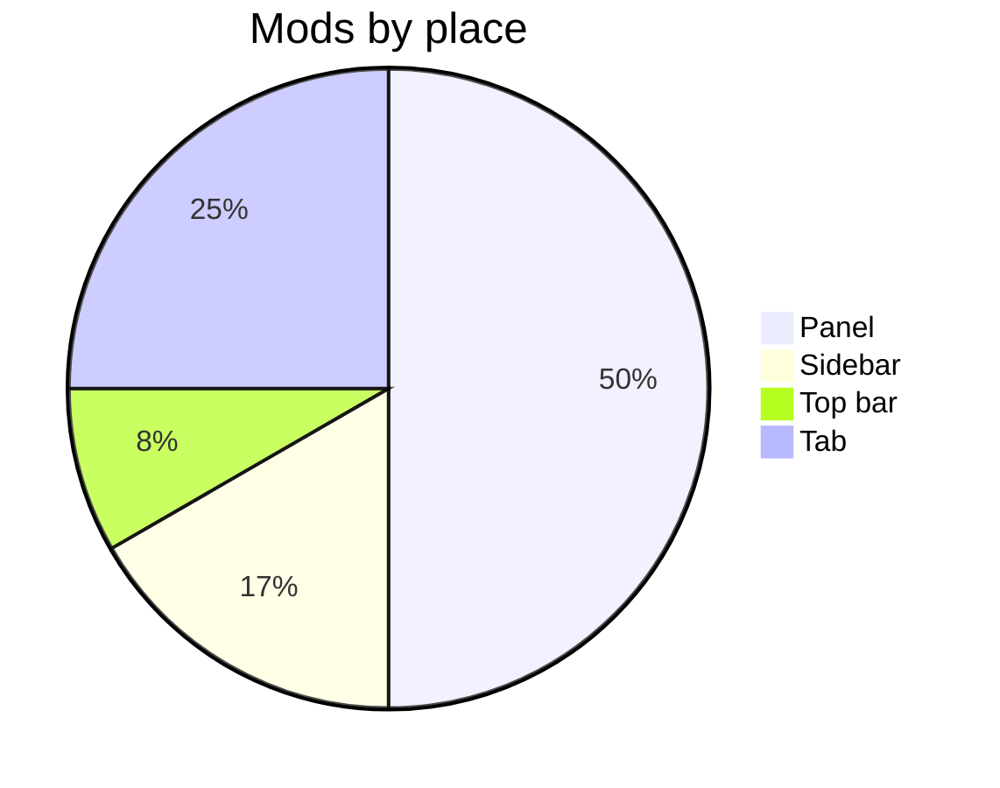

# Markdown test page

A sample for the file view's Preview. Use Ctrl+F to check that search highlights work in each section.

## Text styles

Plain text with **bold**, *italic*, ***bold italic***, ~~strikethrough~~, `inline code` and a [link](https://example.com).
A second line in the same paragraph, then a hard break.  
After the break: an auto link <https://example.com> and an escaped \*star\*.

> A blockquote with **bold** inside.
>
> > A nested quote.

---

## Lists

- Item one
- Item two
  - Nested item
    - Deeper item
- Item three

1. First
2. Second
   1. Sub-step
   2. Another sub-step
3. Third

- [x] Done task
- [ ] Open task
- [ ] Another open task

## Tables

| Mod | Place | Status | Notes |
|:----|:-----:|-------:|-------|
| dg-tabs | top bar | stable | Drag a tab to split |
| dg-spaces | sidebar | stable | Folder rows for other places |
| dg-file-view | tab | **new** | This page |
| dg-tasks | panel | beta | `scheduler` runs jobs |

| Short | Wide column with a long text that should wrap or truncate depending on the renderer |
|-------|------------------------------------------------------------------------------------|
| a | Lorem ipsum dolor sit amet, consectetur adipiscing elit, sed do eiusmod tempor incididunt ut labore |

## Code

```js
// JavaScript
export function groupTabs(rows, ps, git) {
  const out = rows.map((r) => ({ ...r, items: [] }));
  return out;
}
```

```python
# Python
from pathlib import Path

def read(path: Path) -> str:
    return path.read_text()
```

```bash
git worktree add ../herdr-mods-feat -b feat/x
bun test dg-spaces/tests
```

```json
{ "name": "dg-file-view", "place": "none", "tags": ["a", "b"], "n": 3 }
```

```diff
- const mains = new Set(rows.filter((r) => r.g && !r.g.linked));
+ const home = homeOf(r, ps);
```

```
A fenced block with no language.
```

## Mermaid









## Images and HTML


<details>
<summary>Raw HTML details (may show as plain text)</summary>

Hidden content.

</details>

## Footnotes and misc

A sentence with a footnote.[^1] Emoji: ✅ ⚠️ 🚀. Non-ASCII: ação, coração, 日本語.

Term
: Definition list entry (extension, may not render).

[^1]: The footnote text.

## Long line

Supercalifragilisticexpialidocious_and_an_extremely_long_unbroken_token_that_has_to_wrap_or_scroll_without_breaking_the_layout_of_the_preview_pane_0123456789.
