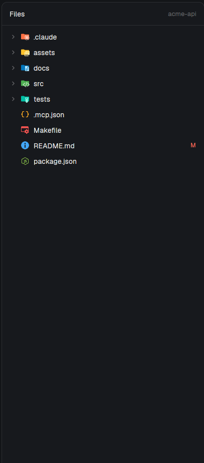

# Files Tabs



A side panel that lists the folder you are working in as a lazy file tree. Single-click a file and it opens as a preview tab in the main area (the next single click reuses that tab); double-click pins it. Files get Material-style icons and git status letters, and the tree follows whichever file tab is active.

## Quick start

1. Install the mod (see below) together with `dg-file-view`, the mod that shows the opened files.
2. Put `dg-files` in a panel slot of your layout.
3. Click a file in the tree: it opens as a preview tab.

## Install

Ask your agent:

> Read ~/.config/herdr-app/AGENTS.md, then add this mod: https://github.com/dobraga/herdr-mods/tree/main/dg-files

<details>
<summary>Install by hand</summary>

```sh
git clone https://github.com/dobraga/herdr-mods
cd herdr-mods
./install.sh dg-files
./install.sh dg-file-view
```

This links the mod into `~/.config/herdr-app/mods`; `git pull` updates it.

The mod has `"place": "none"`, so it does not appear by itself. Add it to a block of your layout:

```json
{
  "id": "files",
  "type": "block",
  "content": { "mod": "dg-files" }
}
```

</details>

## Usage

- The panel shows "Files" and the base name of the current folder. The folder is the focused pane's working directory; switching pane or space re-roots the tree.
- Click a folder to expand or collapse it. With `accordion` on (default), opening a folder closes the open folders that are not on its path.
- Click a file to open it as a preview tab; double-click to pin it.
- Right-click a row for "Open with…" (local files only), "Copy relative path" and "Copy full path".
- Rows show `A`, `M`, `D` or `U` git marks inside a git repository.
- With `followActive` on (default), switching to a file tab expands its folders and highlights its row.
- Settings `accordion`, `materialIcons` (off gives plain folder and file icons) and `followActive` are read from the shared `files-tabs.settings` value, seeded from `<appHome>/data/files-tabs/settings.json` if that file exists. Each is on unless set to `false`.
- At most 500 entries per folder and 5,000 in total are listed.
- The mod defines no keys.

## Requirements

- The `dg-file-view` mod, installed under that name, to display opened files.
- `git` and `sh` on the machine of the focused pane (`powershell` on Windows). They run repeatedly while the window is focused, about every 10 seconds and on file changes.
- It reads folder listings and git status of the folders you browse (names only, not file contents) and the optional settings file above.
- It does not use the network.

Derived from Herdr's files mod (Apache-2.0), see [NOTICE](../NOTICE).

See [RECIPE.md](RECIPE.md) for how it is built.
