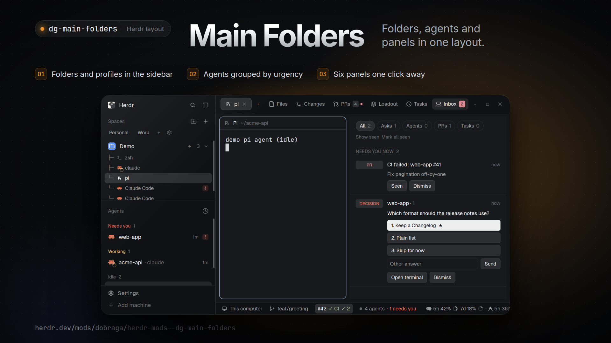

# dg-main-folders



A Herdr layout for working with several projects and agents at once. A sidebar groups your spaces in colored folders and lists every running agent by urgency. A tab bar sits over the terminals and carries six tool panels (Files, Changes, PRs, Loadout, Tasks and Inbox), and a status bar at the bottom shows the branch, PR and CI state, agent count, usage and system load.

It is built from the `dg-*` mods of this repo, each installed from its own folder.

## Quick start

1. Install the layout and its mods (see below).
2. Pick `dg-main-folders` in Settings > Look.
3. Open a project in a space, and click Files, Changes, PRs, Loadout, Tasks or Inbox in the tab bar to open a panel.

## Install

Copy this prompt into your Herdr agent:

> Read ~/.config/herdr-app/AGENTS.md, then add this layout: https://github.com/dobraga/herdr-mods/tree/main/dg-main-folders

[RECIPE.md](RECIPE.md) guides the install. The agent reads every file first, copies the layout to `layouts/`, adds each mod from its folder in this repo to `mods/`, and never overwrites a mod with the same name.

<details>
<summary>Install by hand</summary>

From a clone of the repository:

```sh
git clone https://github.com/dobraga/herdr-mods.git ~/src/herdr-mods
cd ~/src/herdr-mods
./install.sh --setup
```

This links every `dg-*` mod into `~/.config/herdr-app/mods/`, links the layout as `~/.config/herdr-app/layouts/dg-main-folders.json`, and links `keys.json` if you have none. `git pull` updates all of it. If you already have a `keys.json`, merge [keys.json](keys.json) into it:

```json
{ "global": { "ctrl-p": "mod.open:dg-file-picker", "ctrl-t": "mod.open:dg-new-tab", "ctrl-,": "mod.open:dg-settings" } }
```

</details>

## Usage

- **Sidebar:** spaces in folders on top (`dg-spaces`), agents by urgency below (`dg-agents`), Settings and Add machine at the bottom (`dg-workspace-chrome`).
- **Tab bar:** the tabs of the active space, the `+` button, and one button per panel with live badges (`dg-tabs`).
- **Panels:** one at a time on the right. Each follows the focused terminal's folder, so every space shows its own files, changes and pull requests.
- **Status bar:** branch, PR chip and CI state, agent count, Claude and Antigravity usage, and CPU, memory, disk and network (`dg-workspace-status`).
- **Keys:** `ctrl-p` Quick Open, `ctrl-t` new tab, `ctrl-,` Settings, `alt-up` and `alt-down` previous and next space.

## Requirements

- The `dg-*` mods of this repo (`./install.sh --setup` links them all; the agent install adds each from its folder).
- [herdr-chat](https://github.com/dobraga/herdr-chat) for `new-chat` and `chat-menu`, which the layout uses for the floating new-chat block and the terminal menu. Without `new-chat` Herdr shows its own layout and lists what is missing.
- `bun` for the Tasks scheduler (`./install.sh` installs it as a login service); `gh` for the PRs panel.
- Written against Herdr 0.1.10 layouts.

See [RECIPE.md](RECIPE.md) for how it is built.
