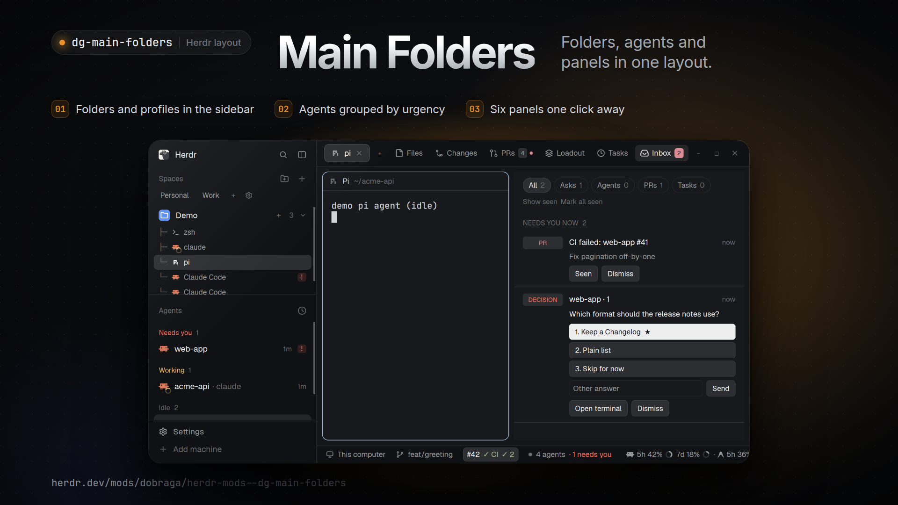

# dg-main-folders

A Herdr layout built on the shipped `main` layout: a spaces and agents sidebar on the left, a tab bar over the terminals, a stacked tool panel on the right (files, changes, PRs, loadout, tasks, inbox) and a status bar at the bottom. Everything except the brand header, the pane header and the new-chat menu comes from the `dg-*` mods in this repo.

## What you see

- Window: `titlebar: none`, traffic lights at `[12, 16]`, `canvas` background, terminal padding `[14, 12]`, 1px `border` dividers.
- Left column (`sidebar`, 268px, min 44, max 480, `chrome` background, not resizable):
  - `brand`, 46px, draggable window area: shipped `workspace-chrome`.
  - Two equal blocks (weight 1, min 90px): spaces (`dg-spaces`), then agents (`dg-agents`).
  - `sidebar-footer`, 69px: `dg-workspace-chrome` with `props {footer: true}`.
- Middle column (`work`):
  - `tabs`, 42px: `dg-tabs`.
  - `main`: the active tab's terminals. Panes have an 8px gap, 10px radius, `background` fill, 1px `border`, and a 1px `accent` border when focused; a lone pane keeps its frame (`lone: true`). Each pane has a 30px header, always visible at the top, drawn by the shipped `pane` mod.
  - `panel`, right of `main`, 368px (min 280, max 900): a stack with one visible block at a time: `dg-files`, `dg-changes`, `dg-prs`, `dg-loadout`, `dg-tasks`, `dg-inbox`.
  - `status`, 28px, under both: `dg-workspace-status`.
- A floating block `new-chat-commands` anchored at the bottom start, showing shipped `new-chat` with `props {role: "commands"}`. `terminal_menu` is `chat-menu`.
- Toasts come from `dg-desktop-toast` (`toast` key of the root).

## How it behaves

- Agent status (working, blocked, done, idle) shows in the agents list and the status bar through `dg-agents` and `dg-workspace-status`; `dg-inbox` collects questions and notifications and `dg-desktop-toast` raises desktop notifications.
- Each tool panel mod follows the focused pane's folder, so every space shows its own files, changes and PRs.
- The keys that go with it are in `keys.json` (for example `ctrl-p` Quick Open, `ctrl-t` new tab, `ctrl-,` Settings, `alt-up` / `alt-down` next and previous space). Merge them into yours.
- The sidebar cannot be dragged to resize (`resizable: false`); the panel can (280 to 900px).

## Built from

- Layout file: `layouts/dg-main-folders.json` (`cloned_from` shipped `main` 0.1.10). Its keys are in `keys.json`, under `layout:dg-main-folders`.
- Shipped mods: `workspace-chrome` and `pane`. `new-chat` and `chat-menu` come from [herdr-chat](https://github.com/dobraga/herdr-chat) (the floating new-chat block and the terminal menu).
- Mods from this repo (each is a folder of this repo, with its own `RECIPE.md`: `https://github.com/dobraga/herdr-mods/tree/main/<name>`; install them first): `dg-spaces`, `dg-agents`, `dg-workspace-chrome`, `dg-tabs`, `dg-files`, `dg-changes`, `dg-prs`, `dg-loadout`, `dg-tasks`, `dg-inbox`, `dg-workspace-status`, `dg-desktop-toast`. Opening files needs `dg-file-view`, Quick Open `dg-file-picker`, the + buttons `dg-new-tab` and `dg-new-menu`, and the Settings rows `dg-settings`.
- Nodes: root row, `sidebar` column (`brand`, `sidebar-lists` column, `sidebar-footer`), `work` column (`tabs`, `work-body` row of `main` + `panel` column with a `panel-body` stack, `status`).

## Watch out

- The layout references mods by name: the `dg-*` folders must exist in `~/.config/herdr-app/mods/` before switching, or Herdr shows its own layout and says which mods are missing. `new-chat` (herdr-chat) counts: without it the layout does not load.
- `dg-prs` runs `gh`/`git` and `dg-tasks` runs a background service; read their recipes before adding.
- The stack has no built-in switcher: the `dg-*` panel mods and the author's keys choose which block is visible.
- Written against Herdr 0.1.10 layouts.

## Done when

- `herdr-app check` passes for every `dg-*` mod and `layout.error` is empty after the layout is copied to `layouts/`.
- `layout.switch {name: "dg-main-folders"}` shows the sidebar, tab bar, panel and status bar described above.
- Focusing a terminal in another repo changes what the files and changes panels list.
