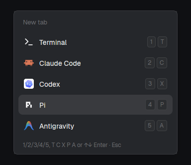

# New tab



A small centered dialog for opening a new tab. It lists "Terminal" plus every agent TUI installed on your machine (Claude, Codex, Pi, and so on). Pick one with a number, a letter, the arrow keys or a click, and a new tab opens in the same space and folder as the terminal you were in, running that program.

## Quick start

1. Install the mod (see below).
2. Bind a key to it in `~/.config/herdr-app/keys.json`, for example `"ctrl-t": "mod.open:dg-new-tab"`.
3. Press the key, then press `1` (or `T`) for a plain terminal, or an agent's number or letter.

## Install

Ask your agent:

> Read ~/.config/herdr-app/AGENTS.md, then add this mod: https://github.com/dobraga/herdr-mods/tree/main/dg-new-tab

<details>
<summary>Install by hand</summary>

```sh
git clone https://github.com/dobraga/herdr-mods
cd herdr-mods
./install.sh dg-new-tab
```

This links the mod into `~/.config/herdr-app/mods`. Run `git pull` in the clone to update it.

The mod never docks (`"place": "none"`) and never opens itself, so something has to open it. A key binding in `keys.json` works:

```json
{ "ctrl-t": "mod.open:dg-new-tab" }
```

You can also run `herdr-app do mod.open --name dg-new-tab`.

</details>

## Usage

- The dialog lists "Terminal" first, then each installed agent, each with an icon, a number badge (1-9) and a letter badge.
- The row matching the program of the terminal you came from starts selected. A plain shell selects "Terminal".
- `1`-`9` opens that row. A letter opens the row with that letter: `t` Terminal, `c` Claude, `a` Antigravity, `x` Codex, `p` Pi. Other agents get the first letter of their name, unless it is already taken.
- `up` / `down` move the selection (wrapping), `tab` moves down, `enter` opens the selected row, `escape` closes the dialog.
- Clicking a row opens it. Hovering highlights it.
- The new tab goes into the space of the focused terminal, using its working directory as the folder. For an agent row, the tab starts that agent.
- It is only a launcher: no agent status is shown and it has no settings. It keeps a cache of the agent list in Herdr's shared state (`new-tab.agents`) so the list appears instantly next time.

## Requirements

- A Herdr version that provides `knownAgents()`, `closeOverlay()`, shared state and `tab.new` with `argv` and `name`.
- No network access and no files read outside its folder. It runs no programs itself: Herdr starts the chosen agent.
- The agents shown are whatever is installed on your machine. None is required, and "Terminal" always works.
- The "Terminal" row uses `icons/shell.svg` from Herdr's own icons folder (`~/.config/herdr-app/icons/`), not from the mod.

See [RECIPE.md](RECIPE.md) for how it is built.
