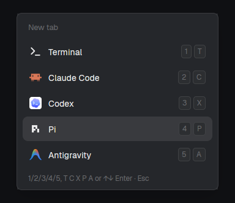

# New tab

A small centered dialog that opens when you want a new tab. It lists "Terminal" plus every agent TUI installed on the machine (Claude, Codex, Pi, and so on). Pick one with a number, a letter, the arrow keys or a click, and a new tab opens in the same space and folder as the terminal you were in, running that program.

## What you see

- A 300px wide modal dialog (overlay kind `dialog`) with an 8px padding, background `theme().popover`, text `theme().foreground`.
- A small heading "New tab" (11.5px, `theme().dim`).
- One row per choice, each 36px high, 10px horizontal padding, 10px gap, 8px rounded corners:
  - an 18x18 icon on the left. The "Terminal" row uses `icons/shell.svg` drawn as a tinted SVG (colored `theme().foreground`). Agent rows use the agent's own `icon`; if the agent marks `tint`, it is drawn as a tinted SVG, otherwise as a plain image.
  - the label (13px, `theme().foreground`), filling the middle.
  - on the right, small badges (11px, `theme().dim`, 1px `theme().border`, `theme().raised` background, 4px radius): the row number 1-9 and the shortcut letter in upper case.
- The first row is always "Terminal". Agents follow in the order `knownAgents()` returns them.
- A footer hint (10.5px, `theme().dim`) built from the real list, for example `1/2/3, T C X or ↑↓ Enter · Esc`.

## How it behaves

- Selection: the row matching the program of the terminal that had focus when the dialog opened starts selected (selected rows use `theme().selected`; hover uses `theme().hover`). If that terminal runs a plain shell or an unknown program, "Terminal" is selected. Aliases are normalized (`claude-code` is `claude`, `antigravity` is `agy`).
- Keys, handled by the dialog while it has focus:
  - `1`-`9`: open that row.
  - A letter: open the row with that letter. Fixed letters: Terminal `t`, claude `c`, agy and antigravity `a`, codex `x`, pi `p`. Any other agent gets the first letter of its name. A letter already taken gets none (no badge, no key).
  - `up` / `down`: move the selection, wrapping around. `tab` moves down.
  - `enter`: open the selected row.
  - `escape`: close the dialog.
- Click on a row opens it.
- Opening runs `tab.new` once (a `done` flag blocks double opens), after closing the dialog. The new tab gets the space of the focused terminal (or the active space) and the focused terminal's cwd as its folder (or the space's folder). For an agent row it also passes the agent's `name` and `argv` (the agent's `run`), so the tab starts that agent. For "Terminal" it passes only space and folder.
- The dialog grabs keyboard focus on open and again after 120 ms (the overlay can steal it while mounting).
- Agent list: starts from the cached list (shared key), then refreshes from `knownAgents()` in the background and re-renders. Only agents with `installed` true and `agent !== false` are shown. If the lookup fails, the cached list (or just Terminal) stays.
- No agent statuses (working, blocked, done, idle) are shown; this is only a launcher.

## Built from

- Files: `mod.json`, `main.js`, and `icons/shell.svg` (the Terminal row's icon). Agent icons come from `knownAgents()`, not from this folder.
- `mod.json`: `{ "place": "none", "title": "New tab", "focusable": true, "overlay": { "kind": "dialog", "width": 300 } }`. `place: none` means it is never docked; it only exists as an overlay. No `props` roles are declared; at runtime it reads `props().overlay` only to close itself.
- Imports: `View, div, svg, image` from `gpui-kit`; `h_flex, v_flex` from `gpui-base`; from `herdr`: `theme, spaces, focused, terminals, knownAgents, run, closeOverlay, props, shared, setShared`.
- Herdr calls: `focused()`, `terminals()`, `spaces()` (to find the space and cwd), `knownAgents()` (installed agents with `key`, `name`, `icon`, `tint`, `installed`, `agent`, `run`), `closeOverlay(props().overlay)`, `run("tab.new", { space, folder, name, argv })`.
- Shipped mods used: none.
- Programs run: none directly. `tab.new` makes Herdr start the chosen agent's `argv`.
- `shared()` keys: reads and writes `new-tab.agents` (cache of the `knownAgents()` result so the dialog shows the list instantly next time).
- Network: none. Files read outside its folder: none.
- Opening it: something must call `openOverlay({ mod: "dg-new-tab", ... })` or a key such as `ctrl-t` bound to `dg-new-tab`/the overlay in the person's `keys.json` (kept in the person's own dotfiles, not in this repo). No sibling mod in this repo opens it; `dg-tabs` opens the separate `dg-new-menu` popup from its "+" button instead.

## Watch out

- It does not open itself. Without a key binding or another mod opening the overlay, nothing shows it.
- The folder passed to `tab.new` is the focused terminal's cwd; if nothing is focused it falls back to the active space's folder, and if that is missing no folder is passed.
- `icons/shell.svg` must exist in the mod folder; the Terminal row's icon is empty without it. Tinting only works with a monochrome SVG that takes the current text color.
- Letter shortcuts depend on the installed agents: two agents starting with the same letter leave the second without a letter. Number keys only cover the first 9 rows.
- Needs a Herdr version that provides `knownAgents()`, `closeOverlay()`, `shared`/`setShared` and the `tab.new` command with `argv` and `name`.
- Cosmetic sibling relation: `dg-new-menu` is a similar launcher in a popup with its own cache key (`new-menu-custom.agents`); the two do not share state.
- Agent TUIs shown are whatever is installed on the machine (for example claude, codex, pi, agy); none is required, and Terminal always works.

## Done when

- `herdr-app check mods/dg-new-tab` passes.
- Opening the overlay shows a 300px dialog titled "New tab" with "Terminal" first, then each installed agent, each with its icon, label, number badge and letter badge.
- The row matching the previously focused terminal's program is selected; a plain shell selects Terminal.
- `up`, `down` and `tab` move the selection with wrap-around; `enter` opens it; `escape` closes the dialog without opening a tab.
- Pressing `1` or `t` opens a plain terminal tab in the focused terminal's space and folder; pressing an agent's number or letter opens a tab running that agent.
- Clicking a row opens it; hovering highlights it.
- Pressing a key twice quickly opens only one tab.
- After one open, `new-tab.agents` is stored with the agent list, and the next open shows the agents before the refresh finishes.
