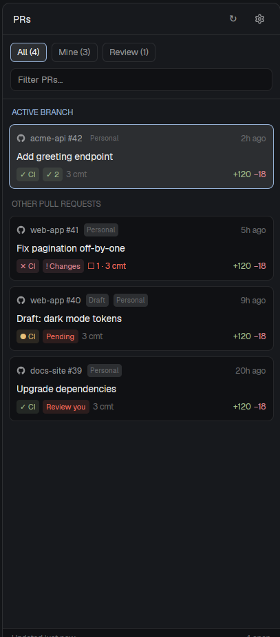

# PRs Panel

A right-docked panel that lists your open GitHub and Bitbucket Cloud pull requests across profiles (for example Personal and Work). Each card shows CI, review state, conflicts, comment counts and diff size. The PR whose branch is checked out in the current workspace is pinned on top. Click a card for an inline detail view (checks, reviewers, recent comments, description) with actions: open in browser, copy URL or branch, jump to the matching space, create a worktree, or start an agent on the PR.



## What you see

A rounded (10px) column filling its pane, `background` fill, 1px `border`, 13px text. Top to bottom:

1. Header, 42px: "PRs" (semibold), spacer, two 26px icon buttons: refresh (`↻`, swaps to a spinning `mods/workspace-chrome/spinner.svg` in the `working` color while syncing) and settings (`mods/workspace-chrome/settings.svg`, 14px).
2. Filter block (10px padding, bottom border): three chips `All (n)`, `Mine (n)`, `Review (n)`; when the workspace holds more than one git repo, a second chip row `All repos` plus one chip per repo; then a 30px search box (placeholder "Filter PRs…", `chrome` fill).
3. Optional error banner: `ansi1` tint, one line of `<profile>:<provider>: <error>` joined by ` | `, and a "Fix config" button.
4. Scrollable list (8px padding, 7px gap, vertical scrollbar). Section labels, 10.5px semibold: `ACTIVE BRANCH` / `ACTIVE BRANCHES` (accent color) and `OTHER PULL REQUESTS` (dim). Each PR card (9px padding, radius 8, 1px border, `chrome` fill; the active-branch card uses `accent` border and `selected` fill; hover `hover`):
   - Row 1: 12px provider icon (`github.svg` / `bitbucket.svg`), `repoShort #number` (11px, muted, truncated), optional "Draft" and profile-name pills (9.5px, `raised`; the profile pill only when no profile filter is active), spacer, relative time (`5m ago`, `3h ago`, `2d ago`).
   - Row 2: title, 12.5px medium, truncated.
   - Row 3 (wraps): CI pill (`✕ CI` red `ansi1`, `✓ CI` green `ansi2`, `● CI` `working`; hidden when no CI), review pill (`! Changes` red, `✓ n` green, `Review you` or `Pending` in `blocked`), `Conflict` pill (red, GitHub only), `☐ unresolved · N cmt` or `N cmt`, spacer, `+adds` green and `−dels` red. Pills use the color at 12% alpha (`+ "20"`) as fill.
5. Footer, 26px, `chrome` fill, top border: `Updated 3m ago` (or `Syncing…` / `Not synced yet`) left, `N open` right.

Empty states: no forge enabled for the scope shows a card "No forge accounts enabled for <Profile|All>" with a "Configure GitHub / Bitbucket" button; otherwise "Syncing pull requests…" or "No matching open pull requests".

Detail view (replaces filters, list and footer; the header stays): 36px subheader with "← Back", provider icon, `repo #n`, Draft and Conflict pills. Scrollable body, 12px padding, 12px gap: title (13.5px semibold), `author · time · +a −d (N files)`, a branch strip (`mods/workspace-chrome/branch.svg`, `source → target`), an action row of 26px pill buttons, then bordered `chrome` cards: "Checks / CI" (label `CI Failed`/`CI Passed`/`CI Running`/`No CI`, one row per check with `✕`/`✓`/`●` and a `↗` when it has a URL), "Reviewers" (label `Changes requested`/`Approved (n)`/`Pending review`, one row per reviewer with a badge), "Comments (N)" (with an `N unresolved` badge; each comment shows author, file path, age and Markdown text capped at 260px height; unresolved ones get a `blocked` border), and a collapsible "Description" (Show/Hide, only when a description exists).

## How it behaves

- Data is not fetched by this mod's list: it reads `shared("forge.state")` (`prs`, `byBranch`, `configuredProfiles`, `errors`, `updatedAt`) and `shared("forge.loading")`, produced elsewhere (see Watch out). Refresh writes `setShared("forge.refreshReq", Date.now())`.
- Profile scope: the list is filtered to `shared("space-folders.profile")` (null means all profiles). The panel has no profile switcher of its own. Profile names come from `shared("space-folders")[""].profiles`, falling back to Personal/Work.
- Tabs: Mine = `isMine`; Review = `isReviewRequested` and not mine; All = both. Repo chips filter on `provider:owner/repo` (click again to clear). Search matches title, repo, source branch, author and `#number`, case-insensitive, live on every keystroke.
- Active branch: every 10 s and on focus/folder change, the panel finds the repos of the active space (focused pane cwd, the space folder if a repo, and one level of `<folder>/*/.git`), reads each repo's `origin` URL and current branch, and looks up `byBranch["<provider>:<owner>/<repo>::<branch>"]`. Matching PRs are pinned under the accent label, one per repo.
- Clicking a card opens the detail view and runs the helper `detail` command (once per PR, cached in memory; a failure is cached too and shown in red). While loading it shows "Loading comments…". Comment text is shown as Markdown with a few `:shortcodes:` mapped to emoji and ```` ```expand ```` fences stripped.
- A jump request `shared("forge.focusPrKey") = { key, seq }` (from other mods) selects that PR when `seq` is newer than the last seen one.
- Detail actions: `Open` (`cx.open_url`, http(s) only), `Copy URL`, `Copy branch` (button text turns to "Copied ..." for 1.5 s), `Go to Space` (shown when a local space has the PR's repo on the PR's source branch; `space.select`), `Worktree` (shown when a local clone is known and no space matches; runs `prepare-worktree`, then either selects or creates a space for an existing worktree with `space.new {folder, name}`, or opens the `worktree` dialog with `{folder, action: "new", branch}`), and `Agent ▾` with four buttons: Claude Chat, Antigravity Chat (copy a prompt about the PR to the clipboard, open a tab with `mod: "chat"`, `props {chat, provider, cwd}`, and toast "paste into the new chat tab"), Claude TUI, Antigravity TUI (open a tab named `PR #n` with `argv: ["claude"|"agy"]` and `task: <prompt>`). The prompt lists number, title, provider, repo, branches, author, CI and review state, URL, failing checks, unresolved count and up to five recent comments.
- Settings button and "Fix config" / "Configure" buttons call `openOverlay({ mod: "dg-settings", kind: "dialog", width: 900, height: 640, props: { section: "git", selectProfile } })`.
- Status colors: failure `ansi1`, success `ansi2`, pending `working`, attention `blocked`, none `dim`.

## Built from

Files (all in `mods/dg-prs/`):
- `mod.json`: `{ "place": "none", "title": "Pull Requests" }`. No props; the default export is a `View` class.
- `main.js`: the panel (list, filters, session repo detection, cards).
- `detail-view.js`: `renderDetailView`, `formatRelTime`, `buildPrPrompt`, `prepMarkdown`.
- `repos.js`: `normalizeRemoteSlug`, `repoName`, `mergeRepoRoots`, `discoverRepoRoots` (pure helpers; the same file is kept in `changes-tabs/` because mods cannot import each other).
- `forge-helper.py`: Python 3 standard library only (no pip packages), about 2250 lines. Subcommands: `get-config`, `gh-accounts`, `gh-login-start|status|cancel` (plus a hidden `_gh-login-worker`), `save-config --from-file`, `delete-profile --id`, `detect`, `test --from-file`, `sync [--profile]`, `detail --profile --provider --repo --number`, `prepare-worktree --repo-path --branch`. Prints one JSON line to stdout.
- Art: `github.svg`, `bitbucket.svg`, `pull-request.svg`, one-line 24x24 `currentColor` icons (the last is also used by other mods as the PRs icon).

Imports: `gpui-kit` (`View`, `div`, `svg`), `gpui-base` (`v_flex`, `h_flex`, `InputState`, `Input`, `Scrollbar`, `TextView`), `herdr` (`appHome`, `checking`, `exec`, `focused`, `openOverlay`, `panes`, `setShared`, `shared`, `spaces`, `theme`, `notify`, `run`). Theme tokens used: `background`, `chrome`, `raised`, `border`, `foreground`, `muted`, `dim`, `accent`, `selected`, `hover`, `solid`, `solid_foreground`, `working`, `blocked`, `ansi1`, `ansi2`.

Shipped/other mods used: `dg-settings` (dialog, `section: "git"`), `worktree` (dialog, Herdr's), `chat` (tab mod), icons `mods/workspace-chrome/{spinner,settings,branch}.svg`.

Herdr commands: `space.select {id}`, `space.new {folder, name}`, `tab.new {name, space?, mod, props}` and `tab.new {name, space?, folder?, argv, task}`, `notify`, clipboard write, `cx.open_url`. Timer: `cx.timer.every(10000)` for the repo re-scan; `cx.timer.after(1500)` for "Copied".

Programs run: `python3 forge-helper.py ...` via `exec` (from `appHome()/mods/dg-prs/`); `git rev-parse --show-toplevel`, `git config --get remote.origin.url`, `git rev-parse --abbrev-ref HEAD` (with `--no-optional-locks -c core.fsmonitor=false`) and `find <folder> -mindepth 2 -maxdepth 2 -name .git`, all through `exec` with `cwd` and the space's `on` machine. The helper itself runs `gh auth token|status|login`, and `git worktree list|show-ref|fetch origin <branch>|branch --track`.

`shared()` keys read: `forge.state`, `forge.loading`, `forge.focusPrKey`, `space-folders` (`[""].profiles`), `space-folders.profile`. Written: `forge.refreshReq`. Not written by this mod: `forge.state`, `forge.loading`, `forge.notifs`.

Network (all from the helper, never from the JS): GitHub GraphQL at `https://api.github.com/graphql` (or `https://<host>/api/graphql` for Enterprise) with a token from `gh auth token`; Bitbucket Cloud REST at `https://api.bitbucket.org/2.0/...` with credentials from env vars (`BB_USER`/`BB_EMAIL` and `BB_TOKEN` by default) or a stored token.

Files the helper reads or writes outside this folder: `~/.config/herdr-forge.json` (profile config, bitbucket tokens, mode 0600; override `HERDR_FORGE_CONFIG`), `~/.config/herdr-space-folders.json` (folder list and profiles, read only), `~/.env` (read, for `BB_*`), `~/.config/gh/hosts.yml` (read), `~/.cache/herdr-forge/` (`cache.json`, `snapshot.json`, `gh-login.json`, all 0600), and it scans `~/src/*` and every folder in the dg-spaces list for git repos (to map `owner/repo` to a local clone).

Helper behavior worth copying: `sync` runs GitHub searches `is:pr is:open author:<me>` and `user-review-requested:<me>` (30 each, optionally scoped by `repo:`/`org:`), and for Bitbucket lists open PRs of the user in the workspace (or of listed repos), enriching each with statuses and a cached diffstat, keeping only PRs that are mine or where I am a reviewer. It returns `{ prs, byBranch, summaryByProfile, configuredProfiles, errors, events, pollIntervalSec, updatedAt }`. `events` are notification diffs (CI failed/passed, changes requested, approved, new comments, review requested) against the last snapshot.

## Watch out

- It reaches the network (through the helper), runs programs (`python3`, `git`, `find`, `gh`) and reads and writes files outside its folder (listed above), including a file that can hold Bitbucket tokens. Review before installing.
- This mod alone shows nothing. `forge.state` and `forge.loading` are produced by `dg-workspace-status` (it runs `forge-helper.py sync` on the poll interval, 90 s default, and writes `forge.state`, `forge.loading`, `forge.notifs`). Profiles and the profile filter come from `dg-spaces` (`shared("space-folders.profile")`). Configuration lives in `dg-settings` (section "git", which also calls `forge-helper.py` and stores per-profile data in `data/prs-panel/`). `dg-inbox`, `dg-changes`, `dg-tabs` and `dg-spaces` read the same `forge.*` keys or open this panel. Without those mods the panel shows "Not synced yet" and the settings button opens nothing useful.
- `place` is `none`: the mod is not placed by itself; a layout or another mod (for example the `dg-tabs` PRs button) must dock it on the right.
- Icons `mods/workspace-chrome/{spinner,settings,branch}.svg` belong to the `workspace-chrome` mod; if it is absent the icons render empty (this repo ships `dg-workspace-chrome`).
- Required programs: `python3` (3.9+ for `removeprefix` and type syntax with `from __future__ import annotations`), `git`, `find`, and the GitHub CLI `gh` logged in (`gh auth login`) for any GitHub profile. Bitbucket needs an API token env var (Atlassian `ATATT...` tokens need the account email as user; workspace/repo tokens use Bearer mode). Agent buttons need `claude` or `agy` on PATH, and the Chat buttons need a `chat` mod.
- `checking()` is true while `herdr-app check` runs: the mod skips every `exec` then, so a check never hits the network or spawns processes.
- Limits: 30 PRs per GitHub query, 50 per Bitbucket query, GitHub review threads read `first: 50`, 30 check contexts, 10 comments in detail (comments capped at 1500 chars, description at 4000). Bitbucket has no conflict flag (`conflicts` is null, so no "Conflict" pill) and uses `task_count` as "unresolved". Poll interval is clamped to 30-600 s.
- Active-branch matching needs the repo `origin` URL to be a github or bitbucket host; slugs are lower-cased `provider:owner/repo`.
- `repos.js` must stay identical to `changes-tabs/repos.js`.
- `Antigravity` buttons run `agy`; remove them if you do not use it.
- Chat mode only copies the prompt to the clipboard; the person pastes it.

## Done when

- `herdr-app check mods/dg-prs` passes.
- With `forge.state` containing PRs, the panel lists cards sorted as given, with working All/Mine/Review chips whose counts match, and the search box narrows the list as you type.
- A PR whose repo `origin` and current branch match `byBranch` appears first under `ACTIVE BRANCH` with an accent border.
- Clicking a card shows the detail view, runs `forge-helper.py detail`, and shows checks, reviewers, comments and a collapsible description; "← Back" returns to the list.
- The refresh button writes `forge.refreshReq`; the settings button opens the `dg-settings` dialog on the "git" section.
- `Open`, `Copy URL`, `Copy branch`, `Go to Space`, `Worktree` and the four Agent buttons each call the commands listed above.
- Setting `forge.focusPrKey` to `{ key, seq }` with a newer `seq` opens that PR.
- `python3 forge-helper.py get-config` prints one JSON line without exposing any token.
