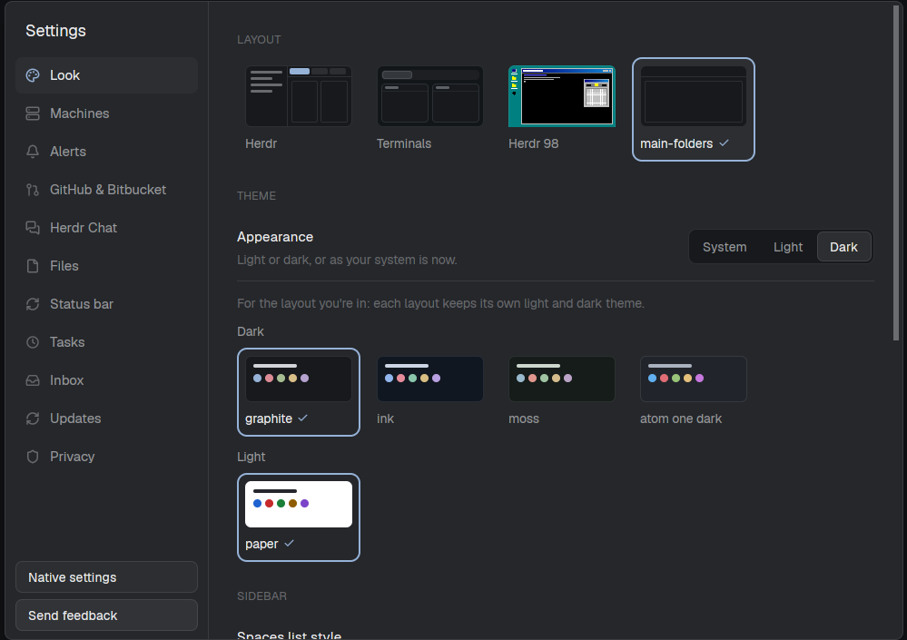

# Settings (custom)



A 900x640 settings dialog for Herdr with a left nav and a scrolling body. It replaces the native Settings window and adds tabs the native one does not have: GitHub and Bitbucket accounts, the Herdr Chat launcher, Files, the status bar, Tasks and the Inbox. Every change applies as you click and is written to disk.

## Quick start

1. Install the mod (see below).
2. Open it with `ctrl-,` (if you bound it) or `herdr-app do mod.open --name dg-settings`.
3. Pick a layout or theme card on the Look tab and watch it apply right away.

## Install

> Read ~/.config/herdr-app/AGENTS.md, then add this mod: https://github.com/dobraga/herdr-mods/tree/main/dg-settings

<details>
<summary>Install by hand</summary>

```sh
git clone https://github.com/dobraga/herdr-mods
cd herdr-mods
./install.sh dg-settings
```

This links the mod into `~/.config/herdr-app/mods`; `git pull` updates it.

The mod is an overlay dialog (`place: none`), so it needs no layout slot. Bind a key in `~/.config/herdr-app/keys.json`:

```json
{ "global": { "ctrl-,": "mod.open:dg-settings" } }
```

</details>

## Usage

- Sections: Look, Keyboard (macOS only), Machines, Alerts, GitHub & Bitbucket, Herdr Chat, Files, Status bar, Tasks, Inbox, Updates, Privacy.
- Look: click a layout card to switch layout, a theme card to change theme. Also appearance (System/Light/Dark), sidebar style, zoom, and terminal and interface fonts, weight, line height, cell width and scroll speed.
- Machines: lists remote machines (refreshes every 3s) with Update, Rename and Remove; "Add a machine" opens Herdr's own `machine-add` mod.
- GitHub & Bitbucket: edit profiles, log in to GitHub from the browser with a one-time code, filter orgs and repos, Test, then "Save & Sync".
- Herdr Chat: toggles, plus "Open Chat Launcher". It sets `global."ctrl-t"` in `keys.json` to `mod.open:new-chat` or `tab.new`.
- Files, Status bar, Tasks, Inbox: toggles, pills and steppers; each saves its own `data/<mod>/settings.json` in the app home.
- Alerts, Updates, Privacy: sound toggle, update checks and restart, and the telemetry toggle. The mod itself sends nothing.
- Esc closes the dialog. Open on a given section with the `section` prop (for example `look`, `git`, `dg-tasks`).
- Native-settings values go to `settings.json` in the app home; a broken `settings.json` blocks saves with an error toast.

## Requirements

- Companion mods in the same repo, since it reads their settings and icons: `dg-prs` (its `forge-helper.py` powers the GitHub & Bitbucket tab, which shows errors without it), `dg-spaces`, `dg-workspace-status`, `dg-files`, `dg-tasks`, `dg-inbox`, `new-chat`.
- Programs it runs: `hc` (Machines), `python3` and `gh` (GitHub tab), and optionally `claude` and `agy` (Inbox tab, via `--help`).
- Network: only through the helper script and `hc machine` commands.
- Outside its folder it writes `keys.json`, `settings.json`, other mods' `data/` files and `~/.config/herdr-space-folders.json`.
- Some defaults are the author's taste: interface font "Geist", terminal font "JetBrains Mono", a fixed Claude model list.

See [RECIPE.md](RECIPE.md) for how it is built.
