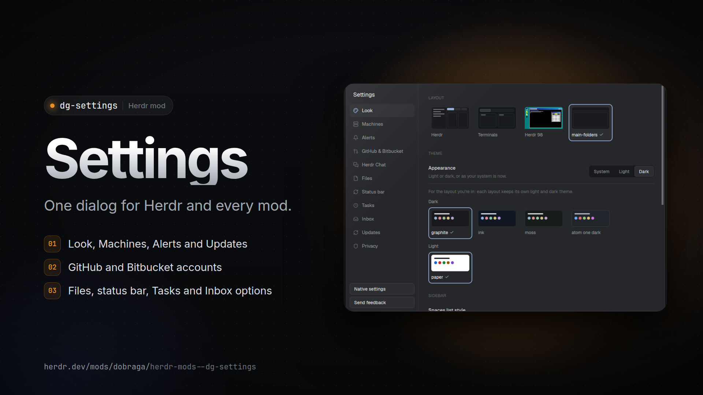

# Settings

A 900x640 modal dialog that replaces Herdr's native Settings with one that has a left nav and a scrolling body. Besides Look (layouts, themes, fonts, zoom), Machines, Alerts, Updates and Privacy, it adds tabs for GitHub and Bitbucket accounts, the Herdr Chat launcher, Files, the status bar, Tasks and the Inbox. Every change applies as you click and is written to disk.

## What you see

- Overlay dialog, `place: none`, title "Settings", 900x640. Two columns.
- Left nav, 204px wide, 1px right border: title "Settings" (16px semibold), then one row per section (15px icon + 13.5px label, selected row on `t.raised`, accent icon). At the bottom: "Native settings" and "Send feedback" buttons. The Updates row gets a 7px accent dot when an app or herdr-core update is ready.
- Sections in order: Look, Keyboard (macOS only), Machines, Alerts, GitHub & Bitbucket, Herdr Chat, Files, Status bar, Tasks, Inbox, Updates, Privacy.
- Body: scrolling column, 28px/22px padding, always-visible vertical scrollbar. Each setting is a row (14px title, 12.5px dim description, control on the right, bottom border). Headings are 12px uppercase dim. Choices are pills (accent border and `t.selected` fill when chosen), 36x20 toggles, or -/+ steppers.
- Look: layout cards (124px wide, 62px preview: the layout's `preview` image, else a drawn mini-wireframe) then Appearance (System/Light/Dark), Dark and Light theme cards (color swatch plus 5 dots), Sidebar style (Tree/Compact), Zoom with Reset, terminal font with a searchable popup list and size, font weight, line height, cell width, scroll speed, and interface font.
- Machines: "This computer" row, then one row per remote machine (state dot, target, state, `hc` version, Update/Rename/Remove), "Add a machine".
- GitHub & Bitbucket: a profile rail (164px) and an editor: profile name, auto-detect, a GitHub card (gh accounts, browser login with one-time code, org and repo filters, Test), a Bitbucket card (env-var, basic or bearer auth, workspace, repos, Test), poll interval and alert toggles, "Save & Sync".
- Other tabs are plain rows of toggles, pills and steppers: Files (accordion, follow active, material icons, close previews, tab width 80-400px, diff tint 0-30%, Quick Open ignore list), Status bar (item toggles, gauge style, thresholds, system monitor intervals), Tasks (time limit, catch-up window, toast level), Inbox (ask cards, per-profile agent/model/effort for detection, sources, toasts, retention), Herdr Chat (3 toggles plus "Open Chat Launcher"), Alerts (sound toggle, Play buttons), Updates (versions, check now, restart/update), Privacy (telemetry toggle, a JSON view of the reports).
- Status colors: connected/ok `t.ansi2`, connecting `t.working`, needs login or failed `t.blocked`, errors `t.ansi1`. No agent statuses are shown.

## How it behaves

- Opens on Look, or on `props().section` (one of the section ids: look, keyboard, machines, alerts, git, chat, files, usage, tasks, inbox, updates, privacy). `props().selectProfile` preselects a profile in the git tab. Esc closes the dialog, or first closes an open font list or rename box.
- Layout card click runs `layout.switch {name}`. Theme card click runs `app.theme {name}`. Only the themes of the current layout (or of no layout) are listed. Zoom runs `app.zoom_in/out/reset`.
- Native-settings values (appearance, fonts, sizes, weight, line height, cell width, scroll speed, option_as_alt, sounds.enabled, telemetry) are written into `settings.json` in the app home with up to 3 re-read-and-write retries. A broken `settings.json` blocks saves with an error toast. Symlinks are resolved first (`readlink -f`).
- Sidebar style: sets shared `space-folders.settings` live and writes `data/space-folders/settings.json`.
- Machines: refreshes every 3s while open (`hc machine ls --json`, temporary machines hidden). Update shows only when the remote `hc` version is older (semver compare). Rename and Remove ask first. Machines in `needs_login` show a copyable `hc machine login <name>`. "Add a machine" and the logout warning run `mod.open {name: "machine-add"}`.
- Status bar, Files, Tasks, Inbox: each change saves its own JSON file under `data/<mod>/settings.json` (Inbox debounced 400ms). Files and Status bar also publish the shared keys so other mods update immediately.
- Inbox tab: offers only agents found on PATH (`claude`, `agy`). Model lists: Claude uses a fixed list (Fable 5.2, Opus 5.5, Sonnet 5.5, Haiku 5.5); others use `<agent> models` when `--help` lists a `models` command. Effort levels come from the `--effort (...)` line of `--help`. Per-level model ids like `x-low`/`x-high` are folded into one model plus a segmented effort bar. Profile choices fall back to "Use default".
- Herdr Chat tab: toggles write `data/herdr-chat/state.json` and set `global."ctrl-t"` in `keys.json` to `mod.open:new-chat` or `tab.new`. Existing `ctrl-t` bindings are read back to set the toggle. Turning chat off disables the other two toggles' effect.
- GitHub login: runs the helper, copies the one-time code to the clipboard, opens the URL in the browser, polls every 1.5s until completed, cancel supported. Save writes the profile list and forge config, then bumps shared `forge.configVersion` and `forge.refreshReq`.
- Updates: "Check now" runs `app.check_updates`, "Restart to update" `app.update`, herdr-core `app.update_core`, "What's new" `app.whats_new`. Privacy shows `telemetry()`; nothing is sent by this mod.

## Built from

- Files: `mod.json` (`place: none`, overlay dialog 900x640, title "Settings"), `main.js` (the `SettingsCustom` view, default export), `profiles-dialog.js` (`ProfilesDialogController`, the git tab, embedded), `agent-models.js` (pure helpers: model grouping, effort parsing; tests in `agent-models.test.mjs`, run with `node --test`).
- Props: `section`, `selectProfile`, `overlay` (used by `closeOverlay`).
- Imports: `gpui-kit` (View, div, svg, image), `gpui-base` (v_flex, h_flex, Scrollbar, InputState, Input, Popup), `herdr`: hc, run, theme, themes, fonts, updates, telemetry, settings, layouts, shared, setShared, appHome, readTextFile, writeTextFile, playSound, props, closeOverlay, notify, window, checking, exec. Also node `fs/promises` and `localStorage`.
- Herdr commands via `run`: `layout.switch`, `app.theme`, `app.zoom_in`, `app.zoom_out`, `app.zoom_reset`, `app.settings`, `app.feedback`, `app.check_updates`, `app.update`, `app.update_core`, `app.whats_new`, `mod.open`.
- Icons: `frame/settings/*.svg` (palette, keyboard, server, bell, refresh, shield, check), `frame/welcome/messages.svg`, `mods/dg-prs/pull-request.svg`, `mods/dg-prs/github.svg`, `mods/files/file.svg`, `mods/dg-tasks/tasks.svg`, `mods/dg-inbox/inbox.svg`, `mods/workspace-chrome/spinner.svg`, `mods/pane/close.svg`. All come from Herdr or sibling mods; the mod ships no art of its own.
- Programs run: `hc machine ls --json`, `hc machine update|rename|rm <name>`; `mkdir -p`; `readlink -f`; `sh -c 'command -v claude|agy'`; `claude|agy --help` and `agy models` (10-20s timeouts); `sh -c cat ~/.config/herdr-space-folders.json`; `python3 mods/dg-prs/forge-helper.py` with `get-config`, `save-config --from-file`, `delete-profile --id`, `detect`, `test --from-file`, `gh-accounts`, `gh-login-start --host`, `gh-login-status`, `gh-login-cancel`.
- shared() keys read: `layout`, `space-folders` (`[""].profiles`, `.list`, `.of`, `.spaceProfiles`), `space-folders.settings`, `space-folders.profile`. Written: `usage.settings`, `files-tabs.settings`, `space-folders.settings`, `dg-spaces` (profile list), `space-folders.profile` (cleared on profile delete), `forge.configVersion`, `forge.refreshReq`.
- Files read/written under the app home: `settings.json`, `keys.json`, `data/herdr-chat/state.json`, `data/workspace-status-usage/settings.json`, `data/files-tabs/settings.json`, `data/tasks/settings.json`, `data/inbox/settings.json`, `data/space-folders/settings.json`, `data/prs-panel/.save-*.json` and `.test-*.json` (temporary payloads, may contain a typed Bitbucket token), `layouts/<name>.json` (reads `preview`).
- Files outside the mod's folder and app data: `~/.config/herdr-space-folders.json` (read and rewritten atomically via tmp + mv).
- Network: none directly. The git tab's Test, login and detect run `forge-helper.py`, which talks to GitHub (via `gh`) and Bitbucket. Auto-detect scans local repos and `~/.env`.

## Watch out

- It runs programs (`hc`, `python3`, `claude`/`agy --help`, `sh`) and writes files outside its own folder (`keys.json`, `settings.json`, other mods' `data/` files, `~/.config/herdr-space-folders.json`). It reaches the network only through the helper script and `hc machine` commands.
- Sibling mods it depends on: `dg-prs` (for `forge-helper.py`, which this mod does not contain: without it the GitHub & Bitbucket tab shows errors), `dg-spaces` (owns the profile list and reads `space-folders.settings`), `dg-status-bar` (reads `data/workspace-status-usage/settings.json`), `dg-files`/`dg-tabs`/`dg-file-view`/`dg-file-picker` (read shared `files-tabs.settings`), `dg-tasks` (reads `data/tasks/settings.json`), `dg-inbox` (settings file), `dg-new-tab`/`new-chat` (target of the Ctrl+T binding; `mod.open:new-chat` does nothing if no mod named `new-chat` exists), `dg-workspace-chrome` and Herdr's own `machine-add` mod (opened by name).
- Non-Herdr programs: `python3` and `gh` (GitHub tab), `hc` (Machines), optionally `claude` and `agy` (Inbox tab; with neither on PATH the tab says none were found). `herdr-tasks` is only read by the Tasks mod, not this one.
- Personal customization baked in: default interface font "Geist", terminal font "JetBrains Mono", the fixed Claude model list, and the "Herdr Chat" wording for the launcher. Change these for another setup.
- `keys.json`, `settings.json`, `data/` and `layouts/` live in the person's app home, not in this folder. Saving the Chat tab rewrites `keys.json` `global."ctrl-t"`.
- Native-only rows (sounds, telemetry, updates) use Herdr's own APIs; if the app lacks them (`telemetry()` null, `updates().checks` false) the panels degrade to text.
- `InputState.new` must not be called in render: all inputs are created in `init` or on the click that opens a tab. The toolkit's Select does not open on a plain click, so dropdowns are hand-drawn.
- Limits: font list shows at most 200 matches; numeric ranges are clamped (font size 8-32, weight 100-900, line height 80-200%, cell width 80-200%, scroll speed 10-500%).
- Validated by build/check only unless run live; the browser login, `hc machine` actions and Test buttons need real accounts and machines.

## Done when

- `herdr-app check mods/dg-settings` passes.
- `node --test agent-models.test.mjs` passes.
- Opening the mod (`mod.open {name: "dg-settings"}`) shows a 900x640 dialog with the section nav and Look selected; Esc closes it.
- Clicking a layout card switches layout and a theme card changes the theme; the selected card shows the accent border and a check.
- Changing Appearance or a terminal font setting rewrites `settings.json` with 2-space JSON and a trailing newline, keeping other keys.
- Toggling a Files, Status bar, Tasks or Inbox option creates the matching `data/<mod>/settings.json`.
- Toggling the Herdr Chat launcher sets `global."ctrl-t"` in `keys.json` to `mod.open:new-chat` or `tab.new`.
- The Machines tab lists machines from `hc machine ls --json` and refreshes every 3s.
- The GitHub & Bitbucket tab lists profiles and saves them with "Save & Sync" (requires `dg-prs`).
