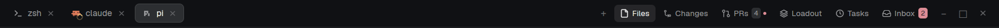

# Tabs (folders)

A top tab bar for Herdr's window. It lists the tabs of the active space, or of the active tab's whole sidebar group (a space, or a worktree) when the Spaces mod groups tabs across spaces. Each tab shows a program or file-type icon, a live title and a close button. The bar also holds a dg-new-tab "+" button, side-panel toggles (Files, Changes, PRs, Loadout, Tasks, Inbox) with badges, and window buttons. Dragging a tab onto another tab or onto the content joins them as a split.

## What you see

One bar, `size_full`, `bg t.chrome`, 1px bottom border `t.border`, 10px side padding (left padding grows on macOS so the traffic lights fit), 3px gap. Left to right:

- Tab strip (flex_1, horizontal scroll, 3px gap). Each tab is 29px high, 10px padding, 7px gap, radius 7, 12.8px text, 1px border.
  - Active tab: `bg t.raised`, `t.border` border, `t.foreground` text. Others: `bg t.chrome`, `t.muted` text, `t.hover` on hover.
  - Icon (14px): the program icon (tinted svg `t.muted` if `program.tint`). A dg-file-view tab shows a Material file-type icon from the file name, or `mods/files/file.svg` (`mods/changes/changes.svg` for a diff) when `files-tabs.settings.materialIcons === false`.
  - Status dot, 7px, on the icon's bottom-right corner: `t.ansi1` blocked, `t.done` done. Working shows a 10px spinning `mods/workspace-chrome/spinner.svg` in `t.working` instead.
  - Name, truncated at `files-tabs.settings.tabMaxWidth` (default 170px), plus " Z" when zoomed.
  - A 9.5px "preview" chip on an unpinned file preview tab; its text and icon are dimmed.
  - A 12px close x on every tab (so widths never change on selection).
  - Inactive tab border tint: blocked `t.ansi1` + "B3", done `t.done` + "73".
- "+" button (26px square, `t.dim`).
- Panel buttons (26px high, 12px text, 14px icon): Files, Changes, PRs, Loadout, Tasks, Inbox. The open one has `bg t.selected` and `t.foreground` text. PRs shows a count chip (`t.raised`) and a 5px dot (`t.ansi1` if any CI failure or changes requested, else `t.blocked` if reviews are waiting). Inbox shows a `t.ansi1` chip with `inbox.count.needsYou` when above 0.
- Window buttons (only when the window reports `buttons`): minimize, maximize, close. Text glyphs on macOS/Linux (close uses `mods/pane/close.svg`), 16px svgs from this folder on Windows.

## How it behaves

- Agent status per tab (counted from `agents()` by tab, falling back to the tab's own status): blocked wins, then done, then working, else idle (no dot, no tint). Blocked and done tint the border and show the corner dot. Working shows the spinner. Idle is plain.
- Tab name: the tab's own name if the person set it; otherwise the lead pane's program name (`Terminal` if none). For an agent pane, an unnamed tab, or one named after its program, follows the agent's live title once cleaned (status glyphs stripped; ignored if it is the terminal id, the program name, a path, contains "@", or equals the program key). In a multi-space group, a single-tab space whose tab is unnamed shows the space's name.
- Click: selects the tab (and its space first if different). Double-click: rename (`tab.rename`); on a preview file tab it pins it instead. Right-click: popup `menu` (props `{tab:"tab", target:{id,space}}`, width 200), or for a file tab with a path and root a `dg-files` popup (190x112) with `contextMenu` props `{path, fullPath, tabTarget}`. Close x: `tab.close` with `confirmed: true`.
- Preview tabs close automatically when another tab becomes active in the same space, unless `files-tabs.settings.closePreview === false`.
- Wheel or touchpad: pans the strip only, one tab per notch or per 40px of swipe; never selects. The strip scrolls to keep the active tab visible and tracks its own pixel offset (`scroll_to_item` leaves visible items alone).
- Mod commands `*.next` / `*.prev` (via `nextCommand()`, skipped when `checking()`): select the next/previous tab in the shown list, wrapping, skipping tabs with `settled` true, selecting its space first if needed.
- Drag a tab:
  - Dropped on the edge quarters of another tab: reorder (`tab.move` with index = target index + 1 within a space; `space.move` across spaces).
  - Dropped on the middle half of another tab in the same space: joins it as a split to its right, or under it with Shift. The target is then selected.
  - Released below the bar: joins the active tab as a split. `dropPlace`: right, or down when the release is in the bottom 35% of the content area or Shift is held. Releasing inside the bar reorders or selects instead. While dragging below the bar, the pressed tab's border turns `t.accent` (or `t.foreground`).
  - Dropping a tab on itself below the bar notifies "Drop another tab here to split it with this one."
  - A failed merge notifies "Tab not moved" (level warning) and the moved terminals are re-labeled back.
- Panel buttons: click toggles `layout.hide`/`layout.show` of the `panel` node after `layout.select {stack:"panel-body", child:id}`. The choice is remembered per space in `localStorage` key `panels` (`{spaceId: panelId|null}`); switching spaces restores that space's panel (closed if none). A pending restore is ignored for 1s while it lands.
- "+" opens popup `dg-new-menu` (250x512). Window buttons run `window.minimize`, `window.maximize`, `window.close`.

## Built from

Files (this folder, `mods/dg-tabs/`):
- `mod.json`: `{"place":"none","title":"Tabs","cloned_from":{"name":"tabs","version":"0.1.16"}}`. It has no props; the mod is placed by a layout node `{"mod":"dg-tabs"}` (a bar region).
- `main.js` (~470 lines): default class `TabsFolders extends View`, using `gpui-kit` (`View, div, svg, image`) and `gpui-base` (`h_flex, ScrollHandle`).
- `move.js`: pure functions `dropPlace(pos, barBottom, winHeight)`, `terminalsOf(tab)`, `findTab(doc, id)`, `mergeTab(doc, fromId, toId, place, newId)`. `mergeTab` edits the layout document: moves all root children of tab `from` into tab `to` (right: appended; down: a `column` of two halves, a new `row` wrapping when a side has several panes; hidden panes stay at the root) and returns null (no write) if tabs are missing, equal, in different spaces, or not `row`-rooted.
- `icon-for.js`: `iconFor(name, isDir, open)` and `iconPath(key)` returning a path under `mods/dg-tabs/icons/`. `icon-map.js` is a generated 84 KB table (extension/file-name to icon key, from material-icon-theme, MIT). The `icons/*.svg` set it points to is NOT in this folder; see Watch out.
- `win-min.svg`, `win-max.svg`, `win-restore.svg`, `win-close.svg`: Windows caption icons.

Shipped mods and assets used: `menu` (tab context popup), `pane` (`mods/pane/close.svg`), `files` (`mods/files/file.svg`), `changes` (`mods/changes/changes.svg`), `workspace-chrome` (`mods/workspace-chrome/spinner.svg`), plus the panel icons `mods/dg-prs/pull-request.svg`, `mods/dg-loadout/loadout.svg`, `mods/dg-tasks/tasks.svg`, `mods/dg-inbox/inbox.svg`.

Sibling mods in this repo it talks to (all optional; each degrades to nothing when absent): `dg-new-menu` (the "+" popup), `dg-files` (context popup, settings), `dg-file-view` (owns `file-view.slots`), `dg-spaces` (`tabGroups`, `profile`), `dg-inbox`, `dg-prs`, `dg-loadout`, `dg-tasks` (panel buttons).

Herdr functions imported: `spaces, agents, panes, run, openOverlay, theme, window, shared, setShared, layout, settings, nextCommand, checking, exec, hc, notify`; plus Node `crypto.randomBytes`.
- `run` commands: `space.select`, `tab.select`, `tab.close`, `tab.rename`, `tab.move`, `space.move`, `layout.select`, `layout.show`, `layout.hide`, `window.minimize`, `window.maximize`, `window.close`.
- `hc label <terminal> herdr.tab=<tabId>` (via `hc()`), and JSON-RPC `doc.get` / `doc.set` on document `herdr-app` (optimistic `version`, retried up to 2 times on `conflict`), sent by running `exec("/bin/sh", ["-c", "... | hc connect"])` after a `hello` request.

`shared()` keys read: `space-folders.tabGroups` (tabId to group id), `space-folders.profile`, `file-view.slots` (slotKey to `{tabId, kind, path, root, preview}`), `files-tabs.settings` (`closePreview`, `materialIcons`, `tabMaxWidth`), `workspace.panels` (array; `[]` treated as default `["files","changes"]`), `forge.state` (`summaryByProfile[profile] {total, review, failingCi, changesRequested}`), `inbox.count` (`{needsYou}`).
`shared()` keys written: `file-view.slots` only (after a tab merge, repoints slots from the moved tab to the target and sets `preview:false`; on double-click it pins a preview).
`localStorage`: `panels`.

Panel buttons Prs, Loadout, Tasks and Inbox are always added to the enabled list on top of `workspace.panels`. Layout dependencies: nodes with ids `sidebar` (size), `panel` (hide/show) and `panel-body` (a stack whose children are named `files`, `changes`, `prs`, `dg-loadout`, `dg-tasks`, `dg-inbox`).

Differences from upstream tabs:
- Tabs are listed across the Spaces group: reads `space-folders.tabGroups`, so the bar may show tabs of several spaces; selecting one selects its space first.
- Agent status counts come from `agents()` (blocked, done); the status is a corner dot on the icon with a spinner for working, instead of a trailing dot/spinner. Colored borders for blocked/done.
- Close x shown on every tab and closes with `confirmed: true` (upstream: only on the active tab).
- Wheel pans the strip (40px swipe threshold, `this.w`/`this.off` tracking, `reveal()`) instead of switching tabs (`tab.next`/`tab.prev`); next/prev tab moved to `nextCommand()` handling.
- File-view tabs: Material icons, "preview" chip, auto-close of previews, double-click to pin, file-specific right-click popup, `tabMaxWidth` setting.
- Drag and drop: join as split (middle half of a tab, below the bar, Shift for down), cross-space `space.move`; implemented in `move.js` plus `rpc`/`moveTabToSplit`.
- Panel buttons: added PRs (with badge from `forge.state`), Loadout, Tasks, Inbox (with badge); per-space remembered panel via `localStorage`.
- "+" opens `dg-new-menu` popup (250x512); window buttons use `window.buttons`/`platform`, mac traffic-lights padding.
- Present but unused in `main.js`: `tabStatusBadge`, `folderKey`, `folderOf` and helpers (`place`, `rule`, `reach`, `deepest`), `clean` is used. Safe to omit.

Derived from Herdr's tabs mod (Apache-2.0), see ../NOTICE.

## Watch out

- No network access. It does run programs: `exec("/bin/sh", ["-c", ...])` piping JSON to `hc connect`, and `hc label ...`, only when a tab is dragged into a split. Both need `hc` on PATH (installed with Herdr).
- It reads/writes the live layout document `herdr-app` (`doc.get`/`doc.set`) during a drag-merge; a bad merge rewrites the whole window layout. It reads no files outside its own folder, and `localStorage` only for `panels`.
- Splits only work within one space and for tabs whose root is a `row` with a `children` array; anything else notifies and changes nothing. Hidden panes (chat hosts) stay at the target root.
- Moved terminals must be labeled `herdr.tab=<target>` before `doc.set`, or a chat restarts its host; roll back the label on failure.
- `icons/*.svg` (Material icon files named by `icon-for.js` / `icon-map.js`, ~MIT material-icon-theme) are not shipped here, so `iconPath()` images will be missing unless generated into `mods/dg-tabs/icons/` (the sibling `files-tabs/scripts/gen-icons.mjs` generates them). Without them, set `files-tabs.settings.materialIcons` to false to get the plain file icon.
- Needs `dg-spaces`, `dg-file-view`, `dg-files`, `forge`/`dg-prs`, `dg-inbox` only for their shared data and panel icons; panel buttons for mods you lack still render (they just show nothing). The `panel` / `panel-body` / `sidebar` layout ids must exist.
- Sizes: tab 29px, close 12px, status dot 7px, preview chip 9.5px text, tab max width 170px; menu popup 200px wide, new-menu popup 250x512, files context popup 190x112.
- Wheel swipes under 40px are ignored on touchpads; a drag that stays in the bar reorders instead of splitting.

## Done when

- `herdr-app check mods/dg-tabs` passes.
- The bar lists every tab of the active space (or group) with icon and live title; the active one is `t.raised`.
- A blocked agent in a tab shows a `t.ansi1` corner dot and tinted border; done shows `t.done`; working shows a spinning spinner.
- Clicking selects, double-click renames, right-click opens the menu, the x closes without a prompt.
- The wheel pans the strip without changing the selected tab; `tab.next`/`tab.prev` commands move the selection.
- Dragging a tab onto the middle of another tab in the same space merges its panes as a right split (Shift: below), and a failure shows the "Tab not moved" toast.
- Panel buttons toggle the side panel, and the choice is restored per space.
- Window buttons appear only when the window reports `buttons`.
