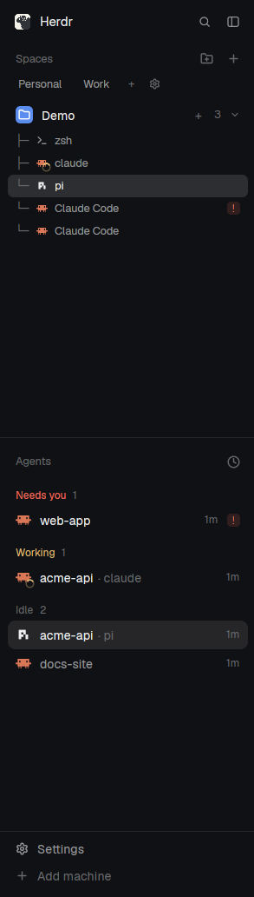

# Workspace Chrome Custom



The header and footer of the Herdr sidebar: the logo and name with a search button and a sidebar toggle at the top, and Settings and Add machine rows at the bottom. The toggle shrinks the sidebar to a narrow icon rail and back. An accent dot on Settings shows when an app update is ready.

It is a one-line fork of Herdr's shipped `workspace-chrome` mod: the Settings row opens the `dg-settings` mod instead of the stock settings.

Derived from Herdr's workspace-chrome mod (Apache-2.0), see [NOTICE](../NOTICE).

## Quick start

1. Install the mod (see below) and make sure `dg-settings` is installed too.
2. Add it to your layout as the sidebar footer (and optionally the header), as shown under Install.
3. Reload the layout: the footer shows Settings and Add machine, and the toggle collapses the sidebar to a rail.

## Install

Ask your agent:

> Read ~/.config/herdr-app/AGENTS.md, then add this mod: https://github.com/dobraga/herdr-mods/tree/main/dg-workspace-chrome

<details>
<summary>Install by hand</summary>

```sh
git clone https://github.com/dobraga/herdr-mods
cd herdr-mods
./install.sh dg-workspace-chrome
```

This links the mod into `~/.config/herdr-app/mods`; `git pull` updates it.

The mod has `place: none`, so a layout must host it by name. Use it as a block in the sidebar column, once for the header and once more with `props: { footer: true }` for the footer. The sidebar node needs the id `sidebar` and a pixel size. Footer block as used by the author:

```json
{
  "id": "sidebar-footer",
  "type": "block",
  "size": { "px": 69 },
  "content": { "mod": "dg-workspace-chrome", "props": { "footer": true } }
}
```

For the header, use the same block without `props` (the author's layout keeps the stock `workspace-chrome` header and uses this mod for the footer only).

</details>

## Usage

- Header: Herdr logo and name, a search button (opens `picker`) and a sidebar toggle.
- Toggle: collapses the sidebar to a 44px rail (76px on macOS) and restores the previous width on the next click (268px if none was saved).
- Dragging the sidebar under 160px wide also switches to the rail: icon-only rows with tooltips, and the header keeps just the toggle.
- Footer: Settings opens `dg-settings`, Add machine opens `machine-add`.
- An accent dot appears on Settings when an update is ready.
- The last expanded width is kept in the shared keys `sidebar.width` and `sidebar.collapsed`. There are no other settings.

## Requirements

- The `dg-settings` mod from this repo (without it the Settings row does nothing useful), plus Herdr's shipped `picker` and `machine-add` mods.
- Herdr's shipped `workspace-chrome` mod stays installed: the icons and logo are loaded from it and from the app assets.
- It runs no programs and makes no network calls.
- Checked only with `herdr-app check` and by reading the code, not tested in a live window.

See [RECIPE.md](RECIPE.md) for how it is built.
