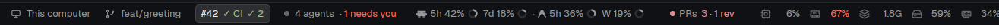

# Workspace Status Usage



A status bar for the bottom of the Herdr window. It shows the computer name, git branch (with a PR chip and CI state when the branch has an open PR), the agent count, Claude Code and Antigravity subscription usage as small rings, a pull-requests button and a live CPU / memory / disk / GPU / network strip. On the right sit a now-playing media pill and the command-palette key hint. Hover the usage, system or media items for a detail card; click to pin it.

Derived from Herdr's workspace-status mod (Apache-2.0), see [NOTICE](../NOTICE).

## Quick start

1. Install the mod (see below), together with `dg-prs` if you want the PR parts.
2. Mount `dg-workspace-status` in a layout block (this mod has no slot of its own).
3. Open Herdr: the bar appears. With Claude Code credentials present, the `5h` / `7d` usage rings fill in; hover them to open the Subscription Usage card.

## Install

> Read ~/.config/herdr-app/AGENTS.md, then add this mod: https://github.com/dobraga/herdr-mods/tree/main/dg-workspace-status

<details>
<summary>Install by hand</summary>

```sh
git clone https://github.com/dobraga/herdr-mods
cd herdr-mods
./install.sh dg-workspace-status
./install.sh dg-prs
```

This links the mod into `~/.config/herdr-app/mods`; `git pull` updates it.

The mod's `place` is `none`, so the layout has to mount it. Add a block at the bottom of your layout (the author's layout uses a 28px-high block):

```json
{ "id": "status", "type": "block", "size": { "px": 28 }, "content": { "mod": "dg-workspace-status" } }
```

</details>

## Usage

- **Bar:** computer (or remote machine), branch, "N agents" (with "K needs you" when an agent is blocked), usage pill, PRs button, system pill, media pill, palette hint.
- **Usage:** hover to open the card (5h session, 7d weekly, per-model limits, Claude Code and Antigravity); click to pin, click again to close. Refresh is automatic every 3 minutes.
- **System:** hover for sparklines and top processes (CPU, memory, Herdr memory, disk, GPU, network).
- **Media:** prev / play-pause / next buttons, a seek bar and volume in the card.
- **PRs:** click the PR chip or the PRs button to open the `prs` child of the `panel-body` stack and show the `panel` node in your layout; new PR events arrive as toasts.
- **Settings:** a JSON file at `<appHome>/data/workspace-status-usage/settings.json`, re-read on each refresh. Keys include `style` (`ring`, `bar`, `text`), `warn`, `critical`, `colorMode` (`threshold`, `pace`), `showReset`, per-item switches such as `showSystem`, `showMedia`, `showPrs`, and `sysInterval` / `diskInterval`.

## Requirements

- **Network:** sends your Claude Code OAuth token to `api.anthropic.com` to read usage. The PR helper talks to GitHub / Bitbucket.
- **Reads outside its folder:** `~/.claude/.credentials.json` (or the macOS Keychain entry), `~/.cache/agy-statusline/quota.json`, `~/.cache/herdr-statusline/`, `/proc`, and home-folder sizes via `du`. It creates `~/.cache/herdr-statusline/`.
- **Programs it runs:** `git`, `python3` (runs `dg-prs`'s `forge-helper.py`), `agy`, `ps`, `df`, `du`, `uptime`, `top`, `nvidia-smi`, `busctl` and `wpctl` (Linux), `nowplaying-cli` (macOS). Optional ones simply hide their part.
- **Sibling mods:** `dg-prs` for the PR chip, counts and toasts; `dg-settings` to edit settings; `dg-spaces` for the PR profile. The layout needs `panel` and `panel-body` nodes with a `prs` child, and the `media-card` icons for media button icons.

See [RECIPE.md](RECIPE.md) for how it is built.
