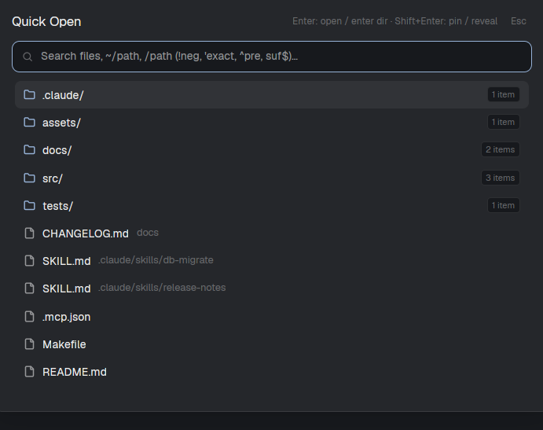

# Quick Open

A popup that drops from the top of the window (Ctrl+P) with a search box and a list of files in the active space's folder. You type a few letters, arrow to a file, press Enter, and it opens in a file tab. Typing a path starting with `~` or `/` browses any folder on the machine instead.

## What you see

A popup anchored at the top, 40px below the edge, 640px wide, 80% of the window tall (`"overlay": {"kind":"popup","at":"top","offset":40,"width":640,"height":0.8}`). Background is the theme's `popover` color, 18px padding, 10px gap, 13px text. Top to bottom:

1. **Header row:** "Quick Open" (15px, semibold, foreground), the hint "Enter: open / enter dir · Shift+Enter: pin / reveal" (11px, dim), and an "Esc" chip (11px, dim, 5px radius, hover shows the hover color).
2. **Breadcrumb row**, only inside a folder: a chip with the root folder's name, then `/` and one chip per path segment (11.5px, bordered, the last one uses the `selected` background), and "Backspace: up" at the right (10.5px, dim).
3. **Search box:** 36px high, 9px radius, 1px accent border, `background` fill, a 15px search icon, then the input (12.8px). Placeholder: `Search files, ~/path, /path (!neg, 'exact, ^pre, suf$)…`.
4. **Result list:** rows 32px high (4px side margin, 10px padding, 7px radius, 8px gap), at most 360px tall, then it scrolls. Each row: a 14px icon (folder or file; accent for folders and for files already open, muted otherwise), the file name (medium weight, max 260px, truncated), the parent folder (11.5px, dim, fills the rest, truncated), then small bordered badges: `N item(s)` on folders, `open` or `preview` on files already open in a tab. At most 80 rows are shown. The list is 44px high with a dim message when empty: "Indexing files…", "Looking up path…", "No matching files", or an error such as "No folder in active space".

## How it behaves

- **Opening:** the input is focused at once and again after 80ms and 300ms. The file list loads in the background; the box is usable while it says "Indexing files…".
- **Which folder:** the focused pane's cwd, else the focused terminal's cwd, else any pane's cwd in the active space, else the space's folder. If the focused terminal is on another machine, everything runs there.
- **Empty query:** at the top level it lists files already open in this space first, then top-level folders, then files. Inside a folder it lists direct subfolders, direct files, then nested files.
- **Typing:** space-separated tokens, all must match. Per token: `!x` excludes paths containing x, `'x` exact substring, `^x` path starts with x, `x$` path ends with x, otherwise: file name equal (best), name starts with, name contains, path contains, then a subsequence match with a bonus at word boundaries (`/ _ - .`) and for consecutive letters. Ranked by score, then shorter path. A leading `./` or the root path is stripped.
- **Direct paths:** a query starting with `~`, `~/` or `/` (also quoted or `file://`) probes the disk: a file shows as the single result, a folder lists its entries (folders first), `dir/partial` filters that folder's entries fuzzily. Folder listings are cached while you keep typing in the same folder; stale lookups are dropped.
- **Keys:** Down / Ctrl+N and Up / Ctrl+P move (wrapping); Enter opens the row; Shift, Ctrl or Cmd+Enter pins it; Tab on a folder enters it; Backspace on an empty box goes up one folder; Esc closes. Mouse: click selects and opens; double click or Shift+click pins; the wheel scrolls; Esc chip and breadcrumb chips click.
- **Opening a file:** closes the popup, then reuses a tab already showing that file (selecting it, and un-previewing it if pinned), else replaces the space's current preview tab (rename + select), else creates a new `file-view` tab. A plain open makes a preview tab, a pinned open makes a permanent one.
- **Folders:** Enter or click enters the folder (scope, breadcrumb appears). Shift+Enter on a folder closes the popup, shows the layout node `panel`, and selects child `files` of stack `panel-body` so the Files tab reveals that folder.
- **Ignore list:** names or `*.ext` globs matched against any path segment are dropped. Default: `*.pyc, __pycache__, .venv, venv, node_modules, .git, .DS_Store, .mypy_cache, .pytest_cache, .ruff_cache`. A user setting overrides it.
- Limits: 10000 files indexed.

## Built from

Files: `mod.json`, `main.js` (one class, `FilePicker extends View`, about 930 lines). No icons of its own.

`mod.json`: `{"place": "none", "title": "Quick Open", "overlay": {popup as above}}`. It occupies no layout slot; it is opened on demand. No `props` are read except `props().overlay`, which is passed to `closeOverlay` to dismiss itself.

Imports: `View, div, svg` from `gpui-kit`; `v_flex, h_flex, InputState, Input` from `gpui-base`; from `herdr`: `spaces, panes, focused, exec, run, theme, settings, props, closeOverlay, shared, setShared, window, home, checking`.

Commands run with `run(...)`: `tab.new {name, space, mod:"file-view", props:{slotId, ...slot, beforeTabs}}`, `tab.select {id}`, `tab.rename {id, name}`, `layout.show {id:"panel"}`, `layout.select {stack:"panel-body", child:"files"}`.

Programs run with `exec` (on the focused machine via `on`):
- `git rev-parse --show-toplevel`, then `git ls-files --cached --others --exclude-standard -z` (with `--no-optional-locks -c core.fsmonitor=false`) in the repo root.
- `sh -c 'find . -maxdepth 3 -name .git ...'` to find up to 20 nested repos under the root, each listed with `git ls-files`.
- Fallback when not in a git repo: `rg --files --null --hidden --glob '!.git'`; then on Windows a `powershell Get-ChildItem` (first 4000 files); else `sh -c 'find . -maxdepth 6 ... | head -n 5000'`.
- Path probe for `~`/`/` queries: an `sh -c` script using `test`, `dirname`, `basename`, `pwd` and `ls -1Ap | head -n 2000`. Not used on local Windows.

`shared()` keys:
- Read: `files-tabs.settings` (field `quickOpenIgnore`, an array of strings) and `file-view.slots` (map of slotId to `{spaceId, tabId, kind, path, root, on, name, preview, updatedAt}`).
- Written: `file-view.slots` (adds or updates a slot, prunes dead ones: tab gone, or no tab id and older than 5s) and `files-tabs.reveal` (`{spaceId, root, dir, seq: Date.now()}`).

Mods it needs: `file-view` (the tab that actually shows the file; must read `file-view.slots` and the `slotId` prop), `files-tabs` (layout child `files`, stack `panel-body`, node `panel`; consumes `files-tabs.reveal`; supplies `mods/files-tabs/folder.svg`), `settings-custom` (writes `files-tabs.settings`, the "Quick Open ignores" setting). Shipped mods used for art: `mods/files/file.svg` and `mods/workspace-chrome/search.svg`.

Keys (in the person's `keys.json`, not shipped here): `"global": {"ctrl-p": "mod.open:file-picker"}`.

Network: none. Reads outside its own folder: only through the programs above, so it can list any folder the person types (`~`, `/...`) and the space's cwd; it writes nothing to disk.

## Watch out

- It runs programs (`git`, `sh`, `find`, `ls`, `rg`, on Windows `powershell`) and lists directories outside the space folder when the query starts with `~` or `/`. It has no network access.
- Needs `git` on the machine; `rg` and POSIX `sh`/`find`/`ls` are fallbacks. Not tested here on Windows; local direct-path browsing is disabled there.
- Depends on sibling mods: without `file-view`, Enter creates a tab for a mod that is missing; without `files-tabs`, Shift+Enter on a folder does nothing useful. Without `settings-custom` (or anything writing `files-tabs.settings`) the default ignore list is used.
- `files-tabs.settings` is only set once the files-tabs or settings mod has run; read with `?.` so a missing value is fine.
- Open files are matched by `root + "/" + path`. The Files tab keys by the space's cwd, not the git top level, so the picker re-roots a chosen file to the cwd when it lies inside it. A fresh build that skips this opens duplicate tabs.
- The slot prune (5s grace for slots without a `tabId`) prevents a just-created tab from being deleted before it registers; keep it.
- The list height comes from `on_size_change` divided by `settings().zoom`; without that the rows misalign at non-100% zoom. Rows are absolutely positioned when the list scrolls.
- `checking()` returns early in init so `herdr-app check` does not run any `exec`.
- The `svg(...)` paths are relative to the home (`mods/...`), so the shipped `files` and `workspace-chrome` mods must exist.
- Folder badges show a count only for the indexed repo listing, not for disk-browse entries.

## Done when

- `herdr-app check mods/file-picker` passes.
- `mod.json` has `place: "none"` and a top popup overlay 640 wide, 0.8 tall, offset 40.
- With `ctrl-p` bound to `mod.open:file-picker`, the popup opens with the search box focused and lists files of the active space's folder, ignoring `node_modules`, `.git` and the other default names.
- Typing `^src main.js$` or `!test foo` filters as described; Down/Up wrap; Esc closes.
- Enter on a file opens a preview `file-view` tab; Shift+Enter opens a pinned one; choosing the same file again selects the existing tab.
- Enter or Tab on a folder shows the breadcrumb; Backspace on an empty box goes up.
- Typing `~/` lists the home folder's entries; choosing a file there opens it; choosing a folder fills the box with it.
- Setting `files-tabs.settings.quickOpenIgnore` changes what is hidden.
