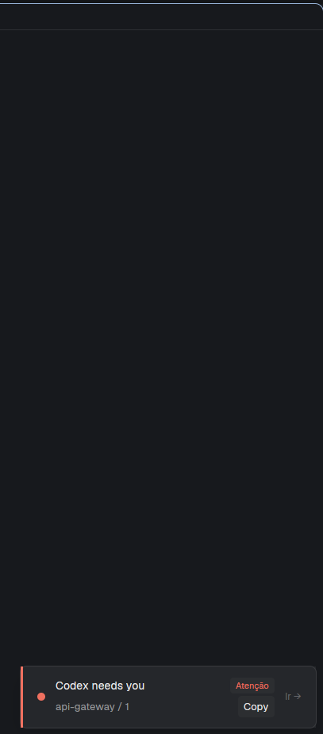

# Files Tabs

A side panel that lists the folder you are working in as a lazy file tree. Single-click a file and it opens as a preview tab in the main area (VS Code style: the next single click reuses that tab); double-click pins it. Files get Material-style icons, git status letters, and the tree follows whichever file tab is active.

## What you see

- One rounded (10px) panel filling its slot: theme `background`, 1px `border`, `foreground` text at 13px.
- Header, 42px tall, 14px side padding, bottom border: "Files" in semibold on the left; on the right the current folder's base name, 12px, `dim`, truncated, right-aligned.
- Below it a vertically scrolling tree (6px padding). Rows are 28px high, 7px gap, 7px radius. Indent is 8px + 18px per depth level.
  - Folders: a 12px chevron (right when closed, down when open, `dim`), then an icon, then the name.
  - Files: a 12px blank spacer in place of the chevron, then icon, then name.
  - Icon: 16px Material-style per-extension / per-filename / per-folder-name icon (open-folder variants where they exist). With the `materialIcons` setting off: plain 14px `folder.svg` / `file.svg` in `muted`.
  - Folders sort before files, then by name (`localeCompare`).
  - Git mark at the row's right edge, 11px: `A` (added or untracked) in `ansi2`, `D` or `U` in `ansi1`, anything else changed `M` in `blocked`.
- The row of the file open in the active tab is highlighted with `theme.selected`; hover uses `theme.hover`.
- Empty or error states (12px, `dim`): "Loading files…", "No files", "No folder", or the error text. If the cap is hit: "File list limited to 500 entries per folder and 5,000 total" (11px).
- Right-click menu: a 190px-wide popup (`popover` background, 12.5px text, 30px items, 6px padding) with "Open with…" (files only, local only), "Copy relative path", "Copy full path". Height 108px for local files, 76px otherwise.

## How it behaves

- Which folder: the focused pane's `cwd`, else the focused terminal's cwd, else the first pane cwd in the active space, else the space folder. Switching pane or space re-roots the tree. Each root remembers its set of expanded folders for the session.
- Click a folder: toggle it, loading its children on demand. With `accordion` on (default) opening a folder closes every open folder not on its path or inside it.
- Click a file: open it as a preview tab. Double-click (`click_count >= 2`): pin it. If the same file is already open in this space the tab is selected (and a preview is promoted to pinned on double-click). If a preview tab exists, it is retargeted to the new file and renamed; otherwise a new tab is created.
- Right-click a row: the menu above. "Open with…" opens a tab of kind `open-with`. Copy items write to the clipboard and close the popup. A "Tab options…" item (opens the shipped `menu` popup) only appears if another mod passes a `tabTarget` in the context-menu props; this mod never sets it.
- Follow active (`followActive`, default on): when the active tab is a file-view tab for this root, its parent folders expand and the row scrolls into view, once per tab switch.
- Reveal: another mod can ask the tree to expand to a folder by writing `files-tabs.reveal` (`{seq, spaceId, dir, root?}`); a higher `seq` than last seen is applied, `dir` is made relative to this panel's root, and that folder row is highlighted.
- Git: `git status` marks refresh when the window is focused. Listing refreshes on a folder watch event (local only), on window refocus, and on a 10s poll. Slow `git status` runs back off (up to 60s) and runs are shared between copies of the panel. No marks outside a git repo.
- No window focus: nothing polls while the window is inactive (except on first visit to a root).
- Settings (from Settings → Files, see Built from): `accordion`, `materialIcons`, `followActive`; each defaults to on unless explicitly `false`.

## Built from

Files (all in `mods/files-tabs/`):
- `mod.json`: `{"place": "none", "cloned_from": {"name": "files", "version": "0.1.16"}}`. Not placed by itself; a layout puts it in a panel slot.
- `main.js` (~590 lines): the `FilesTabs` view (tree, git status, tab opening, reveal, context menu).
- `icon-for.js`: `iconFor(name, isDir, open)` returns an icon id (exact filename, then longest dotted extension, then `file`; folder-name map with `-open` variants); `iconPath(id)` returns `mods/files-tabs/icons/<id>.svg`.
- `icon-map.js`: generated lookup tables `EXT`, `NAMES`, `FOLDERS`, `HAS_OPEN` (~80 KB, one long line each).
- `icons/*.svg`: about 1125 Material-style icons (MIT, from material-extensions/vscode-material-icon-theme), plus `file.svg` (copy of `document`), `folder.svg` / `folder-open.svg` (copies of the base folder icons).
- `scripts/gen-icons.mjs`: Node script that regenerates `icon-map.js` and `icons/` from a checkout of the icon theme (`node gen-icons.mjs <checkout>`); not needed at runtime.
- `chevron-right.svg`, `chevron-down.svg`, `file.svg`, `folder.svg` (14-line stroke icons used for the chevrons and the plain-icon fallback).

Mod props: the same module serves two roles. With no props it is the panel. With a `contextMenu` prop (`{path, fullPath, spaceId, root, on, name, isDir, tabTarget?}` plus `overlay`) it renders the right-click popup (`openOverlay({mod: "files-tabs", kind: "popup", ...})`).

Shipped mods used: `menu` (only via `tabTarget`).

Sibling mods it depends on or provides for (in this repo):
- Requires `file-view` (the mod it opens: `tab.new` with `mod: "file-view"`, props `{slotId, spaceId, tabId, kind, path, root, on, name, preview, updatedAt, beforeTabs}`). It reads and writes the `file-view.slots` shared map together with `file-view`.
- Provides `files-tabs.settings` consumers: `settings-custom` writes it; `file-picker` reads `quickOpenIgnore`; `tabs-folders`, `space-folders` read `materialIcons` (and `tabs-folders` `closePreview`, `tabMaxWidth`); `file-view` reads `diffTint`. `space-folders` and `tabs-folders` also copy `icon-for.js` and the icons.
- `file-picker` writes `files-tabs.reveal`.
- Settings seed file read: `<appHome>/data/files-tabs/settings.json` (JSON object). It lives in the person's own data folder, not in this mod, and is optional.

herdr functions and commands: `spaces`, `panes`, `focused`, `exec`, `watchFolder`, `theme`, `window`, `run`, `shared`, `setShared`, `props`, `openOverlay`, `closeOverlay`, `appHome`, `readTextFile`; `gpui-kit` (`View`, `div`, `svg`, `image`) and `gpui-base` (`v_flex`, `h_flex`, `ScrollHandle`); `cx.write_to_clipboard`, `cx.spawn`, `cx.timer.every(500)`. Commands: `tab.new`, `tab.select`, `tab.rename`.

Programs run (via `exec`, in the focused pane's folder, on the pane's machine if remote):
- `git rev-parse --show-toplevel`
- `git --no-optional-locks -c core.fsmonitor=false status --porcelain=v1 -z --no-renames --untracked-files=all`
- `sh -c <glob listing script>` for directory listing (skips `.git`, stops after 501 entries); on Windows or when `sh` is missing remotely, `powershell -NoProfile -Command ...` does the same.

`shared()` keys: reads `file-view.slots`, `files-tabs.settings`, `files-tabs.reveal`; writes `file-view.slots`, `files-tabs.settings` (seed only, when unset). Also stores a cross-copy scan cache in `globalThis[Symbol.for("herdr.repoStatus.v2")]`.

Limits: 500 entries per folder, 5,000 total, depth 40.

Differences from upstream `files`:
- Clicking a file opens it in a `file-view` main tab (preview or pinned) instead of an inline read-only code preview; the inline `Editor`, back arrow and syntax map are removed.
- Added right-click context menu overlay (open with, copy relative or full path, optional tab options).
- Added Material-style icons (`icon-for.js`, `icon-map.js`, `icons/`) with a plain-icon fallback.
- Added settings (`accordion`, `materialIcons`, `followActive`) read from `files-tabs.settings` / `data/files-tabs/settings.json`.
- Added accordion folder collapsing, follow-active-tab, and reveal-from-another-mod (`files-tabs.reveal`).
- Added selected-row highlight and scroll-to-row via `ScrollHandle`.
- Fallback cwd also considers any pane cwd in the active space; location now returns the space id.
- Icon paths and element id renamed from `files` to `files-tabs`; `mod.json` gains `cloned_from`.
- Git status, watch, polling and directory listing code is unchanged.

Derived from Herdr's files mod (Apache-2.0), see ../NOTICE.

## Watch out

- It runs programs: `git` and `sh` (or `powershell`) via `exec`, repeatedly (every 10s while the window is focused, and on file changes). It does not use the network. It reads outside its own folder: the browsed project folders (names only, never contents) and `<appHome>/data/files-tabs/settings.json`.
- Opening a file only works if the `file-view` mod is installed and named `file-view`; without it the tab will be empty or fail. "Open with…" likewise relies on `file-view`'s `open-with` kind (which uses Python helpers inside `file-view`).
- Tab bookkeeping is delicate: slots older than 5s without a `tabId`, or whose tab is gone, are pruned from `file-view.slots` before each open. Keep `beforeTabs` in the `tab.new` props: `file-view` uses it to claim the right new tab.
- The seed file is only a startup default; live changes come from `files-tabs.settings`. The seed read fails silently if the file is missing.
- Marks come from the git top-level, keyed by absolute path; folders show marks only for themselves, not rolled up from children.
- Folder watching is skipped on remote machines (`on` set); those rely on the 10s poll.
- `mod.json` has `"place": "none"`: it needs a layout slot or a mod placement to appear.
- The `menu` popup used by "Tab options…" is unreachable unless another mod supplies `tabTarget`.
- The icon map and SVGs are generated; do not hand-edit, rerun `scripts/gen-icons.mjs`. Icons are MIT-licensed upstream.
- Keys: none defined by this mod.

## Done when

- `herdr-app check mods/files-tabs` passes.
- The panel shows "Files" and the current folder's base name, and a lazily loaded tree with folders first.
- Clicking a folder expands it and loads children; with `accordion` on, siblings close.
- Clicking a file opens a preview tab via `file-view`; clicking another file retargets the same tab; double-click pins it.
- Files show `A`/`M`/`D`/`U` marks inside a git repo, and no marks outside one.
- Right-click shows "Copy relative path" and "Copy full path" (plus "Open with…" for local files), and copying fills the clipboard.
- Switching to a file tab expands its folders and highlights its row (when `followActive` is on).
- Turning `materialIcons` off in `files-tabs.settings` swaps in plain folder/file icons.
- A folder with over 500 entries shows the limit message.
