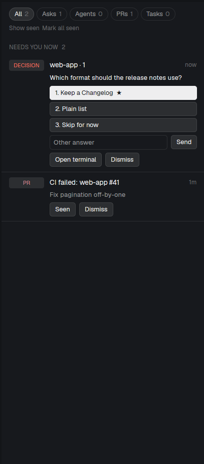

# Inbox



One ranked list of everything that needs you.

Inbox is a right-hand panel that gathers blocked and finished agents, pull-request alerts, scheduled task runs and "ask cards" in a single list. Instead of hunting through tabs, you scan one place. You can answer a permission prompt or a multiple-choice question from a waiting agent with one click, right from the card.

## Quick start

1. Install the mod (see below) and make sure your layout has the panel stack described under Install.
2. Open Herdr and click the Inbox button in the panel. With nothing pending it shows `Nothing needs you.`
3. When an agent blocks on a prompt, an `APPROVAL`, `QUESTION` or `DECISION` card appears. Click an option to answer it.

## Install

> Read ~/.config/herdr-app/AGENTS.md, then add this mod: https://github.com/dobraga/herdr-mods/tree/main/inbox

<details>
<summary>Install by hand</summary>

```sh
git clone https://github.com/dobraga/herdr-mods
cd herdr-mods
./install.sh inbox
```

This links the mod into `~/.config/herdr-app/mods`; `git pull` updates it.

Inbox has `"place": "none"`: it is not placed on its own, it is a child of another mod's panel. In the author's layout it is a block in a stack:

```json
{ "id": "inbox", "type": "block", "content": { "mod": "inbox" } }
```

The stack is `panel-body` inside a node with id `panel`. The `tabs-folders` mod adds the Inbox button to that panel and shows the badge. No `keys.json` entry is needed.

</details>

## Usage

- Filter chips: `All`, `Asks`, `Agents`, `PRs`, `Tasks`, each with a count. A chip is hidden when its source is turned off in settings.
- Rows are grouped as `NEEDS YOU NOW`, `REVIEW` and `NEW FOR YOU`, newest first.
- Click a row to open it (focus the agent, show the PR or the task) and mark it seen.
- `Seen` marks one row, `Mark all seen` marks all, `Dismiss` hides a row, `Show seen` / `Hide seen` toggles seen rows.
- Ask cards: click a numbered option, or type under `Other answer` and press `Send`. Recommended options are marked with a star. Multi-question dialogs have `‹ Back`, `Next ›` and `Continue`. Answering presses keys in the agent's terminal.
- If an answer is not delivered, the card shows `Retry` and `Open terminal`.
- A toast appears once per agent request. Setting `notify`: `asks` (default), `all` or `off`.
- Informational rows are marked seen after the panel has been visible for a few seconds (default 5). Asks, failures and review requests never are.
- Settings (sources, notify, auto-seen, plain-text detection, retention days) live in `~/.config/herdr-app/data/inbox/settings.json`. The `settings-custom` mod has an Inbox section that edits it.
- Seen, dismissed and answered marks are stored in `~/.config/herdr-app/data/inbox/state.json`. Answers are also logged under `decisions/<space>.md` (when `decisionsLog` is on).

## Requirements

- `hc` on PATH: Inbox reads agent terminals and types keys and text into them. Only Claude Code, Codex, Pi and Antigravity agents are read, and detection is heuristic, so a UI change in an agent can break cards (it then shows as a plain `AGENT` row).
- `herdr-tasks` (optional): needed for the Tasks source and the plain-text classifier. Install it with `./install.sh tasks` (requires bun).
- Network: Inbox has no direct network access. The optional plain-text detection (`asks.plainText`, off by default) calls a model through `herdr-tasks ask`, at most 6 calls per minute.
- Companion mods (the other sources show nothing without them; asks and agents still work): `tabs-folders` hosts the panel, `workspace-status-usage` provides PR alerts, `prs-panel` and `tasks` are the panel pages opened from rows, `space-folders` provides profiles.
- Files outside the mod folder: only `~/.config/herdr-app/data/inbox/`.

See [RECIPE.md](RECIPE.md) for how it is built.
