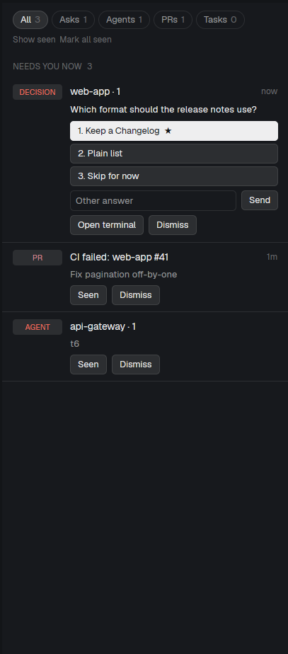

# Inbox

One ranked list of everything that needs you, in a right-hand panel: agents that are blocked or finished, pull-request alerts, scheduled task runs, and "ask cards" that let you answer a waiting agent right from the list. You scan one place instead of hunting through tabs, and answer a permission prompt or a multiple-choice question with one click.

## What you see

A vertical panel, full width of its host, on the theme background, 12.5px text.

- **Header row** (14px side padding): filter chips `All`, `Asks`, `Agents`, `PRs`, `Tasks`, each 24px high, pill-shaped (radius 12), 11.5px, with a dim count after the label. The active chip has the theme `selected` fill and `input` border. A chip whose source is turned off in settings is not drawn. Right side: a dim `Show seen` / `Hide seen` link and, when anything is unseen, `Mark all seen`.
- **Hints**: `N more in other profiles` (dim, 11px) when a space profile hides rows; a red error line; a dim classifier note.
- **List** (scrolls, with a vertical scrollbar), grouped under headings `NEEDS YOU NOW`, `REVIEW`, `NEW FOR YOU`, each with a count. Empty list: `Nothing needs you.`
- **Plain row**: a 64px-wide kind badge (10px semibold, centered, `raised` background; text color by tone: error red, done green, blocked muted-amber-by-theme, accent), then a bold truncated title, the age at the right (`now`, `5m`, `2h`, `3d`), an optional one-line muted body, and small buttons `Seen` (if unseen) and `Dismiss`. Seen rows are drawn at 60% opacity.
- **Ask card**: same badge column. Title is `<space> · <tab>`, with age. Then the question (12px), optional dim context, an optional step indicator (`2/4`, or tab labels prefixed `✔`/`○`), the option buttons, a text input (placeholder `Other answer`) with `Send`, and a button row (`‹ Back`, `Next ›`, `Continue`, `Retry`, `Open terminal`, `Dismiss`). Recommended options are marked `★` and drawn primary (solid).
- **Answered strip**, pinned below the scroll area with a top border: `ANSWERED · N`, a `Clear` link, and the last 4 answers as `<space> · <answer>` lines.

## How it behaves

Agent status mapping (from `agents()`):
- **blocked**: if an ask card was read from its screen, one card (`QUESTION`/`APPROVAL`/`DECISION`/`QUESTIONS`, section NEEDS YOU NOW); otherwise a plain `AGENT` row, body `Waiting for you`.
- **done**: a `DONE` row (`<space> · <tab> finished`) in REVIEW. With the plain-text classifier on, a finished agent whose last message asks something also gets a text card; if its last output is an API/login error it gets a red `STOPPED` card (with `Continue` unless logged out).
- **working / idle**: not listed.

Sources and sections: asks and failed/missed task runs and error-level PR alerts go to NEEDS YOU NOW; done agents and warning PR alerts to REVIEW; info PR alerts and finished task runs to NEW FOR YOU. Within a section, newest first. Dismissed rows are always hidden; seen rows hidden unless `Show seen`, except asks, which stay.

Clicks and keys:
- Click a plain row: opens it (agent row `agent.focus`; PR row selects the PRs child of the panel and shows it, after setting the focused PR key; task row selects the Tasks child) and marks it seen.
- `Seen` marks one row (PR alert gets `read: true`; task run is marked seen through `herdr-tasks seen <run>`). `Dismiss` hides it (a dismissal hides only the card it was made on, never a later ask of the same question).
- Dialog options (permission/choice) send the option number as a key press; agents using arrow navigation (Antigravity) get down/up arrows and Enter. Multi-select cards tick boxes locally; `Confirm (n)` presses only the number keys that differ, then right-arrow. `‹ Back` / `Next ›` send left/right. Free text over a dialog presses Esc, waits 500ms, then types the text. Text cards: click a question to expand its offered options; with several questions each pick is a draft and `Send answers (k/n)` sends them as one numbered message.
- While an answer is in flight all card controls are dimmed (45%) and ignored. Delivered = the agent left the dialog, showed the next dialog, or started working (checked every 120ms, up to 8s; Back/Next only 1.5s and then just reopen). On a miss it retries once (Enter if the text sits in the input box, else resend); if still nothing the card shows `Not delivered: the agent did not react.` and `Retry`.
- Cards vanish when the agent moves on (answered elsewhere or closed).
- A toast (`notify`) fires once per agent request (not per question of a set; 5s gap starts a new request), for the active profile only, never for the first scan after start; `STOPPED` is level `warning`. Setting `notify`: `asks` (default), `all`, `off`.
- Auto-seen: while the panel is visible for N seconds (3/5/10/20, default 5), informational rows (section NEW FOR YOU, not agents) are marked seen; with the Agents filter open, `DONE` agents too. Asks, failures and review requests are never auto-seen.
- Space profiles: with a profile active, only its rows and profile-less rows show.

Timers: agents scanned every 400ms (a terminal is read only when its `status:seq` changed); settings reloaded every 15s; task runs every 30s; re-render every 60s for ages; auto-seen check every 1s.

## Built from

Files in `mods/inbox/`:
- `mod.json`: `{ "place": "none", "title": "Inbox" }` (it is a child of another mod's panel, not placed by itself).
- `main.js`: the `Inbox` view class (default export): scanning, answering, rendering.
- `items.js`: pure model: `DEFAULT_SETTINGS`, `normalizeSettings`, `parseState`/`serializeState`/`pruneState`, `profileOf`, `classifierFor`, `buildItems`, `inProfile`, `rank`, `needsYouCount`, `hiddenElsewhere`, `autoSeenItems`, `SECTIONS`.
- `asks.js`: pure screen reading: `parseDialog` (numbered options at the bottom of the last 45 lines, requires a live footer or cursor marker, understands Claude Code multi-question tab bars and `Question n/m`, `[ ]`/`[✔]` boxes, strips `(Recommended)`), `parseStopped`, `lastMessage`, `classifyPrompt`, `parseClassifier`, `answerPlan`, `composeAnswers`, `decisionLine`, `dialogId`, `hash` (FNV-1a), `SUPPORTED_APPS = claude-code, codex, pi, agy, antigravity`.
- `inbox.svg`: 24x24 lucide-style inbox-tray icon (stroke currentColor, 1.8). No `icon-map.js`, no other art.

Imports: `gpui-kit` (`View`, `div`), `gpui-base` (`v_flex`, `h_flex`, `InputState`, `Input`, `Scrollbar`), `herdr` (`agents`, `layout`, `spaces`, `appHome`, `checking`, `exec`, `hc`, `home`, `notify`, `readTextFile`, `run`, `setShared`, `shared`, `theme`, `writeTextFile`). `init` returns early when `checking()`. `InputState.new` can only run in `init`, so 8 inputs are pre-made and lent to cards (at most 8 open asks have a text box).

Props: none (`_props` unused).

Herdr commands via `run`: `agent.focus {terminal}`, `layout.select {stack:"panel-body", child:"prs"|"tasks"}`, `layout.show {id:"panel"}`. Layout read: `layout()` tree, looking for node ids `panel` (not hidden) and `panel-body` with `active === "inbox"`.

Programs run:
- `hc read <address>` (read an agent's screen), `hc keys <address> <keys...>`, `hc send [--force] <address> <text>`.
- `herdr-tasks version | history --limit 100 | ls | seen <runId> | ask --agent <a> [--model m] [--effort e] --prompt-file <file> --timeout 60` (the last is the optional plain-text classifier; it calls a model).
- `mkdir -p`, `rm -f` via `exec`.

`shared()` keys:
- Read: `space-folders` (key `""`: `of`, `list`, `spaceProfiles`, to map a space to a profile), `space-folders.profile` (active profile), `forge.notifs` (array of `{id, title, body, level, at, read, prKey, profile}`).
- Written: `inbox.count` = `{ needsYou, asks }` (set on every render), `forge.notifs` (marks items `read: true`), `forge.focusPrKey` = `{ key, seq }`.

Files outside the mod folder, under `~/.config/herdr-app/data/inbox/` (appHome): `settings.json` (read; written by the settings mod), `state.json` (read once, then written, debounced 300ms; `{version:1, seen, dismissed, answered, classified}`, pruned to `retentionDays` default 14, answered capped at 100), `decisions/<space-slug>.md` (appended decision log, one line per answer), `tmp-<hash>.txt` (classifier prompt, deleted after).

Settings defaults: `classifier {agent:"claude", model:"", effort:""}`, `profiles {}` (per-profile classifier), `asks {enabled:true, plainText:false, decisionsLog:true}`, `sources {agents,asks,prs,tasks: true}`, `notify "asks"`, `autoSeen true`, `autoSeenSeconds 5`, `retentionDays 14`.

Binary lookup: `herdr-tasks` on PATH if `herdr-tasks version` exits 0, else `~/.local/bin/herdr-tasks`.

## Watch out

- **Runs programs**: `hc` (reads agent terminals, types keys and text into them), `herdr-tasks`, `mkdir`, `rm`. Answering a card literally presses keys in the agent's terminal.
- **Network / model**: no direct network access. Plain-text detection (off by default, `asks.plainText`) calls a model through `herdr-tasks ask`; capped at 6 calls per minute, each message classified once (hash cached in `state.json`), only when the last message looks like a question.
- **Reads/writes outside its folder**: `~/.config/herdr-app/data/inbox/*` only (and the terminal contents of every supported agent).
- **Depends on sibling mods** (it shows nothing for a source whose producer is absent; asks and agents still work):
  - `workspace-status-usage` produces `forge.notifs` and `forge.focusPrKey`.
  - `prs-panel` consumes `forge.focusPrKey` and must be the `prs` child of the panel stack.
  - `tasks` provides the Tasks panel (the `tasks` child) and `herdr-tasks` data; `tasks/main.js` uses its own unrelated `inbox` feed name.
  - `space-folders` produces `space-folders` and `space-folders.profile`.
  - `tabs-folders` hosts it: it adds the Inbox button (`mods/inbox/inbox.svg`) to the panel, reads `inbox.count` for the badge, and the layout must have nodes `panel` and a stack `panel-body` with child id `inbox`.
  - `settings-custom` has the `Inbox` section that writes `data/inbox/settings.json` (without it, edit that JSON by hand).
- Non-Herdr programs required: `hc` and `herdr-tasks` (the latter only for the Tasks source and the classifier).
- Screen reading is heuristic: it depends on how Claude Code, Codex, Pi and Antigravity draw dialogs (numbered options, `Esc to cancel` footers, `●` message bullets, `❯` cursor). A UI redesign in those agents breaks card detection; the agent still shows as a plain `AGENT` row.
- Only agents whose `app` is in `SUPPORTED_APPS` are read.
- No `setTimeout` in the runtime: waits use `cx.timer.after`. A click's `cx` dies at the first `await`, so answers run in `cx.spawn`.
- State is read once at start; a second Herdr window will not see marks live. Writes use the read-before-write expected-content check of `writeTextFile`.
- Card ids: a card key is its agent address plus a hash of question and options, so the next question of a set is a new card.
- Text boxes: only 8 open asks get an input; more cards render without one.
- No keys.json needed.

## Done when

- `herdr-app check mods/inbox` passes.
- With the other mods present, the panel's Inbox button opens the list with the five chips and `Nothing needs you.` when idle.
- A Claude Code permission prompt in a blocked agent shows an `APPROVAL` card with numbered buttons; clicking one presses that number in the terminal and the card disappears.
- A finished agent shows a `DONE` row; clicking it focuses that terminal and marks it seen.
- `Dismiss` hides a row; `Show seen` reveals seen rows.
- Turning a source off in settings removes its chip and rows.
- `inbox.count` in shared state reflects the `NEEDS YOU NOW` count after every render.
- `state.json` appears under `~/.config/herdr-app/data/inbox/` after the first mark, and an answered card adds a line to `decisions/<space>.md` (when `decisionsLog` is on).
