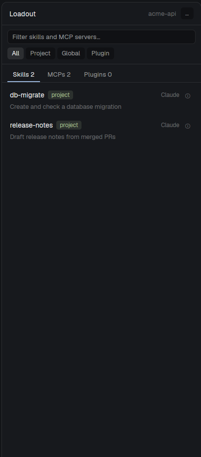

# Loadout



A side-panel inventory of the skills, MCP servers and plugins your AI coding tools have configured for the folder you are working in.

Loadout scans the active folder and your home-directory configs for Claude, Antigravity, Codex and Gemini. Each row shows where it comes from (project, global or plugin), so you can see at a glance what an agent will have available here. Filter by text, scope and tool, and click a skill to open its `SKILL.md`. It is read-only: it never edits or toggles anything.

## Quick start

1. Install the mod (see below).
2. Add it as a block in a panel stack of your layout (see "Place it").
3. Open the panel: the Skills tab lists the skills of the focused folder, with a `project` or `global` badge.

## Install

Ask your agent:

> Read ~/.config/herdr-app/AGENTS.md, then add this mod: https://github.com/dobraga/herdr-mods/tree/main/loadout

<details>
<summary>Install by hand</summary>

```sh
git clone https://github.com/dobraga/herdr-mods
cd herdr-mods
./install.sh loadout
```

This links the mod into `~/.config/herdr-app/mods`; run `git pull` to update it.

**Place it.** Loadout has `"place": "none"`, so it does not show up by itself. It is a panel body: add it as a block in a layout stack, for example:

```json
{ "id": "loadout", "type": "block", "content": { "mod": "loadout" } }
```

In the author's layout this block sits in the `panel-body` stack next to Files, Changes, PRs, Tasks and Inbox, and the `tabs-folders` mod shows a panel button for it.

</details>

## Usage

- Header: the active folder's name and a refresh chip (`↻`). It rescans on open, every 30 s, and when the focused pane, space or machine changes.
- Filter box and chips: narrow by text (name, description, target), scope (`All / Project / Global / Plugin`) and tool. The tool row appears only when more than one tool is detected.
- Tabs: `Skills`, `MCPs` (including claude.ai connectors) and `Plugins`, each with a count.
- Click a skill to open its `SKILL.md` in a file-view tab. The `ⓘ` icon shows paths, symlink targets, `Copy path` and `Open`.
- Click an MCP row to see env and header key names (values are hidden), config paths and `Copy path`. Secret-looking arguments are shown as `•••`.
- Click a plugin row for its install path, `Show skills` / `Show MCPs` and `Copy path`.
- Connectors show a status dot: connected, needs sign-in (collapsed under "Needs sign-in") or failed. Status is cached for 5 minutes.
- No settings: nothing is stored or written by the mod.

## Requirements

- Opening skills needs the `file-view` mod (and ideally `files-tabs`) from this repo: `./install.sh file-view files-tabs`.
- Runs `sh`, `head`, `readlink` and `timeout` on each scan. The `claude`, `agy`, `codex` and `gemini` CLIs are optional; a tool chip appears only when its executable is on PATH.
- Reads files outside its folder: skill folders and configs under `~/.claude`, `~/.claude.json`, `~/.gemini`, `~/.codex` and `~/.agents`, plus `.claude`, `.codex`, `.gemini`, `.agents` and `.mcp.json` in the active folder. Secret values are redacted in the UI.
- Network, indirectly: with the `claude` CLI present it runs `claude mcp list`, which contacts your configured MCP servers and claude.ai connectors (about 16 s, 45 s timeout).

See [RECIPE.md](RECIPE.md) for how it is built.
