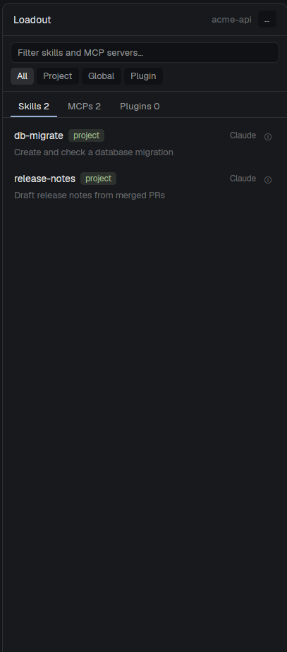

# Loadout

A side-panel inventory of everything an AI coding setup has configured for the folder you are working in: skills, MCP servers and installed plugins, across Claude, Antigravity, Codex and Gemini. Each row says where it comes from (project, global or plugin), you can filter by text, scope and tool, and a click opens a skill's `SKILL.md` in the file viewer. It is read-only.

## What you see

A rounded (10px) card filling its pane, `theme().background`, 1px `theme().border`, 13px text. Top to bottom:

1. **Header**, 42px: "Loadout" (semibold) on the left; the active folder's last path segment, right-aligned, 12px `dim`; a refresh chip (`↻`, shows `…` while scanning).
2. **Filter block** (10px padding, 6px gaps): a 26px filter input (placeholder "Filter skills and MCP servers…"); a chip row `All / Project / Global / Plugin`; a second chip row `All tools` plus one chip per detected tool (Claude, Antigravity, Codex, Gemini, Shared). The tool row only appears when more than one tool is detected.
3. **Tab strip**: `Skills N`, `MCPs N`, `Plugins N`, 26px tall, active tab has a 2px `accent` underline. The MCPs count includes claude.ai connectors.
4. **Scrolling body**:
   - Skills and MCP rows: bold 12.5px name, a scope badge (11px-high pill, 10.5px text, tinted 15% of its colour: project/local `ansi2`, plugin `ansi5`, global `ansi4`; text `project`, `project (local)`, `global`, `global · builtin`, `plugin: <name>`), the tool names joined by ` · ` on the right, and a 11.5px `dim` description (skills) or `transport · target` (MCPs), truncated to one line.
   - Plugin rows: name, version badge, `N skills · M MCPs`, and `marketplace · scope`.
   - Under MCPs, a "CLAUDE.AI CONNECTORS (n)" heading with rows of a status dot (8px, colours under How it behaves), name and status text.
   - "None found", "Scanning…" or a red error line when applicable.

Rows are sorted project/local first, then global, then plugin.

## How it behaves

- On open, and every 30 s, it rescans the active folder; it also rescans when the focused pane, space or machine changes. The refresh chip forces a rescan.
- Folder: the focused pane's `cwd`, else the focus `cwd`, else the first pane's `cwd` in the active space, else the space folder. Works on remote machines (`on`).
- Filter text matches name, description, target and label (case-insensitive). Scope chip `Project` also includes "local" (per-project entries in `~/.claude.json`). Tool chips filter by which tool owns the entry.
- Skill row click: opens its `SKILL.md` in a file-view tab (Markdown preview). Reuses a tab already showing the file, else the preview slot, else makes a new tab. The small `ⓘ` toggles details instead: all paths, symlink targets (`→ target`), `Copy path` (button reads "Copied" for 1.2 s) and `Open`.
- MCP row click: expands to show env and header key names (values never shown, "values hidden"), config file paths, `Copy path`, `Open`.
- Plugin row click expands: install path, `Show skills` / `Show MCPs` (fills the filter with the plugin name, sets scope Plugin, switches tab), `Copy path`.
- Connectors dot: connected `ansi2`, needs sign-in `ansi3` (falls back to `muted`), failed `ansi1`. Rows needing sign-in are collapsed under a "Needs sign-in (n)" toggle (opened automatically while filtering). Status is cached 5 minutes per machine and fetched after the file scan, so tabs never wait on it.
- Redaction: MCP args like `--token=x` show as `--token=•••`; known secret-looking values (`sk-`, `ghp_`, `github_pat_`, `xox*-`, `AIza`, `ya29.`, `eyJ`) become `•••`; URL userinfo and query strings are hidden.

## Built from

Files in `mods/loadout/`:

- `mod.json`: `{"place": "none", "title": "Loadout"}`. It is a panel body mounted by another mod, not placed by itself. No `props` roles are read.
- `main.js`: the `Loadout` view (default export, extends `View`). Imports `gpui-kit` (`View`, `div`), `gpui-base` (`v_flex`, `h_flex`, `Input`, `InputState`), `herdr`.
- `scan.js`: pure helpers plus the shell script: `TOOLS`, `buildSpecs`, `SCAN_SCRIPT`, `flattenSpecs`, `parseRecords`, `parseFrontmatter`, `describeServer`, `parseCodexToml` (minimal TOML for `[mcp_servers.NAME]`), `buildInventory`, `buildPlugins`, `parseMcpList`, `pluginSpecs`.
- `loadout.svg`: 24x24 stroke icon of three stacked layers (used as the panel button icon by `tabs-folders`).

`herdr` functions used: `spaces`, `panes`, `focused`, `exec`, `theme`, `run`, `shared`, `setShared`. Commands via `run`: `tab.select {id}`, `tab.rename {id,name}`, `tab.new {name, space, mod: "file-view", props}`. Timers: `cx.timer.every(30000)`, `cx.timer.after(1200)`; `cx.write_to_clipboard`.

Programs run through `exec` (optionally `on` a remote machine):

- `sh -c <SCAN_SCRIPT>`: loops over (kind, tool, scope, label, path) groups; prints NUL-separated records. Reads `ls`-style listings of skill folders, `head -n 30` of each `SKILL.md`, `readlink` of each skill folder, and `head -c 400000` of config files.
- `sh -c 'command -v claude/agy/codex/gemini'`: tool chips are offered only for executables that exist (`Shared` is always allowed).
- `sh -c 'command -v claude && timeout 45 claude mcp list'`: the claude.ai connector list. Only when the Claude CLI is present.

Paths scanned (`~` expanded by the shell; `<cwd>` is the active folder):

- Skills: `<cwd>/.claude/skills`, `~/.claude/skills`, `~/.gemini/skills`, `~/.gemini/antigravity-cli/builtin/skills` (label `builtin`), `<cwd>/.codex/skills`, `~/.codex/skills`, `<cwd>/.gemini/skills`, `<cwd>/.agents/skills`, `~/.agents/skills`. A skill is a subfolder containing `SKILL.md`; name and description come from its YAML frontmatter (folded `>`/`|` blocks supported).
- MCP JSON (`mcpServers` key): `<cwd>/.mcp.json`, `<cwd>/.claude/settings.json`, `<cwd>/.claude/settings.local.json`, `~/.claude/settings.json`, `~/.gemini/config/mcp_config.json`, `<cwd>/.gemini/settings.json`, `~/.gemini/settings.json`.
- `~/.claude.json`: global `mcpServers` plus `projects[<cwd>].mcpServers` (scope "local").
- `~/.codex/config.toml`: `[mcp_servers.*]` tables.
- `~/.claude/plugins/installed_plugins.json`, then per installed plugin (project-scoped installs only when `projectPath` equals the folder) `<installPath>/skills` and `<installPath>/.mcp.json`.

Dedupe: skills by scope+label+name, MCPs by scope+name, merging tools and paths.

Shared state and sibling mods:

- Reads and writes `shared("file-view.slots")` (the same slot map the `files-tabs` and `file-view` mods use) and opens tabs with `mod: "file-view"` and props `{slotId, spaceId, tabId: null, kind: "file", path, root, on, name, preview: true, updatedAt, beforeTabs}`. Needs `mods/file-view` (and ideally `files-tabs`) present; without them skill/Open clicks create a tab for a missing mod.
- Provides: the `loadout` panel. `tabs-folders` lists it as a panel button (`panelButton("loadout", "Loadout", "mods/loadout/loadout.svg")`) when `loadout` is in its enabled panels.

Art: one SVG icon, no images, no network assets.

## Watch out

- **Runs programs.** Every scan spawns `sh` (and the `claude` CLI for connectors) via `exec`, every 30 s while the pane is mounted, plus on every focus/space change.
- **Reads outside its own folder.** It reads the home-directory config of several tools (see list above), including `~/.claude.json`, which can be large (capped at 400000 bytes per file) and holds MCP env/header key names. Secret values are redacted in the UI and never leave the module, but the files are read.
- **Network: indirectly.** The mod itself makes no requests, but `claude mcp list` contacts each configured claude.ai connector and MCP server to check health. It takes ~16 s and has a 45 s timeout, so it runs after the scan and is cached 5 minutes per machine (forced on the refresh chip).
- **Non-Herdr programs:** `sh`, `head`, `readlink`, `timeout`; optional `claude`, `agy`, `codex`, `gemini` CLIs. None are required: absent tools just produce no chips and no connectors.
- A skills folder alone does not enable a tool chip: the executable must be on PATH. `Shared` (`.agents/skills`) is shown regardless.
- Text-based, read-only: no editing, enabling or disabling of skills or servers.
- The Codex TOML parser is minimal: only `command`, `url`, `args` (quoted strings), and key names under `.env` / `.headers` / `.http_headers`.
- `claude mcp list` output is parsed by a regex for lines starting `claude.ai <name>: <url> - <status>`; other CLI output formats show no connectors.
- No folder (empty space) shows "No folder in active space".
- `place: "none"`: it needs a host (panel stack) to show up, for example `tabs-folders`.

## Done when

- `herdr-app check mods/loadout` passes.
- Mounted in a pane, the header shows "Loadout" and the active folder's name, and the Skills tab lists skills from `~/.claude/skills` with a `global` badge.
- A skill in `<cwd>/.claude/skills` shows a `project` badge and sorts above global ones.
- Typing in the filter narrows rows by name or description; `Project`/`Global`/`Plugin` chips narrow by scope.
- Clicking a skill row opens its `SKILL.md` in a file-view tab; clicking it again reuses that tab.
- Expanding an MCP row shows env/header key names but no values; a `--token=...` arg renders as `--token=•••`.
- The Plugins tab lists entries from `installed_plugins.json` with skill and MCP counts, and `Show skills` filters to that plugin.
- With the `claude` CLI present, the MCPs tab shows the claude.ai connectors section within about 20 s; without it, no such section is populated and no error appears for the files scan.
- The tool-chip row is hidden when only one tool is detected.
- Nothing is ever written to disk by the mod (only `shared("file-view.slots")` and tabs change).
