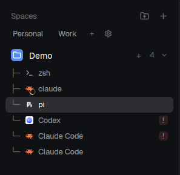

# Space folders

The sidebar's list of spaces, rebuilt around folders and profiles. Spaces live in collapsible, colored folders you create, drag spaces into, or let collect spaces by folder-name rules. Git worktrees sit under their checkout, every tab of a space is listed under it (as a tree or one compact icon line), and a row of profile chips (Personal, Work, ...) filters the whole list. It replaces Herdr's own `spaces` mod.

## What you see

Top to bottom, on the chrome background (`t.chrome`), 13px text:

- **Header (31px):** "Spaces" label (11.5px, dim) on the left; on the right two 26px icon buttons: folder-plus (new folder) and plus (new space). In a rail narrower than 160px the label and folder button disappear and only the plus stays.
- **Profile chips** (hidden in the rail): one 22px chip per profile (11.5px, 6px radius, border), the selected one on `t.selected` with a `t.border` outline and medium weight. Then a "+" chip (new profile) and a settings-gear button (tooltip "Configure profiles & GitHub/Bitbucket"). A chip of a profile that is not selected shows a 5px dot when a space under it is blocked (`t.blocked`) or done (`t.done`). With zero profiles a single "All" chip shows.
- **Scrolling list**, 8px side padding, always-on scrollbar:
  - **Machine header** (26px, 11px dim), only when a machine other than this computer exists and no folder collects it: monitor/server icon, name ("This computer" for local), small folder-plus and "+" buttons, a 6px connection dot (`t.ansi2` connected, `t.dim` otherwise), chevron. Not-connected machines show their state text.
  - **Folder header** (30px, 8px radius): an 18px rounded tile in the folder's color with a white folder icon (grey `t.dim` when uncolored), the name (medium weight, truncated), then optional badges, a "+" button, the count of spaces (11.5px dim) and a down/right chevron. Colors: ansi6 `#22a99a`, ansi3 `#e3814f`, ansi4 `#5b8def`, ansi5 `#8b7cf6`, ansi2 `#3fae6a`, ansi1 `#d9649a`.
  - **Spaces under a folder**, indented 18px more than loose ones (8px base; a machine nested in a folder: 26px header, 44px content). A checkout's own tabs sit directly under the folder with no row of their own; each worktree has a header row (28px) with a branch icon, tree lines "├─"/"└─", and its branch name, listed before the checkout's tabs. A worktree with no space of its own, only tabs working in it, gets a virtual row named after its branch.
  - **Space row** (30px): name (only if the person named it; unnamed checkouts hide the row), a git tail on the right: "repo · branch" only where unusual (master/main and names equal to the space or folder name are omitted), a PR chip `#123` (10px) tinted by state, green `↑n` ahead and red `↓n` behind, a chevron to open or close its tab list.
  - **Tab rows** (24px, 11.5px) under a space, joined by "├─"/"└─": a 12px program icon (or 6px dot), the tab label, a "!" badge when blocked. A split tab becomes one block (raised background) with one line per terminal pane and a "┃" connector.
  - **Compact style:** no worktree headers; one 24px line per space or worktree with a 12px icon per tab (agent, chat, shell, file-view tab) and the branch (branch icon, max 110px) on the right.
  - Loose spaces (in no folder) follow all folders.
  - **Drop zone:** while a space in a folder is dragged, a 34px dashed box "Drop here to take it out of its folder" at the list's end.
- **Rail (sidebar < 160px wide):** each space is a 26px line with its 1-based number and a glyph (`●` blocked or done, `·` otherwise, colored by status); each folder is just its tile.

## How it behaves

Status (per space, per folder, per tab):
- **blocked:** a 16px badge, `t.blocked` at 15% fill and text, "!" or "n!" (tooltip "Needs you" / "n agents need you"); on a tab, a 14px "!" badge. Counts come from `agents()` by space.
- **done:** same badge in `t.done`, "✓" or "n✓" (tooltip "Finished" / "n agents finished"); on a tab, a 7px `t.done` dot at the icon's corner.
- **working:** an 11px spinner (`t.working`, 900ms) on the space row, 10px on a tab icon; a folded folder shows it only when nothing in it is blocked or done.
- **idle:** nothing is drawn.
- Folded folders show the sum of blocked/done in their contents on the header.

Clicks, keys, hovers:
- Click a space row: `space.select`. Click a tab: `space.select` if needed, `tab.select`, and `pane.focus` for a pane of a split tab. Click a virtual worktree row: selects its first tab.
- Click a folder header toggles fold; "+" on it creates a space (`space.new`, in the folder's start path); right-click opens a popup: color swatches (grey + six), profile chips, "New space here", "Edit folder...", "Delete folder".
- "Edit folder" dialog (460px): Name, Profile chips, "Start new spaces in" (path, "Choose..." folder picker on this computer only), "Collect spaces from" (comma-separated rules). Rules mirror the start path until edited; the name follows the path's last part until typed over. Enter saves, Escape closes.
- Rules: `~` is any home (`/home/*`, `/Users/*`, `/root`), `*` is any one folder name, a rule starting with neither `/` nor `~` is a folder name at any depth; a rule matches the folder and everything under it. The folder whose rule reaches deepest wins; ties go to the first. On this computer, a folder also collects another machine's whole section when a rule matches that machine's name or the folder one of its spaces works in.
- Drag a space onto a folder header: joins it; onto another space: moves there (`space.move`) and joins its folder; onto empty list area: leaves its folder (kept out explicitly when a rule would pull it back). Drag a folder over another to reorder. Dragging only works within one machine. Dragging onto a profile chip assigns that profile (to the space's folder, or the loose space).
- Profile chip click: filters the list to that profile and selects its last shown space (or the first). Right-click a chip: "Configure GitHub / Bitbucket...", "Rename profile...", "Delete profile". The selected profile follows focus: when the focused pane or shown space lands in another profile, the chip switches (unless shared `space-folders.follow` is `false`).
- A space made from a folder's "+" goes into that folder; one made from the space in front (Herdr's own new-space keys) lands right under it, in its folder, within 3 seconds. Closing the front space selects the one above it in the list.
- PR chip click: sets shared `forge.focusPrKey`, then `layout.select {stack: panel-body, child: prs}` and `layout.show {id: panel}`.
- Keys: commands `space-folders.next` / `space-folders.prev` (bound by the person in `keys.json`, not shipped) step through spaces in the list's visual order, skipping folded ones, wrapping.
- Tab and tab-list open state persist per space (local storage `spaces.tabs.open`); folded machines in `machines.folded`; selected profile in `space-folders.profile`.
- Git is refreshed on new places, when a command or agent turn ends, when a machine returns, when a repo's `.git` folder changes (`watchFolder`), and every 60s for visible repos while the window is active.

## Built from

Files (all in `mods/space-folders/`):
- `mod.json`: `{ "place": "none", "title": "Space folders", "cloned_from": { "name": "spaces", "version": "0.1.10" } }`. No `props` roles; the mod is placed by a layout (sidebar slot) and opens itself as overlays via its own props: `folderMenu`, `edit`, `profileMenu`, `editProfile` (with `freshProfile`, `machine`, `fresh`).
- `main.js` (~1650 lines): the `Spaces` view, folder and profile state, git cache, drag and drop, dialogs. Exports `rule`, `glyph`, `tone`.
- `groups.js`: pure helpers `groupTabs`, `worktreesFirst`, `tabKey`, `leadCwd`; places a tab under the worktree its own cwd is in.
- `icon-for.js`: picks a Material Icon Theme icon for a file name; `iconPath` returns `mods/files-tabs/icons/<icon>.svg`.
- `icon-map.js`: generated lookup tables (extension, file name, folder name -> icon), MIT, from material-extensions/vscode-material-icon-theme. Do not hand-write it.
- `preview.png` is the screenshot.

Imports: `gpui-kit` (View, div, svg, image), `gpui-base` (v_flex, h_flex, InputState, Input, ScrollHandle), `herdr` (spaces, agents, machines, panes, run, openOverlay, closeOverlay, props, exec, hc, theme, shared, setShared, watchFolder, window, layout, pickFolder, home, appHome, checking, nextCommand, readTextFile).

Herdr commands via `run`: `space.new {machine?, folder?}`, `space.select`, `space.move {id, index}`, `tab.select`, `pane.focus`, `layout.select`, `layout.show`. Overlays: `openOverlay` of this mod (popup/dialog), of shipped `menu` (`{tab: "space", target}` for a space's right-click), and of `settings-custom` (`{section: "git", selectProfile}`).

Shipped mods whose assets it draws: `workspace-chrome` (`folder.svg`, `folder-plus.svg`, `plus.svg`, `spinner.svg`, `chevron-down/right.svg`, `server.svg`, `monitor.svg`, `branch.svg`, `settings.svg`, `terminal.svg`), `files` (`file.svg`), `changes` (`changes.svg`), `files-tabs` (`icons/*.svg`, via sibling mod `files-tabs`).

Programs run: `git` (`rev-parse --show-toplevel`, `rev-parse --git-common-dir`, `symbolic-ref -q HEAD`, `rev-list --left-right --count HEAD...@{upstream}`, `config --get remote.origin.url`; at most 6 places at once; `exec` with `on: <machine>` for other machines), `sh` (read/write the folders file, `printf $HOME`), `hc machine ls --json` every 15s, and `python3 <appHome>/mods/prs-panel/forge-helper.py delete-profile --id <id>` when a profile is deleted (skipped during `herdr-app check`).

Files read or written outside the mod folder:
- `~/.config/herdr-space-folders.json` on every connected machine (read every 15s, written on each change): `{ list: [{id, name, folded, color, path, match, profile}], of: {spaceId: folderId}, profiles, spaceProfiles, at }`. The newest `at` wins.
- `<appHome>/data/space-folders/settings.json` (read once, `{ "style": "tree" | "compact" }`).
- Browser-style local storage keys `space-folders.profile`, `machines.folded`, `spaces.tabs.open`.

`shared()` keys: writes `space-folders` (per machine, `""` is local), `space-folders.profile`, `space-folders.new`, `space-folders.tabGroups` ({tabId: sidebarGroupId}, for the tab bar), `space.colors`, `forge.focusPrKey`, `forge.refreshReq`; reads `space-folders.settings` (written by `settings-custom`), `space-folders.follow`, `forge.state` (`byBranch["<provider>:<owner>/<repo>::<branch>"]` with `number, title, ciState, reviewState, conflicts, key`), `file-view.slots` and `files-tabs.settings` (`materialIcons`).

Network access: none directly. The PR chips read `forge.state`, which another mod (`prs-panel`) fills from GitHub/Bitbucket; `git` may talk to nothing (reads refs only).

Differences from upstream spaces:
- Folders: create, color, fold, rename, delete, reorder; start path with folder picker; collect-by-rule; a folder can take in a whole remote machine; persisted in `~/.config/herdr-space-folders.json`.
- Profiles (Personal/Work, editable) with chips, filtering, follow-focus, drag-to-assign, per-folder and per-space assignment.
- Tab lists under each space (tree or compact), split-tab pane lines, per-tab status, tabs placed under the worktree of their own cwd (`groups.js`).
- Rows lose the colored avatar; blocked/done counts replace the avatar status mark; the machine "connect/repair" row and login helper of upstream are dropped; rail cells are replaced by number + glyph.
- PR chips and ahead/behind on git tails, repo slug from `remote.origin.url` (GitHub or Bitbucket only).
- New spaces made from the space in front are placed under it; closing the front space selects its upper neighbor; `space-folders.next/prev` commands.
- Extra imports (`closeOverlay`, `props`, `pickFolder`, `home`, `appHome`, `checking`, `nextCommand`, `readTextFile`, `InputState`, `Input`, `image`).

Derived from Herdr's spaces mod (Apache-2.0), see ../../NOTICE.

## Watch out

- It runs programs: `git`, `sh`, `hc`, and (profile delete only) `python3` with the `prs-panel` helper. It reads and writes `~/.config/herdr-space-folders.json` on every connected machine, reads `<appHome>/data/space-folders/settings.json`, and runs git in every folder a space works in, including on remote machines. No direct network access.
- Assumes companion mods under the same names: `settings-custom` (profile editor and Look style setting, which also writes `space-folders` shared state and `data/space-folders/settings.json`), `prs-panel` (fills `forge.state`, owns `forge-helper.py`, has the `prs` stack child in a `panel-body` stack inside a `panel` block), `tabs-folders` (reads `space-folders.tabGroups`), `tasks` (reads `space-folders` and `space-folders.profile` to filter by profile), `files-tabs` (icons), `file-view`, `changes-tabs`, and shipped `menu`, `workspace-chrome`, `files`, `changes`. Without them: no PR chips, a settings button that opens nothing, and missing icons. The core list still works.
- It expects a layout block with id `sidebar` (the rail goes by its width: under 160px) and `panel`/`panel-body` for the PR chip jump.
- Profiles other than the defaults live only in the folders file of this computer (`profiles` key), and the local file also holds the profile assignments for local spaces.
- Space ids are per machine; remote entries are stored in the remote's own file with its local ids.
- Herdr returns no id from `space.new`, so a new space is matched to its folder as the first space to appear within 60s: two quick creations may swap folders.
- The `~` rule form only knows `/home/*`, `/Users/*` and `/root`.
- `icon-map.js` is generated; its generator script is not in this folder.
- A folder deleted while its edit dialog is open is not recreated, a new one is created only on Save.
- Needs the `herdr` API names above; on a Herdr release where `nextCommand`, `readTextFile` or `watchFolder` differ, the build must be adapted.

## Done when

- `herdr-app check mods/space-folders` passes.
- The sidebar lists spaces under a "Spaces" header with new-folder and new-space buttons and a chip row of profiles.
- Creating a folder through the header button and Save adds a header row with a colored tile, name and count, and the file `~/.config/herdr-space-folders.json` contains it.
- Dragging a space onto the folder header puts it in the folder; dropping it on the empty list takes it out.
- A folder with rule `~/code/*` collects a space whose terminal is in `~/code/x`.
- A folder's "+" opens a space in its start path.
- A space in a linked git worktree appears under its checkout with a branch row; a tab whose cwd is in a worktree is listed under that worktree.
- A blocked agent shows a `t.blocked` "!" badge, a finished one a "✓" badge, a working one a spinner; a folded folder sums them.
- Clicking a tab row selects its space, tab and (for a split) pane.
- Clicking a profile chip hides spaces of other profiles; moving focus into another profile's space switches the chip.
- Setting `space-folders.settings` to `{ "style": "compact" }` switches to icon lines.
- Narrowing the sidebar under 160px shows numbers and glyphs only.
