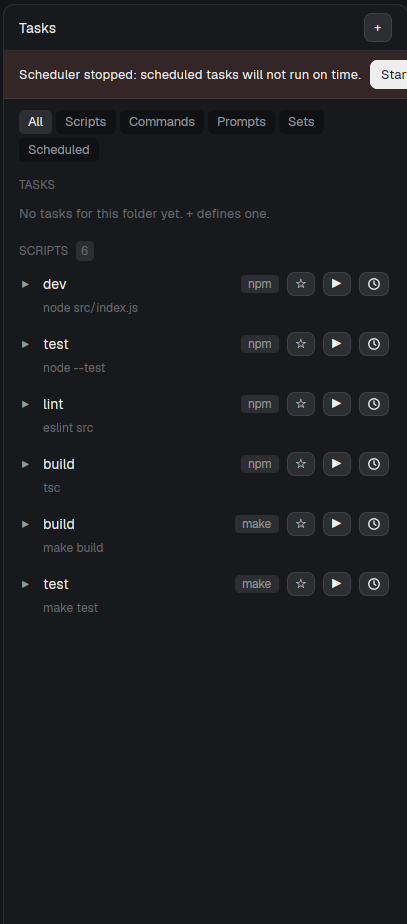

# Tasks

A side panel for the folder you are working in. It lists the scripts it finds there (npm/bun/pnpm/yarn, make, just, pyproject), lets you save your own shell commands, agent prompts and chained "sets" of those, run them now or on a cron schedule, and shows what ran, what failed and what is coming next. Scheduling and background runs are done by a separate program, `herdr-tasks`; the panel is its front end.

## What you see

A single rounded panel (10px radius, 1px theme border, theme background, 13px text) filling its pane, with three stacked parts:

- **Header (42px):** bold "Tasks", a `+` button on the right (new task). In the form and detail views a `‹` back button appears on the left and `+` is hidden.
- **Banner (only when the scheduler is not running):** a strip tinted with the theme "blocked" color at ~13% alpha, reading "Scheduler stopped: scheduled tasks will not run on time." with a solid "Start" button.
- **Error/note line:** 12px red text (theme `ansi1`), only when something failed.
- **Body (scrolls):** one of three views.

**List view**, top to bottom:
1. Filter chips: All, Scripts, Commands, Prompts, Sets, Scheduled.
2. A feed card (shown only if any run or scheduled task exists): tabs "Inbox" (count of unread finished runs) and "Next" (count of upcoming scheduled tasks), links "Show read / Hide read" and "Mark all read", 6 rows per page with `‹ 1 / N ›` paging. Inbox rows (24px): status dot (or agent logo for prompts, chain glyph for sets), name, error/reason or duration, status word (green done, red failed, dim other), age ("now", "5m ago", "3h ago", "2d ago"); read rows are 60% opaque. Next rows: icon, name, schedule label, "in 12m" / "today 09:00" / "Mon 09:00".
3. "PINNED" section (tasks and scripts starred), "TASKS" section, "SCRIPTS" section, each with a small count badge. Task rows: kind icon, bold name, star, run `▶`, schedule (clock icon, green when scheduled); second line "running / paused / manual / <preset or cron> · next"; third line a one-line preview of the command, prompt (`agent · model · text`) or set (`name → name · N steps`). Script rows: `▸` glyph, name, a source badge (npm, bun, make, just, python, poe...), star, run, schedule, and the script body underneath.
4. Invalid scheduler entries (red-tinted cards with name and message), if the scheduler reports any.

**Detail view:** title with kind icon, action buttons (Run now, Run beside for commands, Schedule/Reschedule, Pause/Resume, Pin/Unpin, Edit, Delete with a second "Confirm delete" click), key/value lines (Kind, Folder, Subfolder, Schedule, Next, Agent, Permission, Runs in, Effort), the command/prompt in a raised box (or the numbered steps of a set), then "HISTORY" (last 30 runs: status, info, age, and "Retry from <step>" on a failed set).

**Form view ("New task" / "Edit <name>"):** pills for KIND (Command, Prompt, Set), NAME input, then per kind: COMMAND textarea; or AGENT pills, MODEL dropdown, THINKING (EFFORT) stepped range, RUNS IN (New worktree / Folder root), PERMISSION (Read-only / Can edit files / Full access, with a note, red for Full), PROMPT textarea; or a list of step cards (reorder up/down, remove, "run this step" and "if this step fails" dropdowns, "Pass:" chips for earlier results) plus an "+ Add a step..." dropdown. Then SHOW IN (this folder / all <profile> spaces, only when a space profile is selected), WHEN (Run manually / On a schedule), preset pills (Hourly `0 * * * *`, Every morning `0 9 * * *`, Weekdays 9:00 `0 9 * * 1-5`, Mondays 9:00 `0 9 * * 1`, Fridays 17:00 `0 17 * * 5`), a cron input with live "Next: ..." text, and a catch-up dropdown (default, skip if missed, or run if back within 30 min / 2 h / 6 h / 12 h / 24 h). Cancel and a solid Save at the bottom.

Colors come only from the theme: running = `working`, failed = `ansi1`, scheduled/done = `ansi2`, paused = `dim`, otherwise `muted`; selected chips use `selected` with an `accent` border.

## How it behaves

- **Context:** follows the active space. The folder is the focused pane's cwd, else the focus cwd, else the cwd of any pane in the space, else the space folder. Checked every second; on change it clears the old folder's data and reloads. Full refresh also every 30 s and whenever `~/.local/state/herdr/tasks` changes.
- **Statuses:** running (yellow row title, `◌` instead of `▶`, button "Running..."), done (green), failed (red), missed (red/warning toast), cancelled (dim), paused task (dim icon, "(paused)"), scheduled (green clock). Failed/missed runs and late catch-up runs raise toasts depending on the setting `notify` (`failures` default, `late`, `all`, `off`), only for runs that finished after the panel started, and only for tasks whose folder belongs to the selected space profile.
- **Run now:** a command or script opens a new tab named after it (32 chars max) in its folder, running `sh -c <command>`, moved to sit right after the current tab. "Run beside" splits the pane right instead. Prompts and sets are sent to `herdr-tasks run <id>` and a "Started" toast shows; their output is a Markdown file per run, opened by clicking a run (reusing a file-view tab if it already shows it, else the preview slot, else a new tab).
- **Click a run in Inbox/History:** marks it seen (`herdr-tasks seen <run>`) and opens its output file, or the task detail when it has none.
- **Retry:** a failed set offers "Retry from <step>"; earlier results are kept.
- **Pin/star:** tasks keep `pinned` in the store; detected scripts are pinned by `source:name` in `pins[folder]`. Pinned items go in their own section.
- **Scheduling:** saving writes the store; the daemon picks it up on its next 30 s tick. Pause/Resume toggles `paused` in the store. Cron is validated by `herdr-tasks next <cron> --count 3`; Save is refused on a problem.
- **Sets:** steps are references to saved tasks (live: editing the task changes the set, deleting it makes the set fail) or a detected script copied in as a read-only command step. A set cannot include itself (cycle check). Results flow to later prompt steps via `{{steps.<id>.<field>}}` and to command steps only as `$HERDR_<ID>_<FIELD>` environment variables (never text-substituted).
- **Profiles:** a task saved with "All <profile> spaces" is stored under the key `@<profile>` and shows in every folder of that profile.
- Delete asks for a second click. Nothing runs when the panel opens.

## Built from

Folder `mods/tasks/` (`mod.json`: `{"place":"none","title":"Tasks"}`, so it is not placed anywhere by default):
- `main.js` (~1000 lines): the `Tasks` view class, imports `View, div, svg, image` from `gpui-kit`; `v_flex, h_flex, InputState, Input, TextareaState, Textarea` from `gpui-base`.
- `detect.js`: pure parsers plus a shell snippet (`DETECT_SCRIPT`) that finds `package.json` (walking up 8 levels, with lockfile to pick npm/pnpm/yarn/bun), `Makefile`, `justfile`, `pyproject.toml` (`[project.scripts]`, `[tool.poe.tasks]`), reading at most 200 KB each.
- `store.js`: pure store helpers for `{version:1, folders:{<folder>:[task]}, pins:{<folder>:[key]}}`.
- `sets.js`: pure set validation, id assignment, templating, env-var naming and a `runSet` runner (the panel uses validation and variables only).
- `match.js`: pure folder/automation matching helpers (not imported by `main.js`).
- `scope.js` + `scope.test.mjs`: `taskVisible(folder, spaces, spaceFolders, activeProfile)`; the test runs with `node --test`.
- `clock.svg`, `tasks.svg`: identical 24x24 stroke clock icons (`currentColor`); `tasks.svg` is the Settings entry icon, `clock.svg` the schedule button.

`herdr` functions: `exec`, `home`, `theme`, `spaces`, `panes`, `focused`, `run`, `notify`, `shared`, `setShared`, `watchFolder`, `knownAgents`, `appHome`, `readTextFile`, `writeTextFile`. Commands via `run`: `tab.new`, `tab.select`, `tab.rename`, `tab.move`, `pane.split`.

Programs run (`exec`): `herdr-tasks` (`version`, `ls`, `history --limit 300`, `run <id> [--from <step> --retry-of <run>]`, `seen <run>|--all`, `next <cron> --count 3`, `service install`), `git rev-parse --show-toplevel`, `sh -c` (detect script; `command -v <agent>`), `mkdir -p`, each headless agent's `--help` and (if it lists a `models` subcommand) `<agent> models`. Only `claude` and `agy` are offered for prompts; Claude's models are a fixed list, effort levels are read from `--help`.

Files: reads/writes `<appHome>/data/tasks/tasks.json` (the store, written with `writeTextFile` with the previous text as guard); reads `<appHome>/data/tasks/settings.json` (`notify`); watches `~/.local/state/herdr/tasks`; reads project files of the current folder (listed above).

`shared()` keys: reads `space-folders` (`""` -> `list`, `of`, `spaceProfiles`, `profiles`) and `space-folders.profile`; reads and writes `file-view.slots` (entries `{spaceId, tabId, kind:"file", path, root, on, name, preview, updatedAt}`) and opens a `file-view` mod tab with props `{slotId, ...entry, beforeTabs}`.

Art: `mods/tasks/clock.svg` via `svg()`; agent logos via `image("icons/claude.svg" | "icons/antigravity.svg")` from the app's shared icons folder (not inside this mod). Glyphs: `▸` script, `$` command, `✦` prompt, a chain glyph for set. No network code.

Sibling mods: `file-view` (must exist and use the `file-view.slots` contract), `space-folders` (provides `space-folders` and `space-folders.profile`), `settings-custom` (has a "Tasks" section using `mods/tasks/tasks.svg`, and writes `data/tasks/settings.json`). The Inbox mod keeps a copy of the same profile rule from `scope.js`.

## Watch out

- **Runs programs.** It executes `herdr-tasks`, `git`, `sh`, `mkdir` and each agent's CLI (`--help`, `models`) on its own. Clicking Run executes whatever command is stored, and scheduled prompts run an AI agent unattended; permission "Full access" disables all safety prompts.
- **Reads and writes outside its folder:** `<appHome>/data/tasks/`, `~/.local/state/herdr/tasks`, `~/.local/bin/herdr-tasks` (fallback path), and project files in whichever folder is active. It makes no network calls itself, but the agents and commands it launches may.
- **Needs `herdr-tasks`** (not part of Herdr; install it separately). Without it the panel shows "herdr-tasks is not installed: scheduling and background runs are off. Run now in a tab still works." Command/script tabs and the script list still work. `herdr-tasks` also owns the crontab/history and the prompt-agent run logic; `claude` or `agy` must be on PATH for prompt tasks.
- The mod folder has no `icons/` directory: agent logos resolve from the app's own icons folder. Without them prompt rows lose the logo.
- Command steps must never get `{{...}}` text substitution; `validateSet` rejects it and points to `$HERDR_<ID>_<FIELD>`. Env values are trimmed and capped at 100 KB (last bytes kept). Step ids match `[a-z][a-z0-9_]{0,31}`.
- Folders that start with `@` are profile keys, not paths; running a command from one uses the active folder (or home).
- Refreshes are serialized (`busy`/`again`): a space switch during a refresh queues another. Use the `cx` from `cx.spawn` after an `await`, not the render/timer `cx`.
- The dropdowns are hand-drawn (list opens inline below the trigger) because the toolkit Select did not open from a custom trigger.
- `match.js` is currently unused. `sets.js` comments mention a sync script that copies it into the mod; in this repo the file is simply present.

## Done when

- `herdr-app check mods/tasks` passes.
- `node --test mods/tasks/scope.test.mjs` passes.
- In a folder with a `package.json` `scripts` entry, a Makefile target or a justfile recipe, it appears under SCRIPTS with the right source badge; `▶` opens a tab with that name running it in that folder.
- `+` opens the form; saving a command task adds it under TASKS and writes `<appHome>/data/tasks/tasks.json`.
- Picking "On a schedule" shows "Next: ..." from `herdr-tasks next`, and an invalid cron blocks Save with the message.
- With `herdr-tasks` missing, the panel still opens, shows the "not installed" note, and Run now in a tab works.
- Switching to a space in another folder swaps the task and script lists within about a second.
- A failed run produces an error toast (setting `failures`), appears in Inbox in red, and "Mark all read" empties the unread count.
- A set with a command step referencing `{{steps.s1.stdout}}` is rejected on Save; a prompt step may use it.
