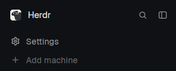

# workspace-chrome-custom

The thin strip at the top of the Herdr sidebar and the Settings / Add machine footer at the bottom of it. The header shows the Herdr logo and name with a search button and a sidebar-toggle button. The footer has a Settings row and an Add machine row. The toggle shrinks the sidebar to a narrow icon rail and back. This is a one-line fork of Herdr's shipped `workspace-chrome`: Settings opens the `settings-custom` mod instead of the stock settings.

## What you see

Both regions use the theme's `chrome` background and `text_size` 13 to 13.5. The mod is one View that draws two different things depending on `props().footer`.

**Header (no `footer` prop), a single row, full size:**
- Left padding 14px, right 10px, gap 4px, items centered, text 13.5px. On macOS, not fullscreen and not collapsed, left padding is 76px so the traffic lights fit.
- A left group (`flex_1`, gap 8px): the image `frame/welcome/herdr.png` at 20px with 5px radius, then "Herdr" in semibold `theme().foreground`.
- Search button (id `search`) and sidebar-toggle button (id `sidebar-toggle`). Each is a 26px square, 6px radius, `muted` text, with `search.svg` / `sidebar.svg` at 15px.

**Footer (`footer` prop truthy):**
- Column, full size, `chrome` background, 1px top border in `theme().border`, padding 8px sides, 4px top, 8px bottom, text 13px.
- Two rows, each 28px high, 8px side padding, 9px gap, 8px radius, with a 14px icon then a label.
  - "Settings" (`settings.svg`), text `muted`.
  - "Add machine" (`plus.svg`), text `dim`.
- When the app has an update ready (`updates().app.ready`), the Settings row gets a 6px round dot in `theme().accent`. It sits after the label in the wide layout.

**Collapsed (rail) variant**, when the sidebar is under 160px wide:
- Header: padding left 6px. The logo, name and search button are hidden. Only the toggle remains. On macOS the toggle is also hidden, because the traffic lights fill the row.
- Footer: no side padding, items centered. Each row is 32px wide, icon only, with the label as a tooltip. The update dot is absolutely positioned at top 5px, right 6px.

## How it behaves

- "Collapsed" is decided by width, not a flag: the sidebar node in the live layout (`layout()`, node id `sidebar`) has `size.px < 160`. Dragging the sidebar edge narrow also gives the rail.
- Toggle click:
  - If not narrow, it saves the current sidebar width to `shared("sidebar.width")`.
  - It always sets `shared("sidebar.collapsed")` to the new collapsed state. This is kept for older mods that still read the flag.
  - It calls `layout.resize {id: "sidebar", px}` with the saved width (default 268) to expand, or 76 (macOS) / 44 (other) to collapse.
- Search button runs `mod.open {name: "picker"}`.
- Settings row runs `mod.open {name: "settings-custom"}`.
- Add machine row runs `mod.open {name: "machine-add"}`.
- Hover on any button or row: background `theme().hover`, text `theme().foreground`. Rows use a pointer cursor.
- Button `mouse_down` stops propagation, so clicking it does not start a window drag.
- It does not use agent statuses (working, blocked, done, idle). The only live indicator is the update dot.

## Built from

Files: `main.js` (55 lines), `mod.json` (`{ "place": "none" }`). The mod ships no icons of its own.

- Place: `none`. The layout hosts it by name, once as the header block and once with `props: { footer: true }` as the footer block. The sidebar region must have node id `sidebar`.
- Imports: `View, div, image, svg` from `gpui-kit`; `h_flex, v_flex` from `gpui-base`; `theme, run, props, window, shared, setShared, updates, layout` from `herdr`.
- Class `WorkspaceChromeCustom extends View`, with a `button(id, label, action)` helper (26px square) and `render()`.
- Theme tokens: `chrome`, `border`, `foreground`, `muted`, `dim`, `hover`, `accent`.
- Herdr functions and commands: `run("layout.resize", {id, px})`, `run("mod.open", {name})`, `layout()`, `window().platform` and `.fullscreen`, `updates().app.ready`, `shared()` and `setShared()`.
- Shared keys written: `sidebar.width`, `sidebar.collapsed`. Read: `sidebar.width`.
- Shipped mods used: `picker` (search) and `machine-add`.
- Art, loaded by path from Herdr's shipped `workspace-chrome` mod:
  - `mods/workspace-chrome/search.svg`, `sidebar.svg`, `settings.svg` and `plus.svg`. Stroke icons, one line each.
  - `frame/welcome/herdr.png`, the Herdr logo.
- Programs run: none. Network: none. Files read outside its folder: only those SVGs and the PNG above, through Herdr's asset loader.

Derived from Herdr's workspace-chrome mod (Apache-2.0), see ../../NOTICE.

Differences from upstream workspace-chrome (`workspace-chrome/main.js`, same size, same `mod.json`):
- The class is renamed `WorkspaceChrome` to `WorkspaceChromeCustom`.
- The Settings row calls `run("mod.open", { name: "settings-custom" })` instead of `run("app.settings")`.
- Nothing else differs: same layout, same `shared()` keys, same icon paths (still `mods/workspace-chrome/*.svg`).

## Watch out

- It runs no programs and makes no network calls. It reads nothing from disk by itself. Its icons and logo come from Herdr's own `workspace-chrome` mod and app assets.
- It depends on the shipped `workspace-chrome` mod staying installed, for its SVGs. Do not copy or rename those icons into this folder unless you also change the paths.
- It depends on a sibling mod named `settings-custom` (in this repo) for the Settings click. Without it, Settings does nothing useful. Switch back to `run("app.settings")` if you do not install it.
- It needs the shipped `picker` and `machine-add` mods.
- The layout must give the sidebar node the id `sidebar` with a pixel `size.px`. If the sidebar is not sized in px, `narrow()` is always false and the toggle collapses nothing useful.
- The mod must be used twice in the layout, header and footer, the second time with `props: { footer: true }`. It does nothing on its own (`place: none`).
- Other mods in this repo (`space-folders`, `settings-custom`) also load icons from `mods/workspace-chrome/`. They do not use this mod's code.
- Rail widths are fixed: 76px on macOS, 44px elsewhere. Expand default is 268px when no width was saved.
- Collapsing to the rail on macOS hides the header toggle. Expand it from the agents list's » control.
- Tested only through `herdr-app check` and reading the code. Check the toggle, the update dot and the Settings click by hand in a live window.

## Done when

- `herdr-app check mods/workspace-chrome-custom` passes.
- The header shows the logo, "Herdr", a search button and a sidebar-toggle button. The footer shows Settings and Add machine.
- The toggle collapses the sidebar to 44px (76px on macOS), saves `sidebar.width`, and a second click restores that width, or 268px if none was saved.
- Dragging the sidebar under 160px switches both regions to the rail variant, with tooltips on the footer rows.
- The search button opens `picker`, Settings opens `settings-custom`, Add machine opens `machine-add`.
- With an update ready, an accent dot appears on the Settings row, and the dot moves to its corner in the rail.
