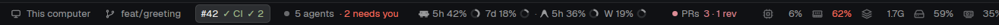

# Workspace Status Usage

A status bar along the bottom of the window (a chrome-colored strip with a top border). On the left it shows the computer name, git branch (with a PR chip when the branch has an open PR), the agent count, subscription usage for Claude Code and Antigravity as tiny rings/bars, a pull-requests button and a live CPU/memory/disk/GPU/network strip. On the right sit a now-playing media pill and the command-palette key hint. Hovering the usage, system and media items opens a card; clicking pins it.

Derived from Herdr's workspace-status mod (Apache-2.0), see ../../NOTICE.

## What you see

One full-size row, `px 14`, `gap 16`, items centered, background `t.chrome`, 1px top border `t.border`, text 11.8px `t.muted`. Left to right:

1. **Computer:** `monitor` icon + "This computer", or `server` icon + the remote machine name (icons from the shipped `workspace-chrome` mod).
2. **Branch:** `branch` icon + branch name. If the branch has an open PR: a chip (`t.raised` background, 1px border) with `#<number>`, then `✓ CI` (green, `ansi2`), `✕ CI` (red, `ansi1`) or `● CI` (`t.working`), then `✓ <approvals>` or `! chg` (changes requested, red).
3. **Agents:** a 6px dot (`t.dim`) + "N agents", plus "· K needs you" in `t.blocked` when any agent is blocked.
4. **Usage pill:** brand icon (`claude` 13px, `agy` 10px) then items separated by `·`. Each item is a label colored by severity, plus a gauge (default a 12px ring in 5% steps; alternatives a 26x4 bar with a 1px pace tick, or text only) and optionally `↻<reset>` (e.g. `↻6d`) in 10.5px `t.dim`.
   - Claude focused: `Ctx NN%`, `5h NN%`, `7d NN%`. Antigravity focused: `Ctx`, `5h`, `W` for the model's quota group. Neither focused: Claude `5h`/`7d` then Antigravity worst-case `5h`/`W`.
5. **PRs button:** 6px dot (working / red if failing CI or changes requested / `t.blocked` if reviews are waiting / green if configured / dim) + "PRs" + a count (`<mine> · <n> rev` when reviews are waiting, else the total).
6. **System pill:** per metric an icon (13px, `t.dim`) and a fixed-width value: CPU %, memory %, Herdr memory (`1.2G`), disk %, GPU % (only if an NVIDIA GPU answers), network `down/up` rate (`1.2M/340K`). Percent colors: >= critical red, >= warn `t.blocked`, else `t.muted`. Numbers use figure-space padding so the row does not jitter.
7. A flexible spacer, then the **media pill** (only while a player exists): prev/play-pause/next 12px buttons and `Title · Artist` truncated to 30 chars.
8. **Palette hint** at the far right, `t.dim`: the real `app.palette` key rendered like `Ctrl+Shift+P  commands` (mac glyphs on macOS), or just "commands" when unbound.

Cards (anchored `top_center` popups, `t.popover` background, 10px radius, shadow, 12px lift above the bar):
- **Subscription Usage** (356px wide): header with "pinned" badge, Refresh and close; a Claude Code section (tier badge, `5h session` and `7d weekly` meters 310x5 with `resets 3d 2h` text, `NN% used`, a pace tick, scoped weekly model limits, "Extra usage used / limit"); an Antigravity section with one block per model group, 5h first. Footer "Updated 3m ago / Click status bar to pin".
- **System** (two cards per row, 282px columns): CPU (60-sample area sparkline, cores + load average, top 5 processes), Memory (used/total, swap, top 5 by RSS), Herdr (memory of Herdr and everything it runs, split by Claude sessions / other agents / chat hosts / Herdr app / shells / other), Disk (used/total, free, top folders under `$HOME`), GPU (util sparkline, VRAM, temperature), Network (down and up sparklines).
- **Media** (340px): art (or brand icon), title/artist, close, seek bar (316px, click to seek), times, prev/play-pause/next, volume -/+ with percent when volume is known.

## How it behaves

- **Agent status:** only `blocked` is shown: the "needs you" text turns `t.blocked`. The count of all agents is always shown. Working/done/idle are not distinguished here.
- **Usage pill** hover opens the card (and refreshes if data is older than 60s); leaving closes it after 260ms unless pinned; click pins; click again unpins and closes. Same pattern for the system and media pills. A 500ms safety timer closes an unpinned card when the mouse is outside both pill and card.
- **Usage refresh:** at start, every 3 minutes, on card hover when stale, and when `shared("usage.refreshReq")` changes. On error the last good data is kept. The pill brand icon turns `t.working` while loading.
- **Colors:** `colorMode: "threshold"` uses `warn` (60) and `critical` (90); `"pace"` compares usage with how much of the window has elapsed (warn above the tick, red 15 points above it or at 90%). Context percent uses `ctxWarn`/`ctxCritical`.
- **Context percent** comes from `~/.cache/herdr-statusline/<terminal>.json` (`agent`, `ctx_pct`, `model`, `updated_at`), re-read when that folder changes, every 3s, and when focus moves. A focused chat pane resolves to the hidden terminal hosting its agent.
- **System sampling:** every `sysInterval` seconds (2/3/5/10, default 3), every 1.4s while the card is open. Process/disk detail is read only while the card is open. The folder scan (`du`) runs at most once per `diskInterval` minutes (5/10/30/60) while the card is open and shows "Scanning folders…".
- **PR sync:** 1.5s after start, then every `forge.state.pollIntervalSec` (default 90s), and when `shared("forge.refreshReq")` changes. New events from the helper become toasts (`notify`, action `workspace-status-usage.open-pr:<prKey>`) and are prepended to `forge.notifs` (max 50). Clicking the PR chip, the PRs button or such a toast selects the `prs` child of the `panel-body` stack and shows the `panel` node.
- **Branch** comes from the space or its panes; otherwise `git rev-parse --abbrev-ref HEAD` is run in the space's cwd (on the remote machine if any).
- **Media:** polled every 2s. Linux: MPRIS over `busctl --user`; macOS: `nowplaying-cli`. A playing player beats a paused one; no player hides the pill. Commands go through `shared("media.cmdReq")`. Volume falls back to `wpctl set-volume @DEFAULT_AUDIO_SINK@`.
- **Settings** (JSON, defaults in `usage-settings.js`) are re-read on each refresh: `style` ring|bar|text, `warn`, `critical`, `showReset`, `showPace`, `colorMode`, `showPercent`, `ctxWarn`, `ctxCritical`, per-item `showComputer/Branch/Agents/Prs/System/Cpu/Mem/Herdr/Disk/Gpu/Net/Usage/Media/Procs/Spark`, `sysInterval`, `diskInterval`, `diskTop` (3/5/10). The effective config is also published as `shared("usage.settings")` and merged live on render.

## Built from

Files (all in `mods/workspace-status-usage/`):
- `mod.json`: `{ "place": "none", "cloned_from": { "name": "workspace-status", "version": "0.1.16" } }`. The bar is placed by the layout, not by the mod.
- `main.js`: the `WorkspaceStatusUsage` View (render, timers, forge sync, usage fetch, popups).
- `usage-card.js`, `sys-card.js`, `media-card.js`: pure element builders for the three cards.
- `usage-settings.js`: `cfg` defaults, `applySettings`, `usageColor`.
- `sysstats.js`: parsers and `readStats`/`readDetail`/`readDiskTop` for Linux and macOS.
- `media.js`: MPRIS / `nowplaying-cli` readers and commands.
- `agent-focus.js`: `resolveFocusedAgent`, maps the focused terminal or chat pane to `claude` or `agy`.
- `icons/`: 8 small monochrome SVGs (`agy`, `claude`, `cpu`, `disk`, `gpu`, `herdr`, `memory`, `net`). `rings/`: `track.svg` + `arc-5.svg` ... `arc-100.svg` (5% steps) used for the ring gauge, tinted with `text_color`.

Shipped mods used (assets only): `workspace-chrome` (`server`, `monitor`, `branch` svgs), `pane` (`close.svg`). Also `media-card` (`mods/media-card/icons/*.svg`: `prev`, `next`, `play`, `pause`, `volume`, `volume-mute`, `spotify`, `music`), which is not shipped by Herdr and is not part of this repo.

Herdr API used: `spaces, agents, panes, terminals, focused, theme, run, window, keys, exec, readTextFile, watchFolder, home, appHome, notify, nextCommand, layout, shared, setShared, checking`; commands `run("app.palette")`, `run("layout.select", { stack: "panel-body", child: "prs" })`, `run("layout.show"/"layout.hide", { id: "panel" })`; mod command `open-pr[:<prKey>]` via `nextCommand`; `Popup` from `gpui-base`.

Programs run (via `exec`): `git` (`config --get remote.origin.url`, `rev-parse --abbrev-ref HEAD`), `python3 ~/.config/herdr-app/mods/prs-panel/forge-helper.py sync`, `agy -p /usage --output-format json`, `security find-generic-password` (macOS Keychain fallback), `mkdir -p ~/.cache/herdr-statusline`, `busctl`, `wpctl`, `nowplaying-cli`, `nvidia-smi`, `ps`, `df`, `du`, `sh -c`, `getconf`, `uptime`, `top`, `vm_stat`, `sysctl`, `netstat`.

`shared()` keys:
- Written: `usage.data`, `usage.loading`, `usage.settings`, `usage.open|pinned|pillHovered|cardHovered`, `sys.stats|hist|detail|diskTop|diskScanning|open|pinned|pillHovered|cardHovered`, `media.state|open|pinned|hovered|cardHovered|cmdReq`, `forge.state`, `forge.loading`, `forge.notifs`, `forge.focusPrKey` (`{ key, seq }`).
- Read: `usage.refreshReq`, `forge.refreshReq`, `forge.state` (`pollIntervalSec`, `byBranch["<provider:owner/repo>::<branch>"]` with `key, number, title, ciState, reviewState, approvals`; `summaryByProfile[<profile>]` with `total, mine, review, failingCi, changesRequested, configured`), `space-folders.profile`.

Network: `fetch("https://api.anthropic.com/api/oauth/usage")` with the Claude Code OAuth access token (header `anthropic-beta: oauth-2025-04-20`). The PR helper talks to GitHub/Bitbucket.

Files read outside the mod folder: `~/.claude/.credentials.json`, `~/.cache/agy-statusline/quota.json`, `~/.cache/herdr-statusline/<terminal>.json` (folder watched), `<appHome>/data/workspace-status-usage/settings.json`, `/proc/stat`, `/proc/meminfo`, `/proc/net/dev`, `~/` (via `du`), `<appHome>/mods/prs-panel/forge-helper.py` (executed). Writes: only creates `~/.cache/herdr-statusline/`.

### Differences from upstream workspace-status

Upstream (0.1.16) is a ~30-line view: computer, branch, agent count, spacer, palette hint, with no settings, no popups and no network. This fork adds:
- Renamed class and mod `workspace-status-usage`; `mod.json` keeps `place: none` and `cloned_from`.
- Per-item visibility, ring/bar/text style and thresholds from `data/workspace-status-usage/settings.json`.
- Claude and Antigravity subscription usage pill and card, pace ticks, context-percent from `herdr-statusline`.
- Focused-agent resolution (`agent-focus.js`), including chat-host terminals.
- Git branch fallback via `git`, PR chip, PRs button with summary, forge sync, toasts and `forge.*` shared state.
- System pill and card (`sysstats.js`, `sys-card.js`), including GPU, Herdr memory tree and top folders.
- Media pill and card (`media.js`, `media-card.js`).
- Click-to-pin popups with a hover safety timer; the palette hint gets a pointer cursor; the agent label is always "agents" (upstream pluralizes: "1 agent", "needs"/"need").

## Watch out

- **Reaches the network** (Anthropic OAuth usage endpoint with the person's Claude token, plus GitHub/Bitbucket via the PR helper) and **runs many programs** (see list). It **reads outside its folder**: Claude credentials, `~/.cache/*`, `/proc`, home directory sizes. Tell the person before adding it.
- Requires siblings and non-Herdr programs when you want the matching part: `prs-panel` (supplies `forge-helper.py`, which needs `python3`; without it the PR chip, PRs counts and toasts stay empty); `settings-custom` (writes the settings file and `usage.settings`, and sets `forge.refreshReq`); `space-folders` (sets `space-folders.profile`). The layout must contain nodes `panel` and `panel-body` with a `prs` child, and `media-card` icons must exist or media button icons render blank. Optional: `agy` CLI, `nvidia-smi`, `busctl`/`wpctl` (Linux), `nowplaying-cli` (macOS), a statusline script writing `~/.cache/herdr-statusline/<terminal>.json` and `~/.cache/agy-statusline/quota.json`.
- Provided to siblings: `forge.state` (read by `space-folders`, `tabs-folders`, `changes-tabs`), `forge.focusPrKey`, `usage.*`, `sys.*`, `media.*`. Without this mod those PR chips and badges go blank.
- `usage-card.js` loads `icons/claude.svg` and `icons/antigravity.svg` with a relative path, but the folder ships `claude.svg` and `agy.svg` only: the Antigravity header icon in the card is missing and the relative path may not resolve. Use `mods/workspace-status-usage/icons/<name>.svg` like the rest of the code.
- The PR button, branch chip and toasts depend on the `prs` panel child existing; clicks do nothing otherwise.
- `usage-settings.js` header comment lists only five keys; the real list is in `cfg`.
- The `agy -p /usage` call has a 25s timeout and runs every 3 minutes; "not installed" (exit 127 or ENOENT) hides the Antigravity part. An expired Claude token shows "Claude OAuth token expired (run claude)"; the mod never refreshes the token.
- The token is read from `~/.claude/.credentials.json`, else the macOS Keychain entry "Claude Code-credentials". It is only sent to `api.anthropic.com`.
- Seeking uses click position inside a 316px bar; `e.x` and `e.bounds.x` must exist. macOS media has no volume or album art.
- Disk scan (`du -kx -d1 $HOME`, plus `~/Library` on macOS) can take tens of seconds (timeout 5 min). GPU polling stops after the first `nvidia-smi` failure.
- Under `checking()` (the `herdr-app check` dry run) no timers, exec or fetches run.
- Fixed widths (`w(30)`, `w(34)`, `w(62)`) assume digits are figure-space padded; do not switch to proportional padding.

## Done when

- `herdr-app check mods/workspace-status-usage` passes.
- The bar shows computer, branch, "N agents" and the palette hint with the actual bound key; a blocked agent adds "· K needs you".
- With Claude credentials present, the usage pill shows `5h`/`7d` percents with ring gauges; hover opens the Subscription Usage card, click pins it, close or second click unpins.
- Setting `"style": "bar"` or `"text"` in `data/workspace-status-usage/settings.json` changes the gauge on the next refresh; `"showSystem": false` hides the system pill.
- The system pill shows CPU, memory, Herdr memory, disk and network values that update every ~3s; hovering opens the System card with sparklines and top processes.
- With a branch that has an open PR (and `prs-panel` present), the chip shows `#N` plus CI state; clicking it opens the PRs panel.
- With a media player running, the pill shows controls and title, and play/pause works from the pill and card.
- With no network or no credentials, the bar still renders and the card shows an error text instead of crashing.
