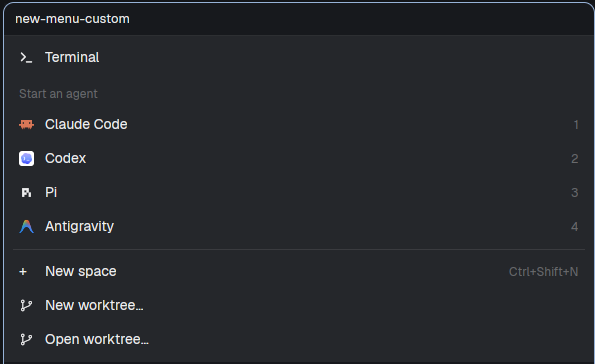

# New Menu Custom



A "+" popup for the Herdr tab bar that lists only the agents you actually have installed.

New Menu Custom is a small popup that opens from the "+" button in the tab bar. It shows a Terminal row, then only the agent CLIs found on the machine (Claude Code, Codex, Pi and so on), then New space, New worktree and Open worktree. Click a row, or press 1-9, to start the matching agent in a new tab. Agents that are not installed are never listed, so the menu stays short.

Derived from Herdr's new-menu mod (Apache-2.0), see [NOTICE](../NOTICE).

## Quick start

1. Install the mod (see below).
2. Make your tab bar's "+" button open this mod, for example by using the `tabs-folders` mod from this repo.
3. Click "+" in the tab bar, then click an agent or press its number.

## Install

Ask your agent:

> Read ~/.config/herdr-app/AGENTS.md, then add this mod: https://github.com/dobraga/herdr-mods/tree/main/new-menu-custom

<details>
<summary>Install by hand</summary>

```sh
git clone https://github.com/dobraga/herdr-mods
cd herdr-mods
./install.sh new-menu-custom
```

This links the mod into `~/.config/herdr-app/mods`. Run `git pull` to update it.

The mod has no panel (`"place": "none"`), so installing it alone changes nothing. Something must open it: the "+" button of `tabs-folders` in this repo calls `openOverlay({ mod: "new-menu-custom", kind: "popup", width: 250, height: 512 })`. If you use your own tabs mod, point it at `mod: "new-menu-custom"` the same way (popup, width 250).

</details>

## Usage

- Click "+" in the tab bar to open the popup. It takes keyboard focus.
- **Terminal**: opens a plain terminal tab in the active space. The `tab.new` shortcut is shown at the right.
- **Start an agent**: one row per installed agent. Click it, or press 1-9 (no modifier keys), to open it in a new tab of the active space. Only the first nine agents get a digit hint. Past ten agents the list scrolls.
- **New space**: runs `space.new`, with its shortcut shown at the right.
- **New worktree...** and **Open worktree...**: open the `worktree` dialog for the active space and the focused pane's folder. Both are dimmed when there is no active space.
- While loading, the list shows "Checking installed agents...". It shows "No installed agents" or "Could not check installed agents" when appropriate.
- Shortcut hints are read from your `global` keys and are not shown for unbound actions.
- The last agent list per machine is cached in Herdr's shared state under `new-menu-custom.agents`, so the menu appears at once and refreshes in the background.

## Requirements

- An opener, such as `tabs-folders` from this repo (see Install).
- Herdr's shipped `worktree` mod, for the two worktree rows.
- No programs are run and there are no network calls. Herdr itself checks the machine for agent CLIs (through its own connection for remote machines).
- The Terminal row points at `icons/shell.svg`, which is not shipped in this folder, so that icon may be blank.

See [RECIPE.md](RECIPE.md) for how it is built.
