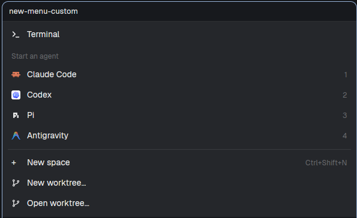

# new-menu-custom

A small popup that opens from the "+" button in the tab bar. It lists a Terminal row, then only the agent CLIs actually installed on the machine (Claude, Codex, and so on), then New space, New worktree and Open worktree. Click a row, or press 1-9 to start the matching agent in a new tab.

## What you see

A popup, 250px wide (the opener asks for 512px high), background `theme().popover`, 5px padding, text 12.8px. Rows top to bottom:

1. **Terminal** row: 14px `icons/shell.svg` icon, label, and on the right (11px, dim) the global `tab.new` shortcut, for example `Ctrl+T`.
2. Section label "Start an agent": 11px, dim, padding 9px sides, 8px top, 4px bottom.
3. **Agent list**: one row per installed agent (icon, name, right-aligned digit hint 1-9; rows past the ninth have no hint). Agents with `tint` get a 14px SVG in `theme().foreground`; the rest get a 14px image. If more than 10 agents, the list is capped at 310px high and scrolls with a scrollbar. When empty, one dim line shows: "Checking installed agents…", "Could not check installed agents" or "No installed agents".
4. A 1px divider (`theme().border`), 4px side margin, 5px vertical margin.
5. **New space** row: a "+" glyph, label, global `space.new` shortcut at right.
6. **New worktree…** row and **Open worktree…** row: 14px `mods/workspace-chrome/branch.svg` icon, no hint.

Every row is 31px high, 9px side padding, 10px gap, 7px radius, `flex_none`. Hover paints `theme().selected`. Disabled rows use `theme().dim` text and no hover.

## How it behaves

- On open the menu takes keyboard focus. Plain keys 1-9 (no ctrl, platform or alt modifier) close the popup and run `tab.new` with the nth installed agent. Other keys are ignored.
- Clicking any enabled row closes the popup (`closeOverlay(props().overlay)`) and then runs its action.
- Terminal: `tab.new` in the active space. Agent: `tab.new` with `{ name, space, argv: agent.run }`. New space: `space.new`.
- New worktree… opens a 460x280 dialog of the `worktree` mod, `action: "new"`; Open worktree… opens a 560x480 dialog, `action: "open"`. Both pass the active space id and the focused pane's `cwd` as `folder`. Both rows are disabled when there is no active space.
- Agent list loading: the last result per machine is read from `shared()` and shown at once. `knownAgents({ on: machine })` is then awaited and replaces it; the result is written back to `shared()`. If the call throws, `failed` is set and the empty message says so.
- Shortcut hints are read from `keys()` (section `global`, action `tab.new` / `space.new`) and formatted per platform: macOS uses symbols (⌃ ⌥ ⇧ ⌘) joined without separator; others use `Ctrl+Shift+T` style. `secondary` maps to cmd on macOS and ctrl elsewhere. An unbound action shows no hint.
- Only installed agents are listed. Not-installed agents are never shown.

## Built from

Files in `mods/new-menu-custom/`:

- `mod.json`: `{ "place": "none" }`. No panel; it only ever appears as an overlay opened by another mod.
- `main.js`: the `NewMenuCustom` view (default export, extends `View`). Imports `View, div, svg, image` from `gpui-kit`, `h_flex, v_flex` from `gpui-base`, and `theme, spaces, panes, knownAgents, run, openOverlay, closeOverlay, props, window, keys, shared, setShared` from `herdr`.
- `filter.js`: `installedAgents(agents)` returns `[]` for a non-array, otherwise only entries with a truthy `installed`.
- No `icons/` folder is shipped. `svg("icons/shell.svg")` in the Terminal row points at a file that is not in this folder (upstream has the same reference and no icons folder either).

Herdr functions and commands: `spaces()` (active space, its `machine`), `panes()` (focused pane `cwd`), `knownAgents({ on })`, `keys()`, `window()` (platform), `theme()`, `props()` (the `overlay` id), `openOverlay`, `closeOverlay`, `run("tab.new" | "space.new")`.

`shared()` keys: reads and writes `new-menu-custom.agents`, an object of machine name (or `""` for local) to agent array. It is a different key from upstream's `new-menu.agents`.

Shipped or sibling mods used:

- `worktree` (Herdr shipped mod, dialogs opened with `openOverlay({ mod: "worktree", ... })`, props `space`, `folder`, `action`).
- `mods/workspace-chrome/branch.svg` (art from Herdr's shipped `workspace-chrome` mod).
- Opened by `tabs-folders` in this repo: its "+" button calls `openOverlay({ mod: "new-menu-custom", kind: "popup", width: 250, height: 512 })`. Without that (or another opener) nothing shows this menu. Herdr's stock `tabs` mod opens `new-menu` instead.

Programs and network: none run directly by this mod; no `exec`, no `hc`, no network calls. `knownAgents` is a Herdr call that checks the machine for agent CLIs (for a remote machine it goes through Herdr's own connection). The mod reads nothing outside its own folder except the shipped art above.

Differences from upstream new-menu:

- Lists installed agents only. Upstream also shows up to two not-installed agents, greyed, hinted "not installed" and disabled.
- Hints and shortcut keys 1-9 use the position in the installed list (same as upstream for installed agents); rows are all enabled.
- New `filter.js` (`installedAgents`) imported by `main.js`.
- Cache key renamed `new-menu.agents` to `new-menu-custom.agents`, so it does not share cache with upstream. The cache is validated with `Array.isArray`.
- New `loaded` and `failed` state: `failed` is reset on success, and "Checking installed agents…" shows only until the first result. A loaded empty list shows "No installed agents" (upstream shows "Checking…" forever in that case).
- Height is not fixed in code: upstream sets `h(min(491, 167 + rows*31))`; this one sizes to its content and only caps the agent list at 310px (scrolling) when over 10 agents. The overlay size is set by the opener.
- View class renamed `NewMenuCustom`, element id `new-menu-custom`.
- The unused `gpui-kit.d.ts` and `jsconfig.json` editor files are not shipped.

Derived from Herdr's new-menu mod (Apache-2.0), see ../NOTICE.

## Watch out

- Does not touch the network, run programs, or read files outside its own folder (other than the shipped `workspace-chrome` icon path and Herdr's own `knownAgents` check).
- Depends on the shipped `worktree` mod existing; the two worktree rows do nothing useful without it.
- Needs an opener. Installing this mod alone changes nothing: point your tab bar's "+" at `mod: "new-menu-custom"` (as `tabs-folders` here does) or swap the name in your own tabs mod. Use `kind: "popup"`, width 250.
- The popup height is set by the opener (512px). The agent list scrolls only past 10 agents.
- Digit shortcuts work only for the first nine installed agents.
- The Terminal icon path `icons/shell.svg` is missing from the folder, so that icon may render blank; add a 14px `shell.svg` under `icons/` if you want one.
- Hints show only for shortcuts bound in the `global` keys section.

## Done when

- `herdr-app check mods/new-menu-custom` passes.
- Opening the menu shows Terminal, "Start an agent", installed agents only, a divider, New space, New worktree…, Open worktree….
- No row says "not installed".
- Pressing `1` starts the first listed agent in a new tab of the active space; Ctrl+1 does nothing.
- Clicking Terminal opens a plain terminal tab; clicking New space runs `space.new`.
- With no active space, the two worktree rows are dim and clicking does nothing.
- With an empty agent list the menu shows "No installed agents"; if `knownAgents` throws it shows "Could not check installed agents".
- `shared("new-menu-custom.agents")` holds the last result per machine after the first load.
