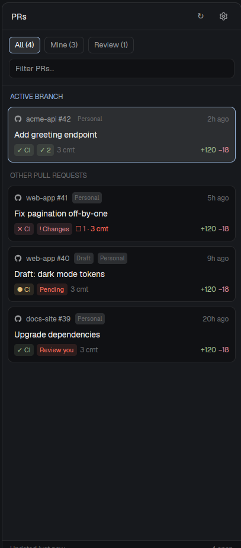

# PRs Panel



A right-docked panel that lists your open GitHub and Bitbucket Cloud pull requests across profiles. Each card shows CI, review state, conflicts, comment counts and diff size. The PR whose branch is checked out in the current workspace is pinned on top under "Active branch". Click a card for an inline detail view with checks, reviewers, recent comments and the description, plus actions such as open in browser, jump to the matching space, create a worktree or start an agent on the PR.

## Quick start

1. Install the mod and its companions (see Install and Requirements).
2. Log in to GitHub with `gh auth login` (and/or set a Bitbucket token), then configure your profiles from the gear button in the panel.
3. Dock the panel in a layout block (see below) and click refresh: your PRs show up as cards.

## Install

> Read ~/.config/herdr-app/AGENTS.md, then add this mod: https://github.com/dobraga/herdr-mods/tree/main/prs-panel

<details>
<summary>Install by hand</summary>

```sh
git clone https://github.com/dobraga/herdr-mods
cd herdr-mods
./install.sh prs-panel
```

This links the mod into `~/.config/herdr-app/mods`; `git pull` updates it.

The mod has `"place": "none"`, so it is not placed by itself. Dock it in a layout as a block:

```json
{ "id": "prs", "type": "block", "content": { "mod": "prs-panel" } }
```

</details>

## Usage

- Open it from the layout block above (or from another mod that docks it, such as `tabs-folders`).
- Header: refresh (`↻`, spins while syncing) and settings (opens the `settings-custom` dialog on the "git" section).
- Chips `All`, `Mine` and `Review` filter by role; when the workspace has several git repos, extra chips filter by repo. The search box matches title, repo, branch, author and `#number`.
- The profile shown follows the active profile of `space-folders`; the panel has no switcher of its own.
- Click a card to see checks, reviewers, comments and the description. Buttons: `Open`, `Copy URL`, `Copy branch`, `Go to Space`, `Worktree`, and `Agent` (Claude or Antigravity, as chat or TUI).
- The chat buttons only copy a prompt about the PR to the clipboard; you paste it into the new chat tab.
- The active branch is re-detected every 10 s from the repos of the current space.
- Settings are stored in `~/.config/herdr-forge.json` (profiles, may hold Bitbucket tokens, mode 0600).

## Requirements

- Companion mods in this repo: `workspace-status-usage` (runs the sync and provides the PR data, without it the panel shows "Not synced yet"), `space-folders` (profiles) and `settings-custom` (configuration). Icons come from `workspace-chrome`. Install them with `./install.sh <name>`.
- Programs on PATH: `python3` (3.9+), `git`, `find`, and `gh` logged in for GitHub. `claude` or `agy` for the agent buttons.
- Network: the helper calls the GitHub GraphQL API (via the `gh` token) and the Bitbucket Cloud REST API (token from `BB_USER`/`BB_EMAIL` and `BB_TOKEN` env vars or stored config).
- Files outside the mod folder: reads and writes `~/.config/herdr-forge.json` and `~/.cache/herdr-forge/`; reads `~/.config/herdr-space-folders.json`, `~/.env`, `~/.config/gh/hosts.yml`; scans `~/src/*` and your space folders for git repos. Review before installing.

See [RECIPE.md](RECIPE.md) for how it is built.
