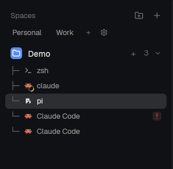

# Space folders



The sidebar's list of spaces, rebuilt around folders and profiles. Spaces live in collapsible, colored folders that you create, drag spaces into, or let collect spaces by folder-name rules. Git worktrees sit under their checkout, every tab of a space is listed under it (as a tree or as one compact icon line), and a row of profile chips (Personal, Work, ...) filters the whole list. Blocked and finished agents show as badges, even on a folded folder.

It replaces Herdr's own `spaces` mod.

## Quick start

1. Install the mod (see below) and restart Herdr.
2. Put it in a layout block in place of the `spaces` mod: `{ "mod": "space-folders" }`.
3. Click the folder-plus button in the "Spaces" header, name a folder, save, then drag a space onto it.

## Install

> Read ~/.config/herdr-app/AGENTS.md, then add this mod: https://github.com/dobraga/herdr-mods/tree/main/space-folders

<details>
<summary>Install by hand</summary>

```sh
git clone https://github.com/dobraga/herdr-mods
cd herdr-mods
./install.sh space-folders
```

This links the mod into `~/.config/herdr-app/mods`; `git pull` updates it.

The mod has `"place": "none"`, so it needs a slot in a layout. The sidebar block looks like this:

```json
{ "id": "spaces", "type": "block", "content": { "mod": "space-folders" } }
```

Optional keys to step through spaces (not shipped, add them to `keys.json`):

```json
{ "alt-down": "space-folders.next", "alt-up": "space-folders.prev" }
```

</details>

## Usage

- **Header:** new-folder and new-space buttons. Under 160px wide the sidebar shrinks to a rail (number and status glyph per space).
- **Folders:** click to fold, "+" to start a space in the folder's start path, right-click for color, profile, "New space here", "Edit folder..." and "Delete folder".
- **Edit folder:** name, profile, "Start new spaces in" and "Collect spaces from" rules (`~`, `*`, or a folder name at any depth).
- **Drag and drop:** a space onto a folder joins it, onto another space moves it, onto the empty list takes it out. Drag a folder to reorder it.
- **Profiles:** click a chip to filter the list, right-click to rename or delete, "+" adds one. The chip follows focus unless the shared `space-folders.follow` is `false`.
- **Rows:** a space shows its git tail (repo, branch, PR chip, ahead/behind); tabs and worktrees are listed under it. Click a tab to select its space, tab and pane.
- **Status:** "!" blocked, a checkmark finished, a spinner working.
- **Style:** `tree` (default) or `compact`, set from the settings-custom mod or in `~/.config/herdr-app/data/space-folders/settings.json`.
- **Where data lives:** folders and profiles in `~/.config/herdr-space-folders.json` (on every connected machine).

## Requirements

- `git` on PATH (read-only queries in each folder a space works in, also on remote machines), `sh`, and `hc`.
- Companion mods under the same names, otherwise the core list still works but PR chips, the settings button and some icons are missing: `settings-custom`, `prs-panel` (fills PR chips from GitHub/Bitbucket; `python3` is used only to delete a profile), `files-tabs`, `tabs-folders`, `tasks`.
- A layout with a `sidebar` block, plus `panel`/`panel-body` for the PR chip jump.
- No direct network access.

Derived from Herdr's spaces mod (Apache-2.0), see [NOTICE](../NOTICE).

See [RECIPE.md](RECIPE.md) for how it is built.
