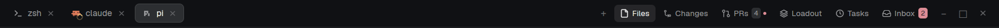

# Tabs (folders)



A top tab bar for Herdr's window. It lists the tabs of the active space (or of the whole Spaces group, when the `space-folders` mod groups tabs across spaces). Each tab shows a program or file-type icon, a live title and a close button, with a colored border and corner dot when an agent in that tab is blocked or done, and a spinner while it works.

The bar also holds a "+" new-tab button, side-panel toggles (Files, Changes, PRs, Loadout, Tasks, Inbox) with badges, and window buttons. Dragging a tab onto another tab or onto the content joins them as a split.

Derived from Herdr's tabs mod (Apache-2.0), see [NOTICE](../NOTICE).

## Quick start

1. Install the mod (see below).
2. Put `{"mod": "tabs-folders"}` in the content of a layout block at the top of the window.
3. Open a few tabs: the bar lists them, click one to select it.

## Install

> Read ~/.config/herdr-app/AGENTS.md, then add this mod: https://github.com/dobraga/herdr-mods/tree/main/tabs-folders

<details>
<summary>Install by hand</summary>

```sh
git clone https://github.com/dobraga/herdr-mods
cd herdr-mods
./install.sh tabs-folders
```

This links the mod into `~/.config/herdr-app/mods`; `git pull` updates it.

The mod has `"place": "none"`, so it is placed by a layout node. Example (a 42px bar):

```json
{
  "id": "tabs",
  "type": "block",
  "size": { "px": 42 },
  "window_drag": true,
  "content": { "mod": "tabs-folders" }
}
```

Optional keys for next/previous tab:

```json
"ctrl-tab": "tabs-folders.next",
"ctrl-shift-tab": "tabs-folders.prev"
```

</details>

## Usage

- Click a tab to select it (its space is selected first if different). Double-click renames it; on a file preview tab it pins it.
- Right-click opens the tab menu (a file tab shows a file-specific menu). The x closes the tab without a prompt.
- Mouse wheel or touchpad pans the strip only; it never changes the selected tab.
- `tabs-folders.next` / `tabs-folders.prev` select the next or previous tab, wrapping.
- Drag a tab onto the edge of another tab to reorder. Drop it on the middle of a tab in the same space, or below the bar, to join it as a split to the right (hold Shift, or release in the bottom of the content, for a split below). A failed merge shows a "Tab not moved" toast.
- Panel buttons toggle the side panel. The open panel is remembered per space (browser-style `localStorage` key `panels`).
- "+" opens the `new-menu-custom` popup. Window buttons (minimize, maximize, close) appear only when the window reports them.
- Settings read from `files-tabs`: `closePreview`, `materialIcons`, `tabMaxWidth` (default 170px).

## Requirements

- The layout needs nodes with ids `sidebar`, `panel` and `panel-body` (children named `files`, `changes`, `prs`, `loadout`, `tasks`, `inbox`) for the panel buttons to work.
- Optional sibling mods in this repo, each degrading to nothing when absent: `new-menu-custom`, `files-tabs`, `file-view`, `space-folders`, `inbox`, `prs-panel`, `loadout`, `tasks`.
- Programs it runs: `hc` on PATH (installed with Herdr), only when a tab is dragged into a split. It runs `hc label` and pipes JSON to `hc connect` through `/bin/sh`, and rewrites the live `herdr-app` layout document. No network access, and no files read outside its folder.
- Material file icons (`icons/*.svg`) are not shipped in this folder; set `files-tabs.settings.materialIcons` to `false` to get the plain file icon.

See [RECIPE.md](RECIPE.md) for how it is built.
