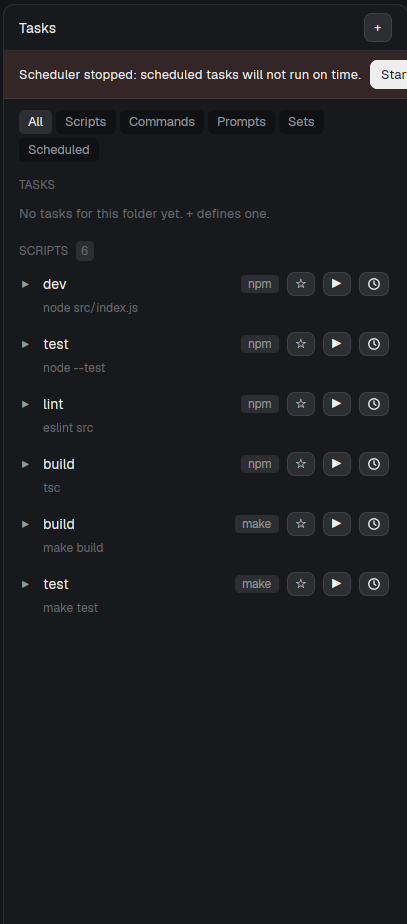

# Tasks



A side panel that lists, runs and schedules the tasks of the folder you are working in.

Tasks follows the active space and shows the scripts it finds in that folder (npm, bun, pnpm, yarn, make, just, pyproject). You can also save your own shell commands, agent prompts and chained "sets" of them, run them now or on a cron schedule, and see what ran, what failed and what is coming next. Scheduling and background runs are done by a separate program, `herdr-tasks`; the panel is its front end.

## Quick start

1. Run `./install.sh tasks` from a clone of this repo (needs [bun](https://bun.sh) for the scheduler).
2. Put the mod in a layout slot (see Install) and restart Herdr.
3. Open a space in a project folder: its scripts show under SCRIPTS. Press `▶` on one to run it in a new tab, or `+` to save your own task.

## Install

> Read ~/.config/herdr-app/AGENTS.md, then add this mod: https://github.com/dobraga/herdr-mods/tree/main/tasks

<details>
<summary>Install by hand</summary>

```sh
git clone https://github.com/dobraga/herdr-mods
cd herdr-mods
./install.sh tasks
```

This links the mod into `~/.config/herdr-app/mods` (`git pull` updates it) and also installs the `herdr-tasks` scheduler (`~/.local/bin/herdr-tasks` plus its login service). Use `--no-tasks` to skip the scheduler.

The mod ships with `"place": "none"`, so it is not placed anywhere by default. Add it as a block in a layout:

```json
{ "id": "tasks", "type": "block", "content": { "mod": "tasks" } }
```

</details>

## Usage

- **Scripts:** detected from `package.json`, `Makefile`, `justfile` and `pyproject.toml`, each with a source badge. Nothing runs when the panel opens.
- **Filters:** All, Scripts, Commands, Prompts, Sets, Scheduled.
- **`+`:** new task. Kinds are Command, Prompt (agent, model, effort, permission) and Set (ordered steps that pass results along).
- **`▶`:** runs a command or script in a new tab next to the current one (`sh -c`). "Run beside" splits the pane instead. Prompts and sets run through `herdr-tasks` in the background.
- **Clock button / WHEN:** run manually or on a schedule (presets or a cron expression, with a live "Next:" preview and a catch-up option for missed runs).
- **Star:** pins a task or script to the top.
- **Detail view:** Run now, Schedule, Pause/Resume, Pin, Edit, Delete (asks for a second click), plus the last 30 runs. A failed set offers "Retry from <step>".
- **Inbox / Next:** unread finished runs and upcoming scheduled tasks. Clicking a run marks it read and opens its output.
- **Toasts:** failed and missed runs raise a toast. The `notify` setting is `failures` (default), `late`, `all` or `off`, stored in `data/tasks/settings.json` under the Herdr app home (the Settings mod has a Tasks section for it).
- **Storage:** tasks are saved in `data/tasks/tasks.json` under the Herdr app home. Run history lives in `~/.local/state/herdr/tasks`.
- If the scheduler is stopped, a banner with a Start button appears. Without `herdr-tasks`, running in a tab still works but scheduling is off.

## Requirements

- `herdr-tasks` (installed by `./install.sh tasks`, needs bun) for schedules and background runs.
- Companion mods `file-view` (opens run output) and `space-folders` (space and profile folders), plus `settings-custom` for the settings section.
- `claude` or `agy` on PATH for prompt tasks. Scheduled prompts run an agent unattended; "Full access" disables its safety prompts.
- The mod runs programs on its own: `herdr-tasks`, `git`, `sh`, `mkdir` and the agent CLIs (`--help`, `models`). Clicking Run executes whatever command is stored.
- It makes no network calls itself, but the agents and commands it launches may.
- It reads project files of the active folder and reads and writes the files listed under Usage.

See [RECIPE.md](RECIPE.md) for how it is built.
